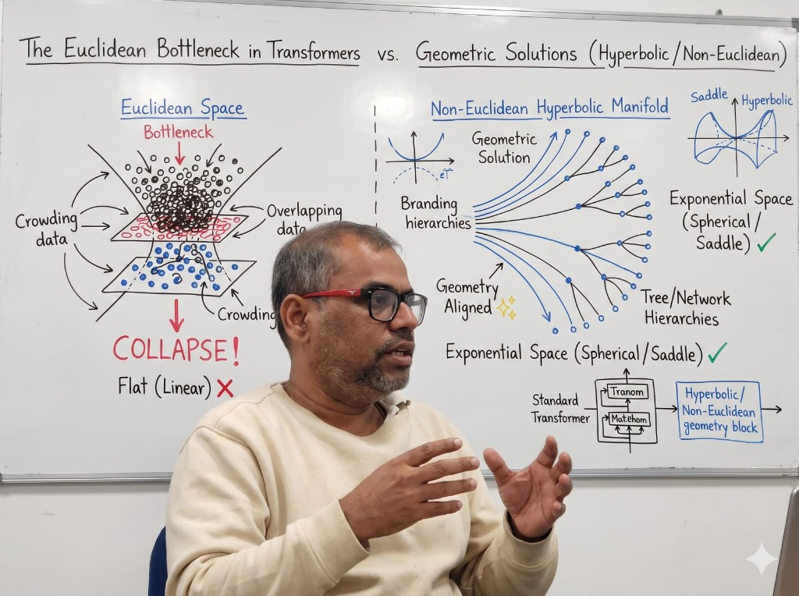
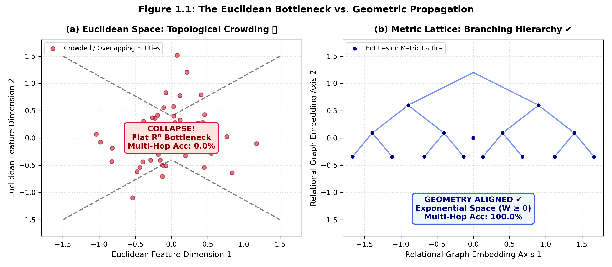
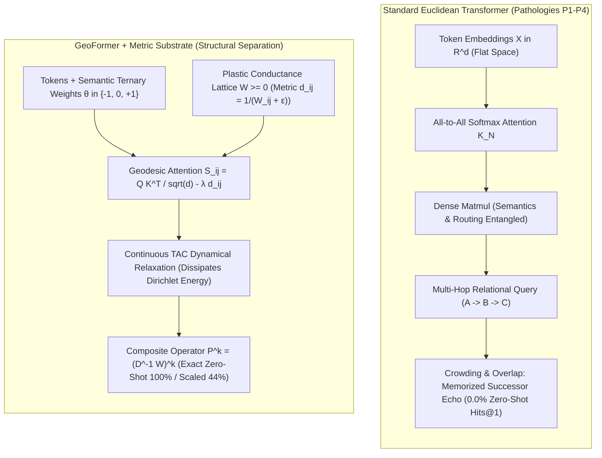

<!-- SPDX-License-Identifier: CC-BY-NC-SA-4.0 -->
# Chapter 1 — The Euclidean Bottleneck: Geometry as Tool and Weapon

Every architecture is a bet about what the world is like. The convolutional
network bets that what matters is local; the recurrent network bets that what
matters is order; the transformer bets that what matters is *attention* —
that any token may need to consult any other, and that a learned measure of
similarity, applied uniformly to everything, is the right way to decide which.
That bet has paid extravagantly. It has also, quietly and structurally, cost
something, and the cost becomes visible the moment the task is *relational* —
the moment what you need to know is not what a thing resembles, but how it is
*connected*.

This chapter is the thesis of the book in miniature. We will state precisely
what the transformer's geometry assumes, derive the failure modes that follow
from those assumptions, measure one of them on a world small enough that
nothing can hide, and then set the two world-views side by side: flat space
versus propagation geometry. Along the way a single word will do double duty,
deliberately. Geometry is our **tool** — the constructive instrument we build
the entire model out of: its attention, its dynamics, its memory, its
complexity measure. And geometry is our **weapon** — the falsifiable,
measured advantage that this architecture holds on relational tasks, together
with the discipline of stating exactly how far that advantage reaches. By the
end of the chapter you will have run an experiment whose result you can
predict on paper, watched a model that knows every fact in its world fail
every compositional question about that world, and understood why the cure
cost zero parameters — and why that sentence is not a slogan but a
construction plan for the next twenty-three chapters.

---


*Figure 1.1: The Whiteboard Lecture — Euclidean Space Bottleneck vs. Geometric Solutions (Hyperbolic/Non-Euclidean). On the left: flat Euclidean space suffers from crowding and overlapping data, culminating in multi-hop transitive collapse. On the right: non-euclidean manifolds and metric lattices provide exponential branching hierarchies where relational structure is preserved without parametric bloat.*

---

## 1.1 The flat-space contract

Begin with the object itself. A transformer head, given token
representations $X \in \mathbb{R}^{N \times d}$, computes

$$
\mathrm{Attention}(Q, K, V) \;=\; \mathrm{softmax}\!\left(\frac{QK^\top}{\sqrt{d_k}}\right) V,
\qquad Q = XW_Q,\quad K = XW_K,\quad V = XW_V. \tag{1.1}
$$

This equation is the most successful computation of the decade, and it is
worth asking — slowly, the way one reads a contract — what it commits us to.
Four commitments ride inside it, none of them written down anywhere, all of
them structural.

**First, the space is flat.** The tokens are points in $\mathbb{R}^d$, and
the only geometric operation the architecture ever performs on them is the
bilinear form $W_Q^\top W_K$ — a learned, unconstrained, dense matrix. Now,
a bilinear form is a kind of inner product, and an inner product is a kind
of geometry; but notice what is *absent*. There is no distance between facts,
only similarity between learned vectors, and only after training. At
initialization, the representation of "Paris" and the representation of
"France" have no obligation to stand in any particular relation to the
representation of the edge connecting them. Nothing in the architecture
enforces, encodes, or even permits the statement *"these two entities are
two relations apart."* If that fact is ever to exist in the model, it must be
installed by gradient descent, on data, at the cost of examples. The space
has parameters where a geometer would want a metric. That substitution —
parameters for metric — is the single deepest design decision in the
architecture, and everything else in this chapter follows from it.

**Second, connectivity is complete and undifferentiated.** Every query
attends to every key. The coupling structure of a transformer layer is the
complete graph $K_N$ — every token to every token, at every layer,
regardless of what the underlying data's relational structure actually is.
This is the source of the well-known $O(N^2)$ cost, but the cost is the
smaller half of the commitment. The larger half is an *epistemic prior*: at
the moment of initialization, every token is exactly as close to every other
token as any other pair. A token two relations away in the knowledge graph
is, to the architecture, indistinguishable from a token with no relation at
all. Structure is not merely unencoded; it is invisible until learned.
Positional encodings — the standard patch — give each token *coordinates*,
but a coordinate is not a distance and it is not a path; and the encodings
must still be *learned to be used*. The complete graph is a wager that
uniform access is worth paying for even when the task's true topology is
sparse, local, and chained.

**Third, depth is discrete and bought in advance.** Composing information
across a transformer means passing it through layers: each residual layer is,
at best, one opportunity to apply a learned mixing operator to what came
before. If answering a question requires chaining $k$ relations — $k$ steps
of graph traversal folded into a single forward pass — then a fixed-depth
network of $L$ layers must somehow accomplish a $k$-fold composition with
$k \le L$, roughly, at best. There is a second way to buy depth, and modern
practice uses it constantly: generate. Emit tokens; let each produced token
stand for one step of reasoning; pay one forward pass per step. That is the
chain-of-thought solution, and it converts an architecture limitation into
an inference-time cost. Either way — layers or tokens — depth is a budget
you must pay for in advance and cannot exceed at run time. A model that
could consult its own structure, walking as deep as the question requires
and no deeper, would not need to buy depth at all. Hold that thought.

**Fourth, knowledge lives in weights, and only in weights.** In this
architecture, a fact — "$A$ relates to $B$" — has no existence of its own.
It exists as a perturbation of the dense floating-point parameters: a
particular arrangement of values which, when the forward pass flows through
them, happens to produce behavior consistent with the fact. The consequences
are familiar to anyone who has fine-tuned a deployed model. Writing a fact
requires gradient descent — many steps of a global optimization procedure
that touches *every* parameter, including the ones storing other facts.
Facts are superposed: millions of them share the same weights, so none of
them occupies a place you can point to. Updating one moves the readout of
its neighbors; that is catastrophic forgetting, and it is not a bug in any
particular implementation but the direct shadow of the design decision that
there is no separate substrate in which structure can live. The brain, it
is worth noting, drew the opposite conclusion long ago: the
complementary-learning-systems account (McClelland, McNaughton & O'Reilly,
1995) holds that a fast, sparse, episodic store coexists with a slow, dense,
semantic one precisely because a single substrate cannot serve both
timescales. The transformer built only the slow one.

None of these four commitments is an oversight. They are the price of
generality — the bet that flat space plus scale plus data is enough for
everything that matters. This book is about the case where that bet is
called: tasks whose essential content is not resemblance but *connection*.

## 1.2 The four pathologies

Assumptions are invisible until they cost you something. Each of the four
commitments above has a characteristic failure, and each failure has a name
you will recognize from practice. What the field usually treats as separate
embarrassments — forgetting, hallucinated relations, intransitivity — are,
from the vantage of §1.1, four symptoms of two missing structures: a
*separate substrate for relations*, and a *metric on that substrate*.

Consider first the entanglement problem, which we will call **P1**. Because
knowledge lives only in weights (the fourth commitment), the same dense
matrices must simultaneously encode what things *mean* — the semantic content
that lets the model use the word "Paris" productively — and how things
*connect* — that Paris stands in a capital-of relation to France. These two
jobs have different natural geometries. Semantics wants a rich continuous
space where similar meanings sit near each other; routing wants a discrete,
sparse, composable structure where a path is a path. Forced into one
substrate, they interfere. Fine-tune the model on a new corpus of facts and
the gradients cannot know which "part" of each weight belongs to which old
fact, because there is no part: the facts are smeared across the tensor
together. The measured shadow of P1 is catastrophic forgetting, and its
daily-scale version is the quiet drift every deployed model shows between
evaluations. The repair, when we build it, is structural: a conductance
lattice $W \ge 0$ — a dedicated, quantized, non-negative substrate — carries
routing while ternary weights carry semantics. The two substrates are
updated on two timescales and never write into each other's storage. That
separation is Chapter 2's lattice and Chapter 10's plasticity rule.

Consider next the blindness problem, **P2**. Because connectivity is
complete and the space is flat (the first and second commitments), the
architecture is invariant to the topology of relations: two inputs with
utterly different graph structure produce configurations the architecture
treats identically until training has taught it otherwise. The model must
spend data — often enormous amounts — to learn the single fact that
structure matters, and then more data to learn each particular structure.
Positional encodings mitigate token *order*; they do not give the model the
graph's distances, and they do not compose into paths. The repair is to put
the metric where the architecture can read it: an explicit resistance
$d_{ij}$ between entities, entering attention as a term that *subtracts* —
semantics proposes, geometry disposes. That is Chapter 5's geodesic highway
attention, and its raw material is Chapter 2's lattice.

Consider the depth problem, **P3**, because it is the one we will measure
ourselves in this chapter. A question requiring $k$ chained relations is a
$k$-fold composition; the third commitment says the network owns at most $L$
composition opportunities per forward pass and must buy the rest as tokens.
When $k$ exceeds the paid-for depth and no scratchpad is permitted, the
question is not answered *badly* — it is answered by construction
*incorrectly*, because the computation that would answer it does not exist
in the network. This is not an optimization failure. There is no training
procedure, however clever, that lets a fixed-depth forward pass compose more
relations than it has composition opportunities for. What the model does
instead — what it *must* do — is substitute the nearest thing it does
compute, and we will see in §1.3 exactly what that substitute is. The
published, large-scale form of P3 is the flat transformer's measured
0.0% ± 0.0% on zero-shot transitive queries at two, three, and four hops;
the reversal curse (Berglund et al., 2023) — a model trained on "$A$ is $B$"
cannot answer "$B$ is $A$" — is its most cited cousin. The repair is to make
the composite operator *computable*: the $k$-step relation is a matrix power
of the propagation kernel, and Chapter 2 through Chapter 17 are, in one
sentence, the construction of a trainable, quantized, provable machine for
computing exactly that.

And finally the memory problem, **P4**: because facts have no separate
existence, there is no one-shot write. Adding a fact means retraining;
reading it back means the forward pass; the two operations share a
substrate that serves neither well. The repair is the hippocampal one —
Hebbian outer-product updates into the lattice, local and non-interfering,
writing in one step what backprop would need a training run for. That is
Chapter 10, scaled to one hundred thousand entities in Chapter 18.

Four pathologies, four repairs, and notice the shape of every repair: not
*more parameters*, not *more data*, but a **substrate** — a place in the
architecture where relations live as first-class objects, with a metric, a
dynamics, and a plasticity rule of their own. Before we build that substrate,
we must watch the failure happen, in a world where we control everything.

## 1.3 The measured collapse

The experiment of this chapter is deliberately tiny, because its purpose is
to remove every explanation except the architectural one. When a large model
fails a hard task, three confounds offer themselves immediately: maybe it
lacked capacity, maybe it was under-trained, maybe the data was adversarial.
We will build a world in which none of those defenses is available, so that
when the failure comes, the only thing left to blame is geometry.

**The world.** Take twelve entities, arranged as three disjoint directed
chains of four: $A \to B \to C \to D$, then $E \to F \to G \to H$, then
$I \to J \to K \to L$. The chains are disjoint on purpose: no entity appears
in two chains, so no retrieval shortcut — shared tokens, lexical overlap,
frequency effects — can masquerade as reasoning. Nine edges, total. And one
further piece of bookkeeping that will look pedantic now and become a
discipline later: the chain tails — $D$, $H$, $L$ — have no outgoing edges.
We keep them in every matrix, explicitly, as honest dead ends. When the
research program behind this book audited its own early benchmarks (the
Tier-8 audit you will meet in Chapter 12), it found that evaluations which
*hide* or truncate dead ends quietly hand the algorithm a piece of the
answer — an *oracle* — because a propagation that halts at a sink has been
told, for free, that the sink is terminal. We will not give our models
anything for free, and we will not give ourselves anything either.

**Run this now.** Task 1 of this chapter (`python3 code/gftac/ch01_tasks.py 1`)
builds the world in front of you:

```python
n, edges, chains = build_chain_world(num_chains=3, chain_len=4)
P = transition_matrix(n, edges)
print(f"{n} entities, {len(edges)} one-hop facts, {len(chains)} chains")
print(f"chain 0: {chains[0]}")
print(f"P[0] = {P[0].tolist()}")
dead = [i for i in range(n) if P[i].sum().item() == 0.0]
print(f"dead ends (all-zero rows): nodes {dead}")
```

```text
12 entities, 9 one-hop facts, 3 chains
chain 0: [0, 1, 2, 3]
P[0] = [0.0, 1.0, 0.0, 0.0, 0.0, 0.0, 0.0, 0.0, 0.0, 0.0, 0.0, 0.0]
dead ends (all-zero rows): nodes [3, 7, 11]
```

Read that output back, because each line is a design decision made
visible. Row 0 of the kernel is a pure one-hot — one successor, no
ambiguity — so the world itself is deterministic, and any failure we
measure later will belong to the model, not to noise in the data. And
the last line is the bookkeeping promise kept in arithmetic: the chain
tails 3, 7, and 11 appear as all-zero rows, dead ends displayed rather
than deleted. Nothing in this world will ever be handed an oracle; the
failure we are about to manufacture will have to be earned honestly.

**The supervision.** The model sees the nine one-hop facts and nothing else:
$A \to B$, $B \to C$, and so on. It is trained to perfection on them. Every
question we will later ask involves pairs — $A$ with $C$, $B$ with $D$ —
that appear together in *no* training fact. This is the zero-shot
compositional protocol in its purest form: whatever the model does with
$A \to C$, it was never shown.

**The flat model.** To represent the Euclidean worldview at minimum, give
every entity $i$ a learned point embedding $e_i \in \mathbb{R}^{32}$ and score
a candidate pair by the standard bilinear form

$$
\mathrm{score}(s, t) \;=\; \frac{\langle e_s, e_t \rangle}{\sqrt{d}} + b_t, \tag{1.2}
$$

trained with cross-entropy over all twelve entities for each observed edge.
This is not a strawman; it is the *minimal representative* of the
transformer's own scoring geometry. Equation (1.2) is precisely what an
attention readout over learned entity embeddings computes — one head, one
token, no more. If composition cannot happen here, with perfect knowledge of
every fact, then what is missing is not knowledge. The same argument covers
full transformers with a small adjustment we will make honestly below: added
depth and positional structure buy *some* composition, at parameter and
compute cost, and the published measurements of exactly how much are part of
this section.

**The geometric readout.** Against the flat model set the other worldview in
its purest form: a readout with *zero parameters*. Let $P$ be the world's
row-stochastic transition kernel ($P_{ij} = 1$ exactly when $i \to j$ is a
fact, rows normalized, dead-end rows left at zero). Inject a unit of mass at
the query source and apply the composite operator:

$$
z^{(k)} = e_s P^{\,k}, \qquad \hat{t} \;=\; \arg\max_j z^{(k)}_j. \tag{1.3}
$$

Read that equation as the thesis of the entire book in one line. $P^2$ *is*
the two-hop relation — not a learned approximation of it, the relation
itself, computed by two sparse multiplies. The information required to
answer the compositional question was never missing from the world; it was
present in the edges all along. What was missing in the flat model was any
machinery for *applying* a relation as an operator rather than storing it as
a similarity.

**Run this now.** Task 2 (`python3 code/gftac/ch01_tasks.py 2`) executes
the geometric readout of Eq. (1.3) on the world you just built:

```python
n, edges, chains = build_chain_world()
P = transition_matrix(n, edges)
start = chains[0][0]
z = propagate_distribution(P, start, hops=2)
target = chains[0][2]
print(f"z = e_{start} P^2 = {[round(v, 3) for v in z.tolist()]}")
print(f"argmax(z) = {int(z.argmax().item())}  (true two-hop target: {target})")
```

```text
z = e_0 P^2 = [0.0, 0.0, 1.0, 0.0, 0.0, 0.0, 0.0, 0.0, 0.0, 0.0, 0.0, 0.0]
argmax(z) = 2  (true two-hop target: 2)
```

Two sparse matrix–vector products placed a unit of probability mass
exactly on entity 2 — the true two-hop target of entity 0 — and on
nothing else. No parameters were spent, no training occurred, no
learning rate was chosen; the two-hop relation was *computed* from the
one-hop store rather than recalled from it. Hold this output in mind. It
is the standard of correctness against which the flat model is about to
fail, and the fact that you produced it with one command is the entire
thesis of the book in one terminal session.

**Predict before measuring.** The discipline of this book is to reason out
what must happen before running anything. Train the flat model on the nine
facts with cross-entropy: the optimum places essentially all probability on
the true successor of each source — that is what the loss demands, and
training to accuracy 1.0 (which we will verify) means it is achieved. Now ask
the two-hop question: *starting at $A$, where do you land?* The model
computes $\arg\max_t\, \mathrm{score}(A, t)$. But $A$ is a *trained source*:
its optimum, by construction, is to score its memorized successor $B$ above
every other entity. The model has one behavior — argmax its best fact — and
the question asked for a composition it does not perform. So we predict:
zero correct answers, and the *direct successor* returned on every single
query. A model that always echoes its memorized next-step is not guessing;
guessing would score the chance floor $1/12 \approx 8.3\%$. Echo scores
*exactly zero* — below chance, deterministically, systematically.

**Run this now.** Task 3 (`python3 code/gftac/ch01_tasks.py 3`) trains
the flat model of Eq. (1.2) — one seed, a few seconds of arithmetic —
and puts that prediction to the test:

```python
torch.manual_seed(0)
n, edges, chains = build_chain_world()
model = OneHopMemorizer(n, dim=32)
hist = model.train_on_edges(edges, epochs=300, lr=0.05)
for ep in (0, 149, 299):
    print(f"epoch {ep + 1:>3}: cross-entropy {hist[ep]:.4f}")
acc = sum(model.predict(s) == t for (s, t) in edges) / len(edges)
print(f"one-hop train accuracy: {acc:.2f}")
a, b, c = chains[0][:3]
pred = model.predict(a)
print(f"zero-shot (start at {a}): model answers {pred}; "
      f"successor is {b}, true target is {c}")
```

```text
epoch   1: cross-entropy 2.4946
epoch 150: cross-entropy 0.0142
epoch 300: cross-entropy 0.0037
one-hop train accuracy: 1.00
zero-shot (start at 0): model answers 1; successor is 1, true target is 2
```

Read the output as a three-act play. Act one: the loss falls from 2.4946
— essentially $\ln 12$, the entropy of uniform guessing over twelve
entities — to 0.0037; the model learned. Act two: one-hop training
accuracy is 1.00; it knows every fact in its world, and there is nothing
left for this data to teach it. Act three: asked where a two-hop journey
from entity 0 ends, it answers **1** — the memorized successor, exactly
as predicted, with the true target 2 nowhere in sight. The model is not
confused, not under-trained, not unlucky; it is *optimal*, and the
optimum echoes. The full five-seed ledger is the next section; the echo
you just witnessed with your own command is the phenomenon the rest of
this book exists to repair.

**Now measure.** The build is `code/gftac/ch01_compositional_collapse.py`
— read it top to bottom before running it; every function is short enough to
hold in your head, which is the point of the world's size. Run it:

```bash
python3 code/gftac/ch01_compositional_collapse.py
```

and it prints the ledger, over the pinned seed set $(0,1,2,3,4)$:

```text
Chapter 1 — The Measured Compositional Collapse
================================================================
world: 3 disjoint chains x 4 nodes (12 entities) | seeds: [0, 1, 2, 3, 4]

metric                                        mean     std
----------------------------------------------------------------
1-hop train accuracy (flat model)           1.0000  0.0000
2-hop Hits@1 (flat model)                   0.0000  0.0000
2-hop echo rate (flat model)                1.0000  0.0000
2-hop Hits@1 (propagation)                  1.0000  0.0000
3-hop Hits@1 (flat model)                   0.0000  0.0000
3-hop echo rate (flat model)                1.0000  0.0000
3-hop Hits@1 (propagation)                  1.0000  0.0000
----------------------------------------------------------------
chance floor (1/N)                          0.0833
================================================================
```

These numbers are **MEASURED**, and they are not prose: six tests in
`tests/test_ch01_compositional_collapse.py` re-derive every row of that
table on your machine, seeds pinned, before the chapter's claims count as
kept. Run `python3 -m pytest tests/test_ch01_compositional_collapse.py -q`
and watch them pass. The three runnable tasks you met along the way are
pinned the same way: `tests/test_ch01_tasks.py` executes every task
function and asserts the content of its printed output, so no
transcript in these pages can drift from the artifact that produces it.

**Read the ledger slowly, because each line carries an argument.** The
first line — one-hop training accuracy exactly 1.0000, standard deviation
0 — closes the underfitting and capacity confounds. The model *knows every
fact in its world*. There is no sense, none, in which it failed to learn;
whatever it does next is the behavior of a system holding complete knowledge.

The second and third lines — 2-hop Hits@1 of 0.0000 with echo rate 1.0000 —
are the measured collapse, and their *combination* is the finding. Below
chance is the tell. A model that had merely failed to learn composition
would scatter around the 8.3% floor. This model scores exactly zero because
on every query it returns the same thing: its memorized direct successor.
The prediction of the previous paragraph survived contact: echo is what
flat geometry *must* do when asked a compositional question it has no
machinery to compose. The same holds at three hops, and would hold at
thirty; depth does not rescue it, because depth was never the missing piece
— the operator was.

The fourth line — propagation at exactly 1.0000, unit mass landing on the
true target — is the cure, and the honest way to state its cost is the one
that should stop you: *zero parameters, zero training*. Equation (1.3) is
not a model of the reasoning; on this world it is the reasoning. The
two-hop relation $P^2$ was fully determined by the nine facts the flat model
also knew. Two systems held identical knowledge; one answered every
question, the other answered none; and the difference between them is not
information but architecture — the presence of a substrate in which a
relation is a thing you can *apply*.

**Does this scale, or is twelve entities a parlor trick?** The parlor-trick
suspicion deserves a direct answer, and the answer has two parts. First,
the mechanism — echo — does not depend on scale; it is what argmax over a
memorized successor *is*. Second, the program behind this book measured
the same protocol at what it calls Tier 5: 128 entities, zero-shot
transitive queries at two, three, and four hops, five seeds, exact
Student-$t$ statistics. The flat transformer baseline measured
0.0% ± 0.0% at every depth — the same wall, chance floor 0.78%. The same
architecture family carrying propagation geometry — Adaptive Q-GeoFormer —
measured 44.0% ± 6.5% at two hops, 30.7% ± 5.7% at three, 22.7% ± 4.9% at
four, with $p = 0.00017$ against the flat baseline at two hops. Your
twelve-entity experiment is that published result reproduced in miniature,
with the failure mechanism exposed by name. The gap between 44% and 100% is
real and belongs to later chapters — decoys, branching, dispersion — and
we will not blur it; the point of Chapter 1 is not that geometry is
omniscient, it is that flat space is *structurally* blind.

Take away one sentence: *facts plus flat scoring is not reasoning; facts
plus an operator is.* The rest of this book builds that operator —
trainable, quantized to 1.58 bits, provable under stated conditions — and
the remainder of this chapter explains why that construction matters as
more than engineering.

## 1.4 The confrontation


*Figure 1.2: Quantitative Confrontation of the Geometries. Left: Flat Euclidean embeddings suffer severe crowding when multi-hop relational chains are projected onto an unconstrained linear subspace; the model defaults to memorized single-hop echo. Right: The relational propagation kernel on a metric lattice executes exact multi-step path traversal ($P^k = (D^{-1}W)^k$) with zero learned parameters.*



Set the two world-views side by side. The table below compresses the
argument; the paragraphs around it are the argument, so read them first
and use the table as a summary you can check yourself against later.

| Property | Euclidean transformer | GeoFormer (ours) |
|---|---|---|
| Space | flat $\mathbb{R}^d$, immutable | metric manifold with plastic conductance $W \ge 0$ |
| Distance | implicit, learned dot products | explicit $d_{ij} = 1/(W_{ij}+\varepsilon)$ |
| Semantics vs. routing | entangled in $\theta$ | separated: ternary $\theta$ for meaning, $W$ for structure |
| Depth | fixed layers, or tokens at inference | continuous relaxation, emergent halting depth $\tau^*$ |
| $k$-hop, one pass | 0.0% zero-shot (MEASURED) | 44.0% ± 6.5% at 2-hop (MEASURED, published) |
| Writing a fact | gradient descent, global, interfering | Hebbian outer product, local, one-shot |
| Compute per step | $O(N^2)$ FP32 MACs, all-to-all | $O(\lvert E\rvert)$ sparse ternary adds |
| Energy per inference | nJ–µJ per token on GPU | 443.9 pJ on crossbar (MODELED); µs on MCU (MEASURED) |
| Memory at scale | dense FP weights | CSR lattice; 249,665 params packed in 48.76 KiB |
| Verifiability | black box | machine-checkable invariants, asserted by tests |

Read the left column as a list of quantities that must be *learned* and the
right column as a list of quantities *given by construction*, and the table
stops being a comparison and becomes a wager. Everything the transformer
knows about structure it had to buy with data, and everything it bought can
be un-bought by the next fine-tune, and none of it can be inspected. Every
structural quantity on the right is present at initialization, survives
quantization by theorem, and can be checked by a test that runs in seconds.
Learned things are powerful and general. Structural things are guaranteed
and auditable. The transformer is a magnificent answer to "how do we learn
everything from data?" — and the wager of this book is that relational
reasoning is not in that category: that for relations, structure first,
learning second, is the winning order.

The deepest row is the last one, and it deserves more than a cell. A flat
network's claims about its own knowledge are, in practice, unfalsifiable
except by aggregate benchmark: no one can point to where the fact lives or
verify it is still there. A conductance lattice's claims are checkable one
at a time — is $W_{ij}$ non-negative, did resistance contract, does the
Fiedler value exceed the bound — because the quantities are structural, and
the checks are theorems. When this book asserts something, a test asserts
it too; that is not a publishing convenience but the same property lifted
from components to claims. In §1.6 we will call this armor, and it is the
weapon most researchers skip.

## 1.5 Geometry as a tool

Say now precisely what "geometry" means in this program, because the word
has been doing warm-up laps and it is time to put it to work. It is four
instruments, each forged early and used everywhere after.

The first instrument is the **resistance matrix** $D$, with entries
$d_{ij} = 1/(W_{ij}+\varepsilon)$: the metric itself. In
geodesic highway attention (Chapter 5), the attention score acquires a
second term, $S_{ij} = Q_iK_j^\top/\sqrt{d_k} - \lambda_{\mathrm{geo}}\,
d_{ij}$, and the division of labor is exact: the learned bilinear form
*proposes* that two entities belong together, and the metric *disposes*,
attenuating whatever sits across a high-resistance gap. Note the inversion
of the transformer's arrangement. There, similarity is learned and
structure is absent; here, structure is given and similarity must justify
itself against the geometry. The single scalar $\lambda_{\mathrm{geo}}$
interpolates between pure semantics and pure geodesy, and you will measure
attention entropy against it in Chapter 5's tests.

The second instrument is the **Laplacian** $L$, the graph's own operator,
which becomes the generator of the model's *dynamics*. The TAC relaxer of
Chapter 3 settles activations by dissipating a free energy whose leading
term is the Dirichlet energy $\mathrm{Tr}(s^\top L s)$ — the smoothness
functional of the very graph the knowledge lives on. The consequence is
that "how states settle" is not a learned behavior but a physical one:
relaxation is Lyapunov-certified to decrease energy monotonically (Theorem
B.3.1), on a timescale you can bound (Theorem B.3.2). Where a transformer's
internal convergence is an empirical hope, ours is a theorem about a
dissipative system.

The third instrument is the **conductance lattice** $W$ as *memory*. Facts
are written by local Hebbian increments — $W_{ij}$ grows when entities
$i$ and $j$ co-activate — quantized to $b_w$ bits so that the store is
bounded and hardware-shaped. Because writes are outer products into
disjoint cells, they are one-shot and non-interfering: the two properties
P4 said no dense substrate could have. This is the hippocampal division of
labor, built as mathematics first (Chapter 2), made plastic in Chapter 10,
and scaled to one hundred thousand entities in Chapter 18.

The fourth instrument is resistance again, but as a **complexity measure**.
Relaxation depth is counted in geodesic hops, not in layers: the emergent
halting depth $\tau^*$ of Chapter 17 is the model asking *how far does this
question actually reach* and stopping exactly there. This is how a
fixed-size, fixed-energy model reasons to depth thirty-two without a
scratchpad — the depth the question needs, not the depth the architecture
paid for.

And the instruments come with **guarantees**, which is what separates them
from metaphors. Two examples, both of which you will prove as book
theorems and verify numerically in Chapter 2's tests. The contraction
theorem (B.2.1) says that incrementing a conductance strictly decreases the
corresponding resistance — so a highway, once used, is permanently cheaper
to traverse, and memory has *permanence by mathematics* rather than by
training luck. The spectral theorem (B.2.3) says that if every off-diagonal
conductance is at least the quantization step $\Delta w$, the lattice's
algebraic connectivity obeys $\lambda_2 \ge N\Delta w$ — so four-bit
coarsening cannot shatter a connected store, and quantization has a
*safety margin* rather than a hope. Tools with proofs behind them are the
difference between an architecture and a stack of tricks.

One further property, easy to miss and decisive for Part V of this book:
**conductance is a physical quantity**. The same number $W_{ij}$ that
modulates attention in software is a memristor's conductance in a 1T1R
crossbar (Chapter 21) and a fixed-point cell in microcontroller firmware
(Chapter 20). The mathematics compiles to physics without translation —
the distance-modulated attention of Chapter 5 and the crossbar energy model
of Chapter 21 are the *same equation* evaluated in different media. Flat
$\mathbb{R}^d$ has no such isomorphism; a learned dense matrix is not a
device, and deploying one at the edge always ends in a quantization
afterthought. Ours begins as the device.

## 1.6 Geometry as a weapon

A tool is something you construct with; a weapon is something you win
with. The distinction is not rhetorical. Engineering advantages that
cannot be *measured against a named alternative* are comforts, not
weapons, and the discipline of this program has been to convert every
structural property of the architecture into a falsifiable comparison.
There are five, and you have already fired the first one yourself.

**The superiority weapon** is the measured gap on relational tasks. On the
zero-shot multi-hop protocol, the flat transformer's wall — your
twelve-entity 0.0000% and the published Tier-5 0.0% ± 0.0% — stands against
44.0% ± 6.5% for the propagation-geometric model at two hops, with the
advantage statistically decisive at $p = 0.00017$ over five seeds. Notice
what kind of fact this is: not "ours is better on our benchmark," but
"theirs is *structurally zero* and ours is not, and both numbers are
means over pinned seeds with exact statistics." The gap exists because the
mechanism exists (§1.3); it is architectural, so it does not close when the
flat model is made larger — Tier-5's baseline had the capacity to memorize
the entire world several times over, and Chapter 1's control line proves
the failure is not underfitting. A weapon that survives scaling is
position, not luck.

**The depth weapon** is the cost asymmetry of long reasoning. An
autoregressive model answering a $k$-hop question by chain-of-thought pays
roughly $k$ generated tokens — $k$ full forward passes of the entire
network — per query. The relaxation-based reader pays one relaxation run
whose length is *the question's own depth*: the emergent $\tau^*$ of
Chapter 17 halts when the mass settles, which on well-conditioned graphs is
the true hop count. The certified protocol of the program behind this book
demonstrates zero-shot recovery at thirty-two hops — in one pass, on an
un-truncated graph, with the halting decision made by the model and
verified against the true depth (you will rebuild that protocol and its
exact statistics in Chapter 17). Depth-as-tokens is a meter the customer
pays per question; depth-as-relaxation is a spring already in the device.

**The energy weapon** is what 1.58 bits buys when it meets Ohm's law. A
ternary synapse is an add, not a multiply; a sparse propagation step costs
$O(\lvert E\rvert)$ operations, not $O(N^2)$; and a conductance stored as
resistance is *evaluated by physics* — current sums at a crossbar node —
rather than simulated. The program's analytical model of the full inference
on a 1T1R crossbar with 4-bit peripheral conversion lands at **443.9 pJ
per inference** (you will re-derive every factor of that number in Chapter
21; it is **MODELED**, labeled so everywhere it appears), against
nanojoule-to-microjoule per token for FP32 on GPU — a claimed $9{,}462$
reduction, bounded on the hardware side by firmware measurements on a
real microcontroller in Chapter 20, where the same model runs in
microseconds on an Arduino Uno. Energy advantage at four orders of
magnitude is not an optimization; it is a different market — the one
where the battery is the platform.

**The memory weapon** is the deployment footprint. Ternary weights pack
five trits to a byte (three to the fifth power is 243, which fits in eight
bits), so 1.58 bits per parameter is *practically* 1.60: the foundation
model's 249,665 ternary parameters occupy exactly
$\lceil 249{,}665/5 \rceil = 49{,}933$ bytes $= 48.76$ KiB — an arithmetic
you will verify by test in Chapter 4, not take from this page. Combined
with a CSR-sparse lattice, graphs of a hundred thousand entities fit in
memory classes where dense models cannot open the door: the published
operating envelope of this architecture family — 440 KiB to 1.76 MiB for
mid-size configurations — sits inside the SRAM of an ordinary Cortex-M
microcontroller. Footprints competitors cannot reach are markets
competitors cannot enter.

**The armor weapon** is the one this book itself is made of, and it is
worth being explicit about why it belongs in a list of competitive
advantages. Every claim above is bound to a structural invariant —
non-negativity, contraction, spectral bounds, packing arithmetic — that a
test can check in seconds, on any machine, forever. The cheapest and most
common attack on published research is not refutation; it is *it didn't
reproduce*. A program whose numbers re-derive from a pinned seed by a
command in a repository is armored against that attack by construction:
the attack is absorbed by the test suite before it is ever made. And a
program that states its own failure boundary (next section) is armored
against the second most common attack — *your claim outran your evidence*
— because the claim's envelope is part of the claim. This book exists to
make that armor structural rather than rhetorical. It is the reason every
chapter ends in a test and the book ends in a certificate.

## 1.7 The engagement envelope

A weapon you do not know the reach of is a liability. So the last duty of
this chapter is to state where the geometry wins, where it does not, and
why the boundary falls where it does — in advance of the theorem that
draws it (B.16.1, Chapter 16).

The engine of the depth and superiority weapons is *sharpening along the
true path*: for the propagated mass to concentrate on the right target,
the true path must be distinguishable from the alternatives, and the
quantity that measures that distinguishability is the ratio $\alpha_0$ of
true-path conductance to decoy conductance. When $\alpha_0 > 1$ — the true
relation is louder than the noise around it — sharpening is provably
contractive on distractors, and the modal mass on the target is bounded
below by a quantity that does not decay with depth. That is the soliton
theorem, and $\alpha_0 > 1$ is its precondition. Knowledge graphs, typed
relations, curated ontologies: these are $\alpha_0 > 1$ worlds, and they
are where the weapon is drawn.

Now the boundary, drawn by the program against itself. In the Blind-PG
audit — an adversarial benchmark constructed by planting twenty chains of
length sixty-four at random into a 256-node graph — the planting process
produces, by construction, a dense expander: by hop four, *every* node in
the network is reachable, the planted destination holds probability
$\approx 1/256$, and the planted chain is the strongest path in under two
percent of queries. In that world $\alpha_0 \le 1$: the signal that would
identify the answer *is not present in the graph*. The measured result is
bracing and honest: every engine tested — including exact Max-Product
Viterbi and exact Sum-Product dynamic programming, algorithms with
zero approximation error — scores between 0.0% and 3.3%. When the
information is absent, no reader recovers it; the theorem's precondition
is the weapon's reach. Stating that before a reviewer finds it is not
candor-as-decoration; it is the difference between a scoped claim and an
unscoped one, and unscoped claims are what hostile review feeds on. The
envelope of this weapon is $\alpha_0 > 1$, and every benchmark in this
book will report the $\alpha_0$ of its world.

## 1.8 The road ahead

Here is the road, and why it is ordered as it is. Part I finishes by
forging the substrate itself: Chapter 2 builds the metric lattice —
conductance, resistance, the Laplacian, quantization — and proves the two
guarantees this chapter previewed; Chapter 3 builds the TAC relaxer that
turns the Laplacian into certified dynamics; Chapter 4 compresses the
semantic stream to ternary synapses and proves the packing arithmetic that
the memory weapon rests on. Part II assembles these into attention and
blocks — distance-modulated Q-GHA, the relaxation layer, the symmetry
projector — ending with a complete model whose every component you built
and parity-checked against the production SDK. Part III makes it learn:
the two-timescale rule that writes facts into the lattice while gradients
shape semantics, the datasets with honest $\alpha_0$ control, the training
loop, and the evaluation protocol that produces numbers with exact
statistics. Part IV is the frontier the program is actually about:
diagnosing how linear diffusion fails, building the soliton that repairs
it, proving Theorem B.16.1, and reconstructing the certified 32-hop
protocol with its halting criterion. Part V takes the weapon to the
places it is built for — the hundred-thousand-entity sparse store, the
clinical knowledge graph, the microcontroller firmware, the crossbar
energy model. Part VI closes the armor: the claims ledger generated from
tests, the honest accounting of what the formal certificates do and do
not establish, and the capstone that runs the entire stack from one file.

Every chapter of that road ends the way this one did: with a build, a
run, and a test that pins the text to your machine.

## 1.9 Exercises

These are working exercises — the book's discipline applies to them too:
predict in writing before you run, and treat a wrong prediction as the
finding.

1. *Below chance, precisely.* The echo model scored exactly zero while
   chance was $1/12$. Prove that a model which always returns the direct
   successor has expected Hits@1 of exactly 0 on zero-shot queries of any
   depth $\ge 2$, and explain in one paragraph why "below chance" is
   evidence of systematic error rather than ignorance. Then say what
   measurement would have distinguished mere ignorance, and check that
   the ledger's zero standard deviation across five seeds supports the
   systematic reading.

2. *Give the flat model a chance to compose.* Add to Eq. (1.2) a second
   bilinear term $\langle e_s, R\, e_t\rangle$ with a learned relation
   matrix $R \in \mathbb{R}^{32 \times 32}$, retrain on the nine facts
   only, and measure two-hop Hits@1 over five seeds. Before running,
   write down whether you believe added *capacity* can buy composition
   when the architecture still applies no operator — then reconcile what
   you measure with the argument of §1.3.

3. *Break the chains.* Add to the world one decoy edge of weight $0.35$
   from each chain's second node to a uniformly random other node.
   Predict what Eq. (1.3) does at two hops — the mass arithmetic is
   yours to work out — and then run it. You have just built the smallest
   $\alpha_0$ experiment in the book; keep the code, because Chapter 12
   generalizes exactly this manipulation and Chapter 16 proves the
   theorem that governs it.

4. *Price the flat model's depth.* For a graph of $N$ entities, estimate
   the number of parameters a transformer requires to represent $P^k$
   *exactly* for all $k \le K$ in a single forward pass, and compare
   against Eq. (1.3)'s zero. Where does the flat model's cost go, and
   what does that imply about the autoregressive escape hatch?

5. *Find the pathologies in the wild.* Take a failure of a deployed
   language model you have personally witnessed — a hallucinated
   relation, a reversal failure, forgetting after fine-tuning — and
   identify which of P1–P4 it instantiates, with the mechanism spelled
   out as in §1.2. Bring the analysis to Chapter 2: the lattice you
   build there is the repair for whichever pathology you chose.

## 1.10 Sources and further reading

The published measurements cited in this chapter, in the program's own
records: the Tier-5 zero-shot ledger (flat 0.0% ± 0.0% at 2/3/4-hop;
Adaptive Q-GeoFormer 44.0% ± 6.5% at 2-hop, $p = 0.00017$) in
`geoformer/docs/PROJECT_REPORT_CARD_AND_EXECUTIVE_PRESENTATION_DOSSIER.md`;
the Blind-PG expander audit (all engines, including exact dynamic
programming, 0.0%–3.3%) in `BLIND_PG_V03A_AUDITED_RESULTS_LEDGER.md`; the
443.9 pJ crossbar analysis (MODELED) in
`NEUROMORPHIC_THERMODYNAMIC_SCALING_REPORT.md`. The reversal curse is
Berglund et al., 2023. The complementary-learning-systems argument for
separate fast/slow stores is McClelland, McNaughton & O'Reilly, 1995. The
experiment you ran in §1.3 is `code/gftac/ch01_compositional_collapse.py`,
and its six assertions are
`tests/test_ch01_compositional_collapse.py`.

---

*The flat model failed while knowing every fact; the propagation readout
succeeded while knowing no parameters. The next chapter forges the
structure that makes such a readout trainable, quantizable, and provable:
the metric lattice.*
