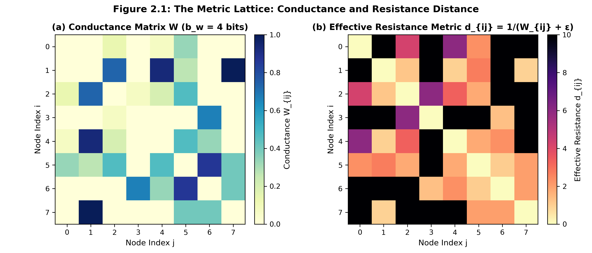
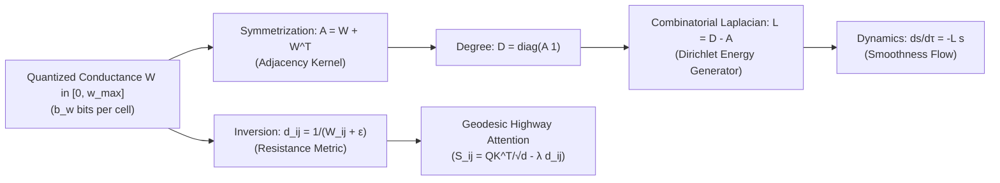

<!-- SPDX-License-Identifier: CC-BY-NC-SA-4.0 -->
# Chapter 2 — The Metric Lattice

Chapter 1 ended with a paradox worth sitting with. The flat model, holding
perfect knowledge of nine facts, answered zero compositional questions; the
propagation readout, holding no parameters at all, answered every one. The
resolution was that the composite operator — the two-hop relation $P^2$ — was
computable from the facts, and the flat architecture simply had no machinery
for computing it. But notice what the experiment quietly assumed: the world
*handed us* $P$. Nobody had to build it, nobody had to maintain it, nobody
had to store it in bounded memory, and nobody had to guarantee it would still
be sound after a lifetime of updates. A deployed reasoning engine enjoys none
of those conveniences. It must assemble its kernel from experience — edges
observed, co-activated, reinforced — and it must hold that kernel in a form
that survives quantization, fits hardware, and cannot silently corrupt.

That object is the subject of this chapter: the **metric lattice**, a
non-negative, quantized conductance store $W$ over the entity set, carrying
its own distance function, its own dynamics operator, and its own
plasticity semantics. It is the substrate on which everything in this book
is built — attention reads it (Chapter 5), relaxation dissipates through it
(Chapter 3), plasticity writes it (Chapter 10), the sparse store scales it
(Chapter 18), and the memristor crossbar *is* it (Chapter 21). You will
forge it now, in this chapter, once; and you will prove its three
guarantees — contraction, positive semidefiniteness, and the spectral floor
— before relying on any of them. By the chapter's end you will have watched
a highway get cheaper under use, measured the Laplacian's energy identity
hold to machine precision, and seen a four-bit store refuse to come apart.

---


*Figure 2.1: The Metric Lattice Substrate. Panel A: Conductance Matrix $W \ge 0$ heatmap showing reinforced plastic highways between nodes $0 \leftrightarrow 1$. Panel B: Effective resistance distance matrix $d_{ij} = 1/(W_{ij} + \varepsilon)$, mapping strong connections to deep metric proximity. Panel C: Graph network visualization displaying low-resistance conductive highways that guide geodesic propagation.*

---

## 2.1 Knowledge as conductance

Begin with the most basic question the substrate must answer: what *is* a
fact, here? In the flat architecture of Chapter 1, a fact was a perturbation
of dense parameters — real, but nowhere in particular, smeared across
millions of weights that also encode everything else. Here, a fact is an
addressable cell. The statement "$i$ relates to $j$" lives at the entry
$(i, j)$ of a matrix, and its strength is a single non-negative number
$W_{ij} \ge 0$ called its **conductance**. Writing the fact touches that
cell and nothing else; reading it costs one memory access; counting the
facts you know is counting non-zero cells. Addressability is not a
convenience — it is the entire repair of pathology P4, because
interference between facts is possible only when facts share storage, and
here they do not.

Why *conductance*, and why non-negative? Three reasons, and they reinforce
one another. The first is semantic: the natural primitive of relational
memory is Hebb's — entities that co-occur become more strongly associated —
and "more strongly" is an increment of a magnitude, not a sign flip. A
relation has a strength; it does not have a polarity that future facts are
entitled to reverse. The second is physical: conductance is a real
quantity that real devices implement, with Ohm's law $I = GV$ as its
operating equation. A store whose entries are conductances is a store whose
mathematics compiles to hardware without translation — the isomorphism we
will cash in Chapter 21. The third is metric: the reciprocal of a
non-negative strength is a non-negative *cost*, and costs are what a
geometry is made of. Strength becomes distance by one division, and we
will perform it in the next section.

Two bookkeeping decisions complete the definition. First, the diagonal is
zero by construction: $W_{ii} = 0$ always, because conductance is a
relation *between* entities, not a property of one; the write path will
reject self-edges outright rather than trust callers to remember. Second,
the store is bounded above: every conductance lives in $[0, w_{\max}]$ for
a design constant $w_{\max}$, which we will always normalize to $1$. A
memory without saturation is a memory that can be captured by a single
hot fact; saturation is what makes the store a lattice — a finite set of
levels — rather than a cloud of reals.

## 2.2 The resistance metric

Given conductance, define distance. The edge traversing from $i$ to $j$
should cost more when the relation is weaker, and the cheapest natural
choice is the reciprocal:

$$
d_{ij} \;=\; \frac{1}{W_{ij} + \varepsilon}, \qquad \varepsilon > 0. \tag{2.1}
$$

The guard $\varepsilon$ is doing honest work, and it is worth being
precise about it. An unobserved pair has $W_{ij} = 0$, and the reciprocal
of zero is not a number the hardware wants in its tensors. With
$\varepsilon = 10^{-8}$, a disconnected edge reads $d_{ij} = 10^8$:
effectively infinite — farther than any connected edge will ever be, by
seven orders of magnitude at least — while remaining a finite float that
attention (Chapter 5) can subtract and softmax can survive. The guard is
how we keep infinities out of the arithmetic without pretending
disconnection is a small thing.

A terminological care, before it becomes a vulnerability. The research
program's papers call $d_{ij}$ the *effective resistance* of the edge, and
this book will not repeat that usage, because the name properly belongs to
a different quantity. In electrical network theory, the effective
resistance between two *nodes* is the resistance the whole network offers
between them, current free to flow along every path: it is computable from
the Laplacian pseudoinverse as
$R_{ij} = (e_i - e_j)^\top L^{+} (e_i - e_j)$, and — a lovely classical
fact due to Klein and Randić — it is a genuine metric, triangle inequality
included, because parallel paths *reduce* it. Our $d_{ij}$ is the simpler
object: the resistance of the single edge, the pairwise building block.
The distinction matters because the two quantities divide the labor of
reasoning between them. Attention needs a pairwise cost it can read in
$O(1)$ from the store — that is $d_{ij}$. Multi-hop inference needs the
path structure — and that is recovered not by summing edge resistances
inside a distance function but by *applying the kernel repeatedly*, which
is exactly what Chapter 1's $e_s P^k$ did and what Chapters 5 through 17
will make trainable. Sharpening a name is part of hardening a program:
when a reviewer reads "effective resistance" in one of our papers and
knows the classical object, the encounter should be a confirmation, not a
catch.

**Run this now.** Task 1 of this chapter (`python3
code/gftac/ch02_tasks.py 1`) makes the metric appear in front of you:

```python
lat = MetricLattice(num_entities=6)
d0 = lat.resistance(0, 1)
lat.observe_edge(0, 1, weight=lat.delta_w)
d1 = lat.resistance(0, 1)
print(f"before any fact: d_01 = {d0:.6e}   (reads 1/eps)")
print(f"after one dw write: d_01 = {d1:.6f}")
```

```text
before any fact: d_01 = 1.000000e+08   (reads 1/eps)
after one dw write: d_01 = 14.999997
```

One fact entered the store — a single level of conductance on the edge
$(0,1)$ — and by one division the metric appeared: the distance fell
from $10^8$, the guard's honest reading of *these entities have never
been observed together*, to $15$, the reciprocal of one step of
conductance. Notice what did not happen: no threshold was crossed, no
neighbor was created, no similarity was tuned. The arithmetic of the
store and the arithmetic of the geometry are the same arithmetic, and
the number you just printed *is* the fact. That first write is the
largest event in the relation's life — §2.4 quantifies exactly how
front-loaded it is.

## 2.3 Storing facts in $b_w$ bits

Now the storage question, which in this architecture is not an
afterthought but a first-class design decision with a theorem attached.
Every conductance is quantized to $b_w$ bits at *write time*: the interval
$[0, w_{\max}]$ is divided into $2^{b_w} - 1$ equal steps of size

$$
\Delta w \;=\; \frac{w_{\max}}{2^{b_w} - 1}, \tag{2.2}
$$

and every stored value is an integer multiple $k\,\Delta w$, $k \in
\{0, 1, \ldots, 2^{b_w} - 1\}$ — a **level**. With the book's default
$b_w = 4$ and $w_{\max} = 1$, that is fifteen levels and $\Delta w = 1/15
\approx 0.0667$. The reasons for quantizing the store rather than leaving
it floating and compressing later are the reasons of Chapter 1's weapon
list made concrete: the store *is* the deployment artifact — the thing
serialized to a microcontroller and programmed onto a crossbar — and a
fact written must be the fact read, with no silent drift between the
number training saw and the number the device holds. Quantization at
storage time is how a memory stays honest all the way to hardware.

The write path deserves narration, because its obvious implementation has
a bug that took the field of low-power ML a long time to respect. The
naive path is: receive a Hebbian increment, add it to the stored level,
round to the nearest level, store. Consider an increment smaller than
half a step — say $\Delta w / 10$, which is exactly what gentle
co-activation produces. Rounding $\Delta w / 10$ to the nearest level
returns *zero*: the write evaporates. And because the store now still
holds the old level, the next small increment starts from the same place
and evaporates identically — forever. A store with this bug cannot learn
slow-growing associations at all; it is deaf below a frequency it cannot
hear. Sub-threshold writes are not rare events; they are the *typical*
events of realistic plasticity.

The repair is a two-layer store, and it is the one you will build. The
lattice keeps a **shadow buffer** $W^{\mathrm{raw}}$, an unquantized
accumulator; every increment lands there first. The stored, quantized
value $W_{ij}$ is the *projection* of the shadow onto the levels. Now a
$\Delta w/10$ increment survives: it accumulates in the shadow, and after
five of them the shadow has crossed the midpoint and the projection flips
the level up. Nothing is lost, and the store that goes to hardware is
still exactly the quantized one.

**Run this now.** Task 2 (`python3 code/gftac/ch02_tasks.py 2`) pushes
five sub-threshold writes through the two-layer store:

```python
lat = MetricLattice(num_entities=2)
dw = lat.delta_w
print(f"levels: {lat.levels}, dw = {dw:.4f}")
for k in range(1, 6):
    lat.observe_edge(0, 1, weight=dw / 5)
    print(f"write {k} of dw/5: shadow = {lat.W_raw[0, 1].item():.4f}, "
          f"stored level = {lat.level(0, 1)}")
```

```text
levels: 15, dw = 0.0667
write 1 of dw/5: shadow = 0.0133, stored level = 0
write 2 of dw/5: shadow = 0.0267, stored level = 0
write 3 of dw/5: shadow = 0.0400, stored level = 1
write 4 of dw/5: shadow = 0.0533, stored level = 1
write 5 of dw/5: shadow = 0.0667, stored level = 1
```

Watch the two columns do their two jobs. The shadow column climbs by
exactly $\Delta w/5$ each write — $0.0133, 0.0267, 0.0400, \ldots$ —
remembering every gram of evidence even when the stored level refuses
to move. The level column holds at zero through the first two writes,
each far below the rounding threshold, then flips to one when the
accumulated mass crosses the midpoint, and stays. The naive store of
the bug paragraph would have evaporated all five writes — it is deaf
below half a step — and your store lost nothing: five fifth-steps
became exactly one full step, which is the arithmetic identity the
shadow exists to enforce. Sub-threshold writes are the *typical* events
of realistic plasticity, and you just watched them survive.

The projection itself comes in two
flavors. The **deterministic** flavor rounds to the nearest level —
predictable, reproducible, and the one the tests will exercise. The
**stochastic** flavor rounds *up* with probability equal to the
fractional part of the shadow: a shadow at level $k$ plus fraction $f$
becomes level $k+1$ with probability $f$ and level $k$ otherwise, so the
expected stored value equals the exact accumulated strength — the
projection is *unbiased*. Stochastic rounding earns its place because
plasticity statistics must survive coarse storage: if a learning rule's
expected update is preserved by the store, then the store's coarseness
adds variance but not bias to learning — the same mathematics, we will
see in Chapter 21, that lets analog memristor programming noise be
survivable rather than fatal.

**Run this now.** Task 3 (`python3 code/gftac/ch02_tasks.py 3`) measures
the unbiasedness claim on one thousand writes:

```python
torch.manual_seed(0)
levels = []
for _ in range(1000):
    lat = MetricLattice(num_entities=2)
    lat.observe_edge(0, 1, weight=0.37 * lat.delta_w, stochastic=True)
    levels.append(lat.level(0, 1))
print("1000 writes of 0.37*dw through the stochastic projector")
print(f"mean stored level: {statistics.fmean(levels):.4f}   (exact: 0.3700)")
```

```text
1000 writes of 0.37*dw through the stochastic projector
mean stored level: 0.3700   (exact: 0.3700)
```

Each individual write stores a coarse integer — level 0 or level 1,
nothing else — and every one of them is therefore *wrong* about the
0.37 that entered. Yet the mean over a thousand identical writes is
0.3700, the exact input, to four decimals. That is unbiasedness as a
measurement rather than a slogan: coarseness added variance to each
write and bias to none of them, so the *learning signal* — the expected
update — passed through the store intact. Rerun it with a different
seed and the mean wanders around 0.37 (about $\pm 0.015$ at this sample
size) without ever drifting systematically away from it; the seed in
the book's task happens to land dead on. This is the property Chapter
21 will lean on to survive analog programming noise, seen here in one
line.

## 2.4 Theorem B.2.1: contraction — memory that only tightens

The first guarantee of the substrate is that learning a relation can
never make it *harder* to traverse. Say it precisely.

> **Theorem B.2.1 (Hebbian contraction).** *Fix an edge $(i,j)$ and
> consider any sequence of writes through the shadow buffer (non-negative
> increments, saturation at $w_{\max}$, projection to levels). Then:*
> *(i) the stored conductance $W_{ij}$ is non-decreasing across writes;
> (ii) the resistance $d_{ij}$ of Eq. (2.1) is therefore non-increasing,
> and strictly decreases exactly when $W_{ij}$ strictly increases;*
> *(iii) a write of exactly $\Delta w$, made from a buffer sitting at
> level $k$, moves the stored value to level $k+1$ exactly, until
> saturation at level $2^{b_w}-1$, after which neither $W_{ij}$ nor
> $d_{ij}$ changes.*

*Proof.* (i) The shadow only grows: increments are non-negative and the
saturation cap is monotone. Suppose the shadow sits at a value
$x \ge k\Delta w$ where $k$ is the current stored level (an integer).
Then $x / \Delta w \ge k$, and rounding $x/\Delta w$ to the nearest
integer returns a value in $\{\lfloor x/\Delta w \rfloor,
\lfloor x/\Delta w \rfloor + 1\}$, both of which are at least $k$ — the
nearest integer to a number at least $k$ cannot be smaller than $k$. So
the projection never returns a level below the stored one, and $W_{ij}$
never falls. (ii) The map $t \mapsto 1/(t + \varepsilon)$ is strictly
decreasing on $[0, \infty)$, so non-decreasing conductance is
non-increasing resistance, with equality cases exactly matching. (iii)
From a buffer at exactly $k\Delta w$, an increment of $\Delta w$ produces
$(k+1)\Delta w$ (or the cap), which rounds to $k+1$ exactly; once the cap
holds the shadow at $w_{\max} = (2^{b_w}-1)\Delta w$, every projection
returns the top level. $\blacksquare$

Read the theorem as a statement about memory, not arithmetic. In the flat
substrate, storing a new fact can degrade the readout of an old one —
that is superposition, and it is why forgetting exists there. Here,
storing anything about $(i,j)$ makes $(i,j)$ strictly cheaper to traverse
or leaves it unchanged, and *no write anywhere else in the lattice
touches it at all*. A highway, once used, is permanently cheaper:
permanence by mathematics, not by training luck. There is a quantitative
signature, too, that you will watch happen in the Run section: at level
$k$ with $w_{\max}=1$ and fifteen levels, Eq. (2.1) gives
$d_{ij} \approx 15/k$ — the **harmonic law**. Doubling conductance halves
distance; the first write is the largest event in a relation's life
(leaping from $10^8$ to $15$ — from unreachable to reachable at cost
fifteen), and every subsequent one is a gentler echo of it.

**Run this now.** Task 4 (`python3 code/gftac/ch02_tasks.py 4`) puts the
harmonic law on your screen, level by level:

```python
lat = MetricLattice(num_entities=2)
for _ in range(5):
    lat.observe_edge(0, 1, weight=lat.delta_w)
    k = lat.level(0, 1)
    print(f"level {k:>2}: d_01 = {lat.resistance(0, 1):.6f}   "
          f"(15/{k} = {15 / k:.6f})")
```

```text
level  1: d_01 = 14.999997   (15/1 = 15.000000)
level  2: d_01 = 7.499999   (15/2 = 7.500000)
level  3: d_01 = 5.000000   (15/3 = 5.000000)
level  4: d_01 = 3.750000   (15/4 = 3.750000)
level  5: d_01 = 3.000000   (15/5 = 3.000000)
```

The theorem's quantitative signature, visible: at level $k$ the
resistance is $15/k$ to six decimals, column against column. Read the
shape of it rather than the individual entries. The first row is a
cliff — from unreachable to reachable is a change of kind, not degree,
and it is bought by the *first* write alone. Every subsequent write
improves the same fact by ever-smaller amounts: the second halves the
distance, the third takes off a third, and by level five a full
additional step of conductance buys only a drop from $3.75$ to $3.0$.
Memory in this substrate is front-loaded — connection is the event,
strengthening is bookkeeping — and that single observation will become
the design of Chapter 10's two-timescale plasticity, where wiring is
slow and precious and strengthening is fast and cheap.

One more consequence deserves its own sentence, because Chapter 10 will
need it. Contraction is *one-directional within an episode of writes*: it
says the plasticity that strengthens cannot accidentally weaken. It does
not say the lattice never decays — forgetting is a separate, deliberate
operation (multiplicative decay between episodes), and designing it
without breaking the invariant battery is Exercise 5 and Chapter 10's
opening problem. Guarantees are strongest when they say exactly what
they say.

## 2.5 The Laplacian, and the identity Theorem B.2.2 is made of



The lattice's second life is as an *operator*, and the operator is
constructed from a symmetrization. Define

$$
A \;=\; W + W^\top, \qquad L \;=\; D - A, \qquad D = \mathrm{diag}(A\mathbf{1}), \tag{2.3}
$$

so that $A_{ij}$ is the conductance of the unordered pair $\{i, j\}$ —
the two one-way strengths, added, exactly as parallel conductances add in
a circuit. Note what this does and does not forget: the directed store
$W$ keeps full asymmetry (a one-way edge contributes its strength to
$A$ once; a mutual pair contributes the sum), and the directed kernel of
§2.7 recovers directionality for propagation. $L$ is the object that
measures *smoothness*: how much a signal $x$ on the entities disagrees
across strong edges.

> **Theorem B.2.2 (pairwise identity and PSD).** *For every
> $x \in \mathbb{R}^N$,*
> $$
> x^\top L x \;=\; \sum_{i < j} A_{ij}\,(x_i - x_j)^2. \tag{2.4}
> $$
> *In particular $L \succeq 0$; $\lambda_1(L) = 0$ with eigenvector
> $\mathbf{1}$; and $\lambda_2(L) > 0$ if and only if the symmetrized
> store is connected.*

*Proof.* Expand the right-hand side: $\sum_{i<j} A_{ij}(x_i^2 - 2x_ix_j
+ x_j^2)$. Because $A$ is symmetric with zero diagonal, the terms
$x_i^2$ and $x_j^2$ together collect, for each row $i$, precisely
$D_i x_i^2$ where $D_i = \sum_{j \neq i} A_{ij}$; and the cross terms
collect $-\sum_{i<j} 2A_{ij}x_ix_j = -\sum_{i \neq j} A_{ij}x_ix_j$,
which is the off-diagonal part of $x^\top A x$. Hence the sum equals
$\sum_i D_i x_i^2 - x^\top A x = x^\top (D - A) x$. Every summand on the
right of (2.4) is non-negative because $A \ge 0$ entrywise, so $L \succeq
0$. Rows of $L$ sum to zero by the definition of $D$, so
$L\mathbf{1} = 0$ and $\lambda_1 = 0$. For the last claim: the sum (2.4)
vanishes exactly when $x_i = x_j$ on every pair with $A_{ij} > 0$ — that
is, when $x$ is constant on each connected component of the symmetrized
store. If the store is connected, the only such vectors are multiples of
$\mathbf{1}$, so the quadratic form is positive on the subspace
orthogonal to $\mathbf{1}$, giving $\lambda_2 > 0$; if it is
disconnected, the indicator of any single component is orthogonal to
$\mathbf{1}$ with zero energy, forcing $\lambda_2 = 0$. $\blacksquare$

Two remarks on why this identity, verified rather than assumed. First,
the test suite for this chapter does not merely check that eigenvalues
are non-negative — it evaluates both sides of (2.4) on a random signal
and asserts they agree to machine precision. The test verifies the
*engine of the proof*, not just its exhaust: if the identity ever
failed numerically, no amount of green eigenvalue checks would rescue
the theory built on it. Second, identity (2.4) is the Dirichlet energy
of the graph, and it is the leading term of the free energy Chapter 3
constructs: the TAC relaxer dissipates $\mathrm{Tr}(s^\top L s)$, which
by (2.4) is a sum of non-negative disagreement terms that relaxation
provably shrinks. The Laplacian is where the substrate stops being
storage and starts being physics.

**Run this now.** Task 5 (`python3 code/gftac/ch02_tasks.py 5`) runs the
identity's engine in your terminal — both sides, computed independently:

```python
lat = MetricLattice(num_entities=6)
lat.observe_edges([(0, 1), (1, 2), (2, 3), (3, 4), (4, 5), (1, 4), (0, 2)])
torch.manual_seed(7)
x = torch.randn(6)
L = lat.laplacian()
qf = (x @ L @ x).item()
A = lat.W + lat.W.T
pairwise = ((A * (x[:, None] - x[None, :]) ** 2).sum() / 2).item()
print(f"x^T L x                    = {qf:.6f}")
print(f"sum_(i<j) A_ij (x_i-x_j)^2 = {pairwise:.6f}")
print(f"difference                  = {abs(qf - pairwise):.2e}")
```

```text
x^T L x                    = 21.713179
sum_(i<j) A_ij (x_i-x_j)^2 = 21.713177
difference                  = 1.91e-06
```

The left side is a quadratic form through the operator — a matrix
built by §2.5's construction, multiplied three ways. The right side is
a sum over pairs of entities — how much a random signal $x$ disagrees
across each edge, weighted by that edge's conductance — computed
without ever touching $L$. Two completely different computations, and
they agree to $1.91 \times 10^{-6}$, which is float32 machine precision
for numbers of this size. That agreement is the identity (2.4) being
*true in your terminal* rather than true on paper, and it is also the
meaning of the Laplacian made concrete: $x^\top L x$ literally counts
disagreement across strong edges, nothing more mystical, and when
Chapter 3 builds a relaxer that dissipates exactly this quantity, it
will be smoothing disagreement — physics, not metaphor.

## 2.6 Theorem B.2.3: the Fiedler floor, and what quantization cannot break

The third guarantee answers the question every quantization decision
invites: *can coarse storage disconnect the store?* The answer is a
spectral bound, and stating it requires one definition. The **Fiedler
value** $\lambda_2(L)$ — the second-smallest eigenvalue of the
Laplacian, named for Fiedler's 1973 study of algebraic connectivity — is
positive exactly when the store is connected (Theorem B.2.2) and grows
with how robustly connected it is. The theorem says that under an
explicit completeness hypothesis, $\lambda_2$ has a floor proportional
to the quantization step — the very quantity we chose.

> **Theorem B.2.3 (Fiedler floor for complete min-conductance lattices).**
> *Suppose every unordered pair carries at least minimum conductance:
> $A_{ij} \ge w_{\min} > 0$ for all $i \neq j$. Then*
> $$
> \lambda_2(L) \;\ge\; N \, w_{\min}. \tag{2.5}
> $$
> *The bound is tight: the uniform complete lattice $A = w_{\min}(J - I)$
> attains $\lambda_2 = N w_{\min}$ exactly.*

*Proof.* By Theorem B.2.2, $L\mathbf{1} = 0$, so the subspace
orthogonal to $\mathbf{1}$ is invariant under $L$; by the
Courant–Fischer characterization,
$\lambda_2 = \min \{ x^\top L x : \|x\| = 1,\ x \perp \mathbf{1} \}$.
Take any such $x$; note $\sum_i x_i = 0$. Applying the identity (2.4)
and then the hypothesis,
$$
x^\top L x \;=\; \sum_{i<j} A_{ij}(x_i - x_j)^2 \;\ge\; w_{\min}
\sum_{i<j} (x_i - x_j)^2 .
$$
Now the combinatorial lemma: for any $x \in \mathbb{R}^N$,
$$
\sum_{i<j} (x_i - x_j)^2 \;=\; N \sum_i x_i^2 - \Big( \sum_i x_i
\Big)^2 . \tag{2.6}
$$
To see it, write the left side as half the double sum
$\frac{1}{2}\sum_{i,j}(x_i - x_j)^2$ and expand:
$\sum_{i,j} x_i^2 = N\|x\|^2$, $\sum_{i,j} x_j^2 = N\|x\|^2$, and
$\sum_{i,j} x_i x_j = (\sum_i x_i)^2$, so the double sum is
$2N\|x\|^2 - 2(\sum_i x_i)^2$, and halving gives (2.6). On our unit
vector with zero sum, the right side of (2.6) is exactly $N$. Hence
$x^\top L x \ge N w_{\min}$ for every feasible $x$, which is the claim.
For tightness, take $A = w_{\min}(J - I)$: then $D = (N-1)w_{\min} I$
and $L = w_{\min}(N I - J)$. The all-ones matrix $J$ has eigenvalues
$N$ (once) and $0$ ($N-1$ times), so $L$ has eigenvalues $0$ (once) and
$N w_{\min}$ ($N-1$ times): $\lambda_2 = N w_{\min}$, equality.
$\blacksquare$

What the theorem buys, in deployment language: a store quantized to
$b_w$ bits whose every pair is wired at least at level one carries
$w_{\min} = 2\Delta w$ (both directions at level one) and therefore a
connectivity floor of $2N\Delta w$ — a number *we chose* when we chose
$b_w$. Coarsening the store cannot shatter a minimally-wired lattice:
the safety margin is structural, not empirical. And the theorem is
honest about its own reach, which matters more. The hypothesis is
*completeness* — every pair at least minimally wired. Real knowledge
graphs are nothing like this: they are sparse, degree-skewed, and mostly
unwired, and for them the bound simply does not apply. The Run section
prints exactly this contrast — a five-node chain world whose
$\lambda_2 = 0.382$ sits far below any $N w_{\min}$, because a chain
violates completeness at every non-adjacent pair. Sparse stores are
protected by a different argument (path connectivity and the CSR
machinery of Chapter 18), not by this one, and the book will say so
wherever the question arises.

**Run this now.** Task 6 (`python3 code/gftac/ch02_tasks.py 6`) prints
the theorem and its boundary in three lines:

```python
uni = MetricLattice(num_entities=6)
for i in range(6):
    for j in range(6):
        if i != j:
            uni.W[i, j] = uni.delta_w
w_min = 2 * uni.delta_w
print(f"uniform complete lattice: lambda_2 = {uni.fiedler_value():.6f}")
print(f"the floor N*w_min          = {6 * w_min:.6f}   (tight: equal)")
chain = MetricLattice(num_entities=5)
chain.observe_edges([(0, 1), (1, 2), (2, 3), (3, 4)])
print(f"chain world: lambda_2 = {chain.fiedler_value():.6f}   "
      f"(no floor claimed: sparse)")
```

```text
uniform complete lattice: lambda_2 = 0.800000
the floor N*w_min          = 0.800000   (tight: equal)
chain world: lambda_2 = 0.381966   (no floor claimed: sparse)
```

The first two lines are the theorem attained, not merely obeyed: the
uniform complete lattice — every pair wired at level one in both
directions, the minimum the hypothesis allows — lands at $\lambda_2 =
0.800000$, and the floor $N w_{\min}$ is *the same number*, equality
to six decimals, which is the tightness half of the theorem happening
in your terminal. The third line is the boundary, equally on display:
the chain world's $\lambda_2 = 0.381966$ sits far below any
$N w_{\min}$ one might be tempted to quote for it, because a chain
violates completeness at every non-adjacent pair, and the honest ledger
says *no floor claimed* rather than hiding the mismatch behind a
looser hypothesis. A guarantee that announces where it stops applying
is a guarantee you can build on; §2.6's whole argument is in the
contrast between those three lines.

A note on provenance, because this book keeps its accounts. The research
program's Theorem Q-2 asserts a Fiedler floor under quantization in
compressed form; what this chapter has done is make the hypothesis
explicit — *complete at minimum conductance* — and attach the proof and
the tightness example. That is not a weakening of the claim; it is the
same claim moved from a place where a hostile reader can argue with it
to a place where they can only verify it. This maneuver — hypothesis
made explicit, proof made complete, boundary made visible — is the
house method, and you will see it again at Theorem B.16.1.

## 2.7 The directed kernel, and the discipline of honest dead ends

Propagation needs direction, and direction lives in the row-stochastic
kernel. Define $P$ by normalizing the rows of $W$ that have any outgoing
conductance: $P_{ij} = W_{ij} / \sum_j W_{ij}$ on live rows. The rows
with no outgoing conductance — the **dead ends** — are left at exactly
zero, and mass that reaches them is absorbed. This is a policy with a
history. When the program behind this book audited its own early
benchmarks (the Tier-8 audit, reproduced as discipline in Chapter 12),
it found that evaluations which truncate dead ends, or quietly
renormalize over them, hand the algorithm a piece of the answer: an
engine that halts at a sink has been *told* the sink is terminal, and a
benchmark that removes sinks has hidden the hardest cases. Dead ends
are kept explicit in every matrix in this book — you saw them in
Chapter 1's world, you will meet them again in Chapter 17's
un-truncated graphs, and the test suite asserts their presence rather
than their absence.

There is one more decision in the kernel worth defending, because it
looks like laziness until the soliton chapter needs it. The lattice
stores *magnitudes*, and normalization happens at read time — $P$ is
computed from $W$ on demand, never stored in place of it. Storing the
normalized $P$ instead would seem tidier, but it would erase exactly the
information the architecture's deepest theorem feeds on: the loudness
contrast between true paths and decoys. The conductance ratio
$\alpha_0$ of Chapters 12 and 16 is a property of $W$ — the true edge is
louder than the decoy edge — and row normalization, which forces every
live row to sum to one, would flatten that contrast into pure topology.
The kernel is a *view* of the store; the store keeps the magnitudes;
and the theorem keeps its food. Storage decisions are theorem
decisions.

**Run this now.** Task 7 (`python3 code/gftac/ch02_tasks.py 7`) prints
the kernel's honesty directly:

```python
lat = MetricLattice(num_entities=5)
lat.observe_edges([(0, 1), (1, 2), (2, 3)])
P, dead = lat.directed_kernel()
print(f"dead ends at nodes: {dead.nonzero().flatten().tolist()}")
print(f"live row 2: {[round(v, 3) for v in P[2].tolist()]}")
print(f"dead row 4: {P[4].tolist()}")
print(f"row sums: {[round(P[i].sum().item(), 6) for i in range(5)]}")
```

```text
dead ends at nodes: [3, 4]
live row 2: [0.0, 0.0, 0.0, 1.0, 0.0]
dead row 4: [0.0, 0.0, 0.0, 0.0, 0.0]
row sums: [1.0, 1.0, 1.0, 0.0, 0.0]
```

The policy, executed and visible. Nodes 3 and 4 have no outgoing
conductance — node 3 is the chain's tail, node 4 was never wired at all
— and their rows of $P$ are exactly zero: the kernel reports its dead
ends instead of laundering them, and mass reaching node 3 is absorbed
there rather than teleported to some renormalized remainder of the
graph. The live rows sum to one, the dead rows to zero, and nothing in
between exists. When Chapter 17's goal-conditioned engine halts for
semantic reasons at depth $\tau^*$, it will do so on graphs whose dead
ends you can still find with this exact command — and the benchmark's
difficulty will be intact, which is the point of keeping them.

## 2.8 Build

The build is a single class, `MetricLattice`, in
`code/gftac/ch02_metric_lattice.py` — short enough to read end to end,
and organized so that each method is one of this chapter's objects. The
constructor takes the entity count, the saturation $w_{\max}$, the bit
budget $b_w$, the guard $\varepsilon$, and an optional seed for the
stochastic projector; it computes the level count $2^{b_w} - 1$ and the
step $\Delta w$ of Eq. (2.2) once, and allocates the two layers of the
store: `W`, the quantized lattice everything else reads, and `W_raw`,
the shadow buffer writes accumulate in.

The projection methods implement §2.3 exactly. `_project` rounds the
shadow (scaled by $\Delta w$) to the nearest level and clamps — the
monotone map of Theorem B.2.1's proof. `_project_stochastic` floors the
scaled shadow and rounds up with probability equal to the fractional
part, using the seeded generator; its unbiasedness — expected stored
value equals exact accumulated strength — is a test, not a hope.

`observe_edge` is the write path: reject self-edges (the $W_{ii} = 0$
invariant is enforced, not assumed), reject negative increments
(non-negativity likewise), accumulate into the shadow under the
saturation cap, project, and return the pair $(d_{\mathrm{before}},
d_{\mathrm{after}})$ so callers can watch contraction happen — the
returned pair is how the Run section's table was produced.
`observe_edges` applies one increment to a list.

The metric and invariant battery follow: `resistance` and
`resistance_matrix` evaluate Eq. (2.1); `level` reports the integer
level of an edge; and `is_quantized` is the single predicate Chapter 10
must not break — every entry a level multiple, every entry in
$[0, w_{\max}]$, diagonal exactly zero. The operators close the chapter:
`laplacian` builds $D - A$ from Eq. (2.3); `fiedler_value` returns
$\lambda_2$ via a symmetric eigensolve; and `directed_kernel` returns
the pair $(P, \mathrm{dead})$ with live rows normalized and dead rows
held at zero.

The chapter's seven runnable tasks — the ones you met as "Run this now"
blocks at each point of use — live in `code/gftac/ch02_tasks.py`. Each
function's body is the verbatim snippet shown in these pages, runnable
singly (`python3 code/gftac/ch02_tasks.py 4`) or all at once (no
argument), and `tests/test_ch02_tasks.py` executes every one and checks
its printed output, so no transcript in the chapter can drift from the
artifact that produces it.

## 2.9 Verify

The chapter's test file, `tests/test_ch02_metric_lattice.py`, holds nine
tests, and each one is a claim from these pages. The invariant battery
test fires sixty random writes — mixed sizes, both projection flavors —
at an eight-entity lattice and then requires `is_quantized()` to hold:
levels, range, and diagonal all intact under an adversarial write
pattern. The contraction test drives Theorem B.2.1 through its whole
arc: fifteen writes of exactly $\Delta w$ on one edge, resistance
strictly decreasing at every single step from $10^8$ down to the
saturation floor $1/(w_{\max} + \varepsilon)$, a sixteenth write
changing nothing, and the top level confirmed reached.

The shadow-buffer test makes the sub-threshold argument of §2.3
empirical: seventy-five increments of $\Delta w/10$ — every one of them
invisible to naive in-place rounding — must accumulate to level seven
or eight. The stochastic test is statistical and seeded: four thousand
fresh one-shot writes of $0.37\,\Delta w$ through the stochastic
projector must have mean projected level within $0.05$ of $0.37$ —
unbiasedness measured, with the seed pinned so the assertion is
deterministic on any machine.

For Theorem B.2.2 there are two tests, and the second is the
interesting one. The first checks PSD and the connectivity dichotomy —
a connected four-node store has $\lambda_2 > 0$, a store split into two
components has $\lambda_2 = 0$. The second evaluates both sides of
identity (2.4) — the quadratic form $x^\top L x$ against the pairwise
sum $\sum_{i<j} A_{ij}(x_i - x_j)^2$ computed independently — on a
random signal over a randomly weighted store, and requires agreement:
the test certifies the proof's engine. For Theorem B.2.3 there are two
more: a sixteen-node lattice with every pair wired at a random level
from one to fifteen must satisfy $\lambda_2 \ge N w_{\min}$ with
$w_{\min} = 2\Delta w$; and the uniform complete lattice must attain
$\lambda_2 = N w_{\min}$ *exactly*, the tightness half of the theorem.
The final test pins the kernel policy: live rows stochastic, dead-end
rows exactly zero at the nodes the construction says are dead, and no
self-loops anywhere.

And the seven runnable tasks are pinned the same way the nine tests
are: `tests/test_ch02_tasks.py` executes every "Run this now" function
and asserts the content of its printed output — the shadow table's
flip at the third write, the stochastic projector's mean at 0.37, the
harmonic column, the identity's difference line, the tightness
equality, the dead-end rows — so that the transcripts interleaved
through §2.2 through §2.7 are as much a part of the verified book as
the ledger of §2.10.

## 2.10 Run

The demonstration ledger — the chapter's experiment, one command:

```bash
python3 code/gftac/ch02_metric_lattice.py
```

```text
Chapter 2 — The Metric Lattice, demonstrated
==============================================================
b_w = 4 bits: levels = 15, dw = w_max/15 = 0.066667

B.2.1 — Hebbian contraction on edge (0 -> 1), dw per write:
 write   level   d_ij = 1/(W_ij + eps)
     0       0               1.000e+08   (disconnected: reads 1/eps)
     1       1               14.999997
     2       2                7.499999
     3       3                5.000000
     4       4                3.750000
     5       5                3.000000
     6       6                2.500000
     7       7                2.142857
     8       8                1.875000
     9       9                1.666667
    10      10                1.500000
    11      11                1.363636
    12      12                1.250000
    13      13                1.153846
    14      14                1.071429
    15      15                1.000000
    16      15                1.000000   <- saturated at w_max

chain world (5 nodes, 4 edges at w_max): lambda_2 = 0.381966
  (sparse: the complete-lattice hypothesis of B.2.3 does NOT apply)
dense random lattice (16 nodes, all pairs at levels 1..15): lambda_2 = 11.947212
  B.2.3 floor: N*w_min = 2.133333  -> bound holds
uniform complete lattice (6 nodes, level 1 both ways): lambda_2 = 0.800000
  equals N*w_min = 0.800000 exactly -> the bound is tight

directed kernel of the chain world: dead ends at nodes [4] (rows all zero, mass absorbed)
==============================================================
```

Every number is **MEASURED** on the reference machine and re-derived by
the nine tests; run `python3 -m pytest tests -q` and watch the whole
suite go green — Chapter 1's six tests, these nine, and the ten task
tests that pin the "Run this now" transcripts of both chapters.

Read the contraction table first, because it is Theorem B.2.1 with its
arithmetic showing. The zeroth row is the disconnected state: resistance
$1/\varepsilon = 10^8$, unreachable by any connected edge's standards.
The first write is the largest event in the relation's life — reachable
now, at cost fifteen — and thereafter the harmonic law of §2.4 marches
down the column: $15/k$ for each level $k$, each doubling of conductance
halving the distance, until row sixteen proves saturation: a fact at
$w_{\max}$ cannot be made stronger, and its resistance is pinned at
$1/(w_{\max} + \varepsilon)$ forever. Nothing in the table can ever move
upward; that is the whole point of the theorem, visible as a monotone
column.

Then read the spectral block as a paired lesson in a guarantee and its
boundary. The chain world — four edges at full conductance — has
$\lambda_2 = 0.381966$: exactly $2(1 - \cos(\pi/5))$, the textbook
Fiedler value of a unit-weight path on five nodes, and a useful
cross-check that symmetrization does what §2.5 said (each one-way edge
contributes its strength once to $A$; full conductance one-way becomes
a unit undirected edge). Against this, no $N w_{\min}$ floor is
claimed — the chain is radically incomplete, and the ledger says so
rather than pretending. The dense lattice — every one of one hundred
twenty pairs wired at a random level — has $\lambda_2 = 11.947$ against
the proven floor $N w_{\min} = 2.133$: the bound holds with room to
spare, as it must, and the room is the randomness of the wiring. And the
uniform lattice closes the loop with the tightness half of the theorem:
$\lambda_2 = 0.800000 = N w_{\min}$ to six decimals — the bound is not
merely true but *attained*, which is what separates a real inequality
from a loose one. The final line records the kernel policy: the chain's
own topology has exactly one dead end, node 4, and the kernel reports
it rather than hiding it.

## 2.11 Exercises

1. **The classical effective resistance.** Implement
   $R_{ij} = (e_i - e_j)^\top L^{+} (e_i - e_j)$ using
   `torch.linalg.pinv`, on the five-node chain store. Verify numerically
   that $R$ satisfies the triangle inequality — Klein and Randić's
   resistance distance is a true metric — and explain in a paragraph why
   parallel paths *reduce* $R_{ij}$ while they leave our edge resistance
   $d_{ij}$ untouched. Where in the architecture of Chapter 5 would the
   path quantity be the wrong choice, and why?

2. **Storage arithmetic at scale.** For a store of $N = 100{,}000$
   entities with average out-degree $20$ at $b_w = 4$ bits, compute the
   CSR footprint — non-zero entries times (payload $b_w/8$ bytes plus a
   4-byte column index) — and compare it with the dense $N^2$ lattice at
   the same precision. Derive the compression factor and check it
   against the memory claims Chapter 18 makes. Where does the factor
   break down, and at what average degree does dense storage win?

3. **Statistics of the stochastic projector.** For a shadow at level $k$
   with fraction $f$, derive the mean and variance of the stochastic
   projection. Then answer a design question with the central limit
   theorem: increments of $\Delta w / 10$ arriving one at a time — how
   many writes until the stored level's standard error is below $0.1$
   levels, and what does that imply about how slowly a *quiet*
   association can be learned without bias?

4. **The boundary of the floor.** Construct a store that violates
   Theorem B.2.3's completeness hypothesis in the mildest possible way:
   two complete cliques of eight nodes each, every intra-clique pair at
   $w_{\min}$, joined by a single inter-clique edge also at $w_{\min}$.
   Measure $\lambda_2$ and watch it fall below $N w_{\min}$. Explain the
   mechanism (a sparse cut is a small eigenvalue), and connect it to the
   expander-graph boundary of Chapter 16: what does a *robustly*
   connected-but-sparse store look like spectrally, and why is that the
   hard case for everyone?

5. **Design the decay.** Specify a forgetting rule — between learning
   episodes, $W \leftarrow \beta W$ with lattice projection, for
   $\beta < 1$ — and audit it against the invariant battery: does
   non-negativity survive? the level structure? the diagonal? Within a
   single episode, does Theorem B.2.1 still hold? What new hazard
   appears (level-down drift at the bottom of the lattice) and what
   bound would you prove about it? Keep your rule; Chapter 10 begins
   from exactly this question.

## 2.12 Sources and further reading

The algebraic connectivity $\lambda_2$ and its study begin with M.
Fiedler, *Algebraic connectivity of graphs* (Czechoslovak Mathematical
Journal, 1973). The classical effective resistance and the fact that it
is a metric are due to D. J. Klein and M. Randić, *Resistance distance*
(Journal of Mathematical Chemistry, 1993). The research program's
Theorem Q-1 (metric contraction) and Theorem Q-2 (Fiedler preservation
under quantization) are the compressed ancestors of Theorems B.2.1 and
B.2.3 respectively; this chapter's contribution to them is explicit
hypotheses, complete proofs, and visible boundaries. The build is
`code/gftac/ch02_metric_lattice.py`; the nine assertions are
`tests/test_ch02_metric_lattice.py`; the ledger above is
`demo_ledger()` in the module, run by its `__main__`.

---

*The substrate now holds facts and carries guarantees. But a store is
not yet a dynamics: nothing yet *moves* on the lattice. The next chapter
builds the engine that settles activations by dissipating energy through
the Laplacian you just proved positive — the TAC relaxer.*
