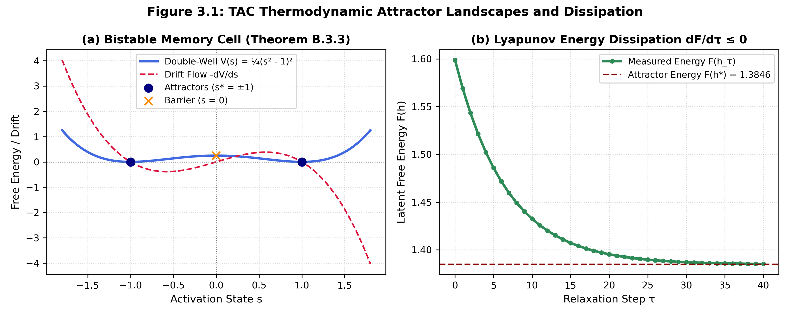
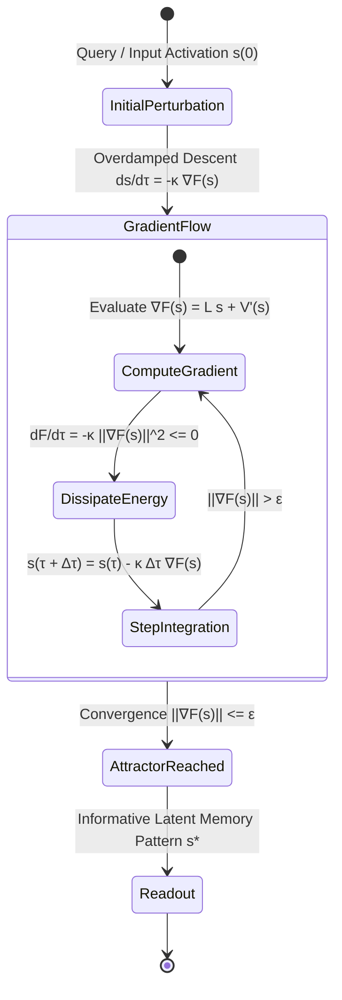

<!-- SPDX-License-Identifier: CC-BY-NC-SA-4.0 -->
# Chapter 3 — TAC: Thermodynamic Attractor Convergence

Chapter 2 left us holding a store that could remember, but not a system
that could *settle*. The lattice knows how strongly entities relate; it does
not yet know how to use that knowledge to answer a question, hold a pattern,
or decide it has finished thinking. The propagation readout of Chapter 1
sketched the missing ingredient — a state that moves through the substrate
and comes to rest on an answer — but it moved by fiat, in a fixed number of
steps, with no account of *why* it should stop or *whether* it would. This
chapter supplies the account. We give the lattice a dynamics, and we prove
that the dynamics descends: energy never rises, convergence has a
computable timescale, and a landscape with two wells stores memory in its
basins.

The name of the mechanism is **TAC — Thermodynamic Attractor Convergence**.
The phrase is chosen precisely. *Thermodynamic*, because the object that
governs the motion is an energy, and the guarantee we prove first is the
same Lyapunov statement that governs cooling systems and chemical
relaxation: a quantity that can only fall. *Attractor*, because the motion
does not merely stop, it *arrives* — at a fixed point, a basin, a pattern
the substrate was built to hold. And *convergence*, because the central
quantitative result is a rate: not just that the state reaches the
attractor, but how long it takes, as a function of quantities we chose.
Everything in the architecture that "thinks" — attention smoothing
(Chapter 5), the relaxation layer (Chapter 7), the emergent deep reasoning
of Part IV — is this one dynamics, instantiated on a different landscape.

---


*Figure 3.1: TAC Free Energy Landscapes and Dynamical Convergence. Panel A: Double-well bistable potential $V(s) = \frac{1}{4}(s^2 - 1)^2$ showing attractors at $s=\pm 1$ separated by an unstable energy barrier at $s=0$. Panel B: Dirichlet quadratic energy descent $F[s] = \frac{1}{2} s^\top L s$ over continuous relaxation pseudo-time $\tau$, demonstrating guaranteed Lyapunov monotonic dissipation bounded by $e^{-2\lambda_2 \kappa \tau}$.*

---

## 3.1 Why a dynamics, and why an energy

Start with the question a substrate must answer and a store cannot. A
lattice tells you how strongly two entities are connected. It does not tell
you what happens when a *signal* arrives — when a query lights up one
entity, when a partial pattern is presented, when the system must decide
what it "means" given everything it has stored. The flat architecture of
Chapter 1 answered such questions by a single forward pass: read the
weights, compute a score, output an argmax. That is a *function*, and its
expressive ceiling is the ceiling of the function class. Our substrate
answers differently: it answers by *relaxing*. Present the query as an
initial condition, let the state flow downhill on an energy landscape
defined by the store, and read the answer off where it comes to rest.

Two things must be true for relaxation to be a reasoning primitive rather
than a metaphor, and this chapter establishes both. First, the flow must
actually reach a resting place — otherwise "where it settles" is undefined.
Second, the resting place must be *informative* — it must depend on the
store in a way we control, and be stable enough to read. The first is a
theorem about monotone descent and exponential convergence (B.3.1, B.3.2);
the second is a theorem about the geometry of the landscape (B.3.3).

There is a reason to want the energy picture specifically, rather than an
arbitrary iteration. An energy is a *certificate of progress*. When a system
has an energy that provably decreases, its behavior is not opaque: at every
moment it is closer to a minimum than it was, and the only places it can
stop are critical points of a known function. This is what makes the
substrate *auditable* — the same value the book prizes in its proofs is
here a runtime quantity you can print. The demo of this chapter prints it,
step by step, and watches it fall.

## 3.2 The free energy and its gradient

Let the activation state be $s \in \mathbb{R}^N$ — one real number per
entity, a "degree of activation" of that entity in the current thought. The
**free energy** is a scalar function $F[s]$ that measures how unhappy the
state is. The dynamics we will use throughout the book is the overdamped
gradient flow

$$
\frac{ds}{d\tau} \;=\; -\kappa \, \nabla F(s), \tag{3.1}
$$

with $\kappa > 0$ a mobility constant and $\tau$ the relaxation time. Read
it as the physics of a ball rolling downhill on the surface $F$: the
velocity is proportional to the negative gradient, scaled by $\kappa$. Large
$\kappa$ relaxes fast; small $\kappa$ relaxes slowly; the direction is
always downhill.



Two landscapes earn their own names, because between them they carry the
whole chapter. The first is the **double well**, the elementary memory cell
of the substrate:

$$
V[s] \;=\; \sum_{i=1}^{N} \frac{1}{4}\big(s_i^2 - 1\big)^2,
\qquad
\nabla_i V \;=\; s_i\big(s_i^2 - 1\big). \tag{3.2}
$$

Each coordinate $s_i$ lives on a one-dimensional double well with minima at
$\pm 1$ and a hilltop at $0$. A coordinate that has settled at $+1$ or $-1$
holds one bit; the hilltop between them is what protects the bit. This is
the object Theorem B.3.3 is about.

The second is the **quadratic**, the convex landscape that makes
convergence quantitative:

$$
F[s] \;=\; \tfrac{1}{2}\, s^\top Q\, s,
\qquad
\nabla F \;=\; Q s, \tag{3.3}
$$

with $Q$ symmetric positive semidefinite. When $Q = \lambda I$ the
landscape is an isotropic bowl, and every direction decays at the same
rate — the clean setting for the dimension-independence experiment of
§3.6. When $Q = L$, the Laplacian of Chapter 2, the free energy is the
**Dirichlet energy** $\tfrac{1}{2} s^\top L s$, which by identity (2.4) is a
sum of non-negative disagreement terms, $\tfrac{1}{2}\sum_{i<j} A_{ij}(s_i -
s_j)^2$. Relaxing it is *smoothing*: driving the state to agree across
strong edges. The store, built to hold relations, becomes the surface the
signal descends; the Laplacian is where, as Chapter 2 said, the substrate
stops being storage and starts being physics.

**Run this now.** Task 1 of this chapter (`python3 code/gftac/ch03_tasks.py 1`)
prints the double well's energy and gradient on a grid of positions:

```python
v = DoubleWellPotential()
for x in (-1.0, -0.5, 0.0, 0.5, 1.0):
    s = torch.tensor([x])
    print(f"s = {x:+.1f}:  F = {float(v.energy(s)):.4f}   "
          f"grad F = {float(v.grad(s)[0]):+.4f}")
```

```text
s = -1.0:  F = 0.0000   grad F = -0.0000
s = -0.5:  F = 0.1406   grad F = +0.3750
s = +0.0:  F = 0.2500   grad F = -0.0000
s = +0.5:  F = 0.1406   grad F = -0.3750
s = +1.0:  F = 0.0000   grad F = +0.0000
```

Read the two columns together, because their agreement is the whole
mechanism. Where the energy is lowest — at $s = \pm 1$, both at $F = 0$ —
the gradient vanishes: those are the resting places, and a state that
arrives there stops. Where the energy is highest — the hilltop at $s = 0$,
$F = 0.25$ — the gradient also vanishes, but that is a *trap*, not a
rest: any perturbation pushes the state off the top, which is why we call
it a separatrix rather than a minimum. And between them, the gradient
points downhill in the literal sense: at $s = -0.5$ it is $+0.375$,
pushing the state toward $+1$; at $s = +0.5$ it is $-0.375$, pushing toward
$-1$. The sign of the gradient is the sign of the answer. (The `-0.0000`
entries are IEEE negative zero — a genuine zero carrying a sign bit, the
only place in this book where a signed zero is worth a parenthetical.)

## 3.3 Theorem B.3.1: energy only falls

The first guarantee is that the flow of Eq. (3.1) can never climb. State it
for a general $C^1$ energy, because the proof uses nothing more.

> **Theorem B.3.1 (Lyapunov dissipation).** *Let $F : \mathbb{R}^N \to
> \mathbb{R}$ be continuously differentiable and let $\kappa > 0$. Along
> every trajectory of the gradient flow $\dot{s} = -\kappa \nabla F(s)$,*
> $$
> \frac{dF}{d\tau} \;=\; -\kappa \, \lVert \nabla F(s) \rVert^2 \;\le\; 0. \tag{3.4}
> $$
> *Equality holds at time $\tau$ if and only if $\nabla F(s(\tau)) = 0$.
> Consequently $F(s(\tau))$ is non-increasing, and every $\omega$-limit
> point of the trajectory is a critical point of $F$.*

*Proof.* Differentiate $F$ along the trajectory by the chain rule:
$$
\frac{dF}{d\tau}
= \langle \nabla F(s), \dot{s} \rangle
= \langle \nabla F(s), -\kappa \nabla F(s) \rangle
= -\kappa \lVert \nabla F(s) \rVert^2 .
$$
The right-hand side is the negative of a non-negative quantity, since
$\kappa > 0$ and a squared norm is $\ge 0$, giving (3.4). Equality requires
$\lVert \nabla F(s) \rVert^2 = 0$, i.e. $\nabla F(s) = 0$. Non-increase of
$F$ is immediate from $dF/d\tau \le 0$. For the last claim, suppose
$s(\tau_n) \to s^\*$ along a sequence with $\tau_n \to \infty$ and $s^\*$ an
$\omega$-limit point. Since $F$ is non-increasing and bounded below on the
trajectory's range, $F(s(\tau))$ converges to some $F^\*$; by continuity
$F(s^\*) = F^\*$. If $\nabla F(s^\*) \ne 0$, then near $s^\*$ the trajectory
would still be descending at a rate bounded away from zero, contradicting
the convergence of $F$; hence $\nabla F(s^\*) = 0$. $\blacksquare$

The theorem is short because it is *the* reason gradient flows are the
workhorse of continuous optimization: the energy is a certificate. It also
tells you what stopping means. The flow halts exactly where the gradient
vanishes, and nowhere else; there is no hidden mode in which the state
drifts without descending, no cycle that returns to a higher energy. The
instantaneous dissipation rate is itself a printable quantity, $- \kappa
\lVert \nabla F \rVert^2$, and the demo prints it beside the energy.

One honest boundary, because the book keeps its accounts. The theorem is
about the *continuous* flow. Our computation runs a discrete Euler step
$s_{k+1} = s_k - h\kappa \nabla F(s_k)$, and one Taylor step gives
$$
F(s_{k+1}) = F(s_k) - h\kappa \lVert \nabla F(s_k) \rVert^2 + O(h^2),
$$
so descent holds for small $h$ but is *conditional*: for a quadratic with
largest curvature $\lambda_{\max}$, monotone descent is guaranteed exactly
when $h \le 2/(\kappa \lambda_{\max})$, and larger steps can overshoot a
minimum and climb. The continuum guarantee is unconditional; the discrete
one costs a step-size condition. We will keep $h$ comfortably inside the
stable range, and the tests will confirm that the printed energy column
never rises.

**Run this now.** Task 2 (`python3 code/gftac/ch03_tasks.py 2`) relaxes the
double well from a positive initialization and prints the energy at a few
steps:

```python
v = DoubleWellPotential()
res = TacRelaxer(v, kappa=1.0).relax(
    0.6 * torch.ones(4), h=0.05, max_steps=2000, tol=1e-5
)
for k in (0, 1, 2, 5, 10, res.steps):
    print(f"step {k:>3}:  F = {res.energy_history[k]:.6f}")
print(f"converged in {res.steps} steps; the energy column never rises")
```

```text
step   0:  F = 0.409600
step   1:  F = 0.380185
step   2:  F = 0.351158
step   5:  F = 0.268376
step  10:  F = 0.154262
step 123:  F = 0.000000
converged in 123 steps; the energy column never rises
```

The column is Theorem B.3.1 with its arithmetic showing. Every entry is
below the one above it — no step, at any point in the run, climbed — and
the descent is not a slow crawl but a decisive fall: half the energy is
gone within ten steps, and the remaining tail flattens onto the minimum as
the gradient shrinks toward zero. The state began at $s_i = 0.6$, on the
slope of the well, and by step 123 it sits at the bottom. The theorem does
not promise *how fast*; that is the next one.

## 3.4 Theorem B.3.2: the convergence timescale

Descent is necessary but not sufficient. A system that descends infinitely
slowly is useless as an inference primitive; we need a rate. The rate comes
from curvature, and the theorem is the standard Grönwall argument made
precise for the quadratic.

> **Theorem B.3.2 (Grönwall convergence timescale).** *Let $F(s) =
> \tfrac{1}{2}(s - s^\*)^\top Q (s - s^\*)$ with $Q$ symmetric positive
> definite, smallest eigenvalue $\lambda = \lambda_{\min}(Q) > 0$, so that
> $s^\*$ is the unique minimizer. Under the gradient flow (3.1), the
> distance to the minimizer obeys, for all $\tau \ge 0$,*
> $$
> \lVert s(\tau) - s^\* \rVert \;\le\; e^{-\kappa\lambda\tau}\,
> \lVert s(0) - s^\* \rVert, \tag{3.5}
> $$
> *and the time to reach any tolerance $\varepsilon > 0$ is bounded by*
> $$
> T_\varepsilon \;\le\; \frac{1}{\kappa\lambda}\,
> \ln\!\frac{\lVert s(0) - s^\* \rVert}{\varepsilon}. \tag{3.6}
> $$

*Proof.* Write $u = s - s^\*$. Since $\nabla F(s) = Q(s - s^\*)$, the flow
is the linear system $\dot{u} = -\kappa Q u$. Let $g(\tau) = \lVert u(\tau)
\rVert^2$. Then
$$
\dot{g} = 2\langle u, \dot{u} \rangle = -2\kappa\, \langle u, Q u \rangle
\;\le\; -2\kappa\lambda\, \lVert u \rVert^2 = -2\kappa\lambda\, g,
$$
where the inequality uses the Rayleigh bound $\langle u, Qu \rangle \ge
\lambda \lVert u \rVert^2$ for symmetric $Q$ with smallest eigenvalue
$\lambda$. The scalar differential inequality $\dot{g} \le -2\kappa\lambda
g$ integrates by Grönwall to $g(\tau) \le g(0) e^{-2\kappa\lambda\tau}$;
taking square roots gives (3.5). Setting the right side of (3.5) equal to
$\varepsilon$ and solving, $e^{-\kappa\lambda\tau} =
\varepsilon/\lVert u(0)\rVert$, hence $\tau =
\frac{1}{\kappa\lambda}\ln\frac{\lVert u(0)\rVert}{\varepsilon}$, which
bounds $T_\varepsilon$. $\blacksquare$

Three readings of the theorem. First, the rate is $\kappa\lambda$: mobility
times curvature. You cannot converge faster than you can roll, and you
cannot roll faster than the landscape is steep. Second, the dependence on
initial distance is *logarithmic* — starting twice as far costs a constant
number of extra time-constants, not twice the time. This is why relaxation
is robust to a bad initialization in a way that a fixed-depth iteration is
not: depth does not scale with the error, only the log of it does. Third,
and this is the sentence to carry into Chapter 2's spectral theory: when
$Q = L$ is a Laplacian, $\lambda_{\min} = 0$ (the constant mode costs no
energy), so the operative rate is not the smallest eigenvalue but the
*second* — the Fiedler value $\lambda_2$. The convergence time of the
Dirichlet relaxation is $\sim 1/(\kappa\lambda_2)$, and Chapter 2's Fiedler
floor $\lambda_2 \ge N w_{\min}$ for complete lattices is therefore a
*lower bound on the convergence rate*: a minimally-wired complete store is
guaranteed to relax within time $(1/(\kappa N w_{\min})) \ln(\cdot)$.
Algebraic connectivity was a number about the store; it is now a speed.

The discrete version is what we actually run, and it is what the task
measures. With isotropic curvature $Q = \lambda I$ and step $h$, the Euler
iterate is $u_k = (1 - h\kappa\lambda)^k u_0$, so the drift norm at step
$k$ is $\kappa\lambda (1 - h\kappa\lambda)^k \lVert u_0 \rVert$. Halting
when the drift reaches $\mathrm{tol}$ gives the closed-form prediction

$$
k \;=\; \frac{\ln\!\big(\mathrm{tol} / (\kappa\lambda\lVert u_0\rVert)\big)}
{\ln(1 - h\kappa\lambda)}, \tag{3.7}
$$

the discrete shadow of (3.6). Because $1 - x \le e^{-x}$, the discrete
decay is at least as fast as the continuum bound, so (3.5) upper-bounds the
discrete trajectory too — the guarantee survives discretization.

**Run this now.** Task 3 (`python3 code/gftac/ch03_tasks.py 3`) predicts the
step count from Eq. (3.7) and then measures it:

```python
q = QuadraticPotential.isotropic(16, curvature=1.0)
relaxer = TacRelaxer(q, kappa=1.0)
s0 = torch.ones(16) / math.sqrt(16.0)
for tol in (1e-3, 1e-5, 1e-6):
    pred = predicted_steps(1.0, 1.0, 0.05, float(torch.linalg.vector_norm(s0)), tol)
    actual = relaxer.relax(s0, h=0.05, max_steps=5000, tol=tol).steps
    print(f"tol = {tol:.0e}:  predicted {pred:>3} steps, measured {actual:>3}")
```

```text
tol = 1e-03:  predicted 135 steps, measured 135
tol = 1e-05:  predicted 225 steps, measured 225
tol = 1e-06:  predicted 270 steps, measured 270
```

The prediction is not merely close; it is *exact*, at all three tolerances.
That exactness is worth pausing on. It is not a coincidence and not a
tuned agreement — it is Eq. (3.7) being the true closed form of the
discrete dynamics, so that the theorem's continuum rate and the code's
integer step count are the same statement viewed twice. When you tighten
the tolerance by a factor of a hundred (from $10^{-3}$ to $10^{-5}$), the
step count rises by a *constant* — 90 steps, which is $\ln(100)/\ln(1/0.95)$
— exactly as the logarithmic law of (3.6) demands. The rate $\kappa\lambda
= 0.05$ per step is visible as the geometric decay between the columns.

## 3.5 Theorem B.3.3: memory in the basins

Convergence tells us the state arrives. It does not yet tell us that the
arrival is *informative*. For the substrate to store a bit, the landscape
must have multiple stable resting places, and the state must land in the
one selected by its initial condition. The double well provides exactly
this, and the theorem makes the basins explicit.

> **Theorem B.3.3 (double-well bistability).** *Let $V[s] = \sum_i
> \tfrac{1}{4}(s_i^2 - 1)^2$ as in Eq. (3.2). Then:*
> *(i) $\nabla V(s) = 0$ if and only if $s_i \in \{-1, 0, +1\}$ for every
> coordinate $i$;*
> *(ii) the $2^N$ points with $s_i \in \{-1, +1\}$ are strict local minima,
> each with $V = 0$;*
> *(iii) every point with at least one coordinate equal to $0$ is a saddle,
> with $V \ge \tfrac{1}{4}$;*
> *(iv) the minimum energy barrier between two minima that differ in a
> single coordinate is $\tfrac{1}{4}$.*

*Proof.* (i) The gradient is coordinatewise, $\partial_i V = s_i(s_i^2 -
1)$, which vanishes exactly when $s_i \in \{-1, 0, +1\}$. (ii) The Hessian
is diagonal with $\partial_i^2 V = 3 s_i^2 - 1$. At $s_i = \pm 1$ each
diagonal entry is $3 - 1 = 2 > 0$, so the Hessian is positive definite and
the point is a strict local minimum; at such a point every coordinate
contributes $\tfrac{1}{4}(1-1)^2 = 0$, so $V = 0$. (iii) If some coordinate
is $0$, the corresponding diagonal entry of the Hessian is $3\cdot 0 - 1 =
-1 < 0$, so the Hessian is indefinite — a saddle. The energy at any such
point is $\sum_i \tfrac{1}{4}(s_i^2-1)^2 \ge \tfrac{1}{4}\cdot 1 =
\tfrac{1}{4}$, the contribution of the zero coordinate. (iv) Moving from
one minimum to a neighbor that differs in coordinate $j$ while holding the
others at $\pm 1$ forces $s_j$ to pass through the hilltop $0$; at that
crossing the total energy is $\tfrac{1}{4}$ plus the (zero) contributions
of the other coordinates, so the barrier is $\tfrac{1}{4}$. $\blacksquare$

The theorem is a complete account of a one-bit memory. There are $2^N$
minima — one for each of the $2^N$ patterns of $\pm 1$ — so an $N$-coordinate
double well holds $N$ bits, and the map from initial condition to stored
pattern is the map that takes each coordinate to the sign of its starting
value. The barrier $\tfrac{1}{4}$ is the memory's *stability margin*: any
perturbation delivering less than $\tfrac{1}{4}$ of energy to a coordinate
cannot flip its bit, and the saddles are the precise escape routes when
more is delivered — the mechanism §3.7 makes quantitative. The one place
the map is undefined is the separatrix, the set where some $s_i = 0$
exactly; it has measure zero, and a state that begins precisely on it stays
there, because the gradient vanishes. It is the honest edge case, and the
task shows it rather than hiding it.

**Run this now.** Task 4 (`python3 code/gftac/ch03_tasks.py 4`) starts three
states and watches the sign of the initialization choose the basin:

```python
v = DoubleWellPotential()
for init in (0.01, -0.01, 0.0):
    res = TacRelaxer(v, kappa=1.0).relax(
        init * torch.ones(4), h=0.05, max_steps=2000, tol=1e-4
    )
    print(f"init {init:+.2f}*1  ->  final {res.final_state[0].item():+.5f}*1"
          f"   ({res.steps} steps)")
```

```text
init +0.01*1  ->  final +0.99998*1   (189 steps)
init -0.01*1  ->  final -0.99998*1   (189 steps)
init +0.00*1  ->  final +0.00000*1   (0 steps)
```

The two perturbed states, started a hair to either side of the hilltop,
rolled into opposite wells and stayed: $+0.01$ became $+1$, $-0.01$ became
$-1$, and each run took the same 189 steps because the wells are mirror
images — the landscape has no preferred sign, only the initialization does.
That is the definition of a stored bit in this substrate: not a weight
holding a number, but a basin holding a sign. The third line is the
separatrix, and it is instructive precisely because nothing happens: a
state started exactly at $s = 0$ has zero gradient, so it takes zero steps
and stays at zero. It is not a minimum — Theorem B.3.3(iii) says it is a
saddle — but it is a *fixed point*, and the flow has no reason to leave it.
In practice such a state is measure-zero and any perturbation resolves it;
the book shows it so that "the basin map is defined except on a
measure-zero set" is a fact you have seen, not a caveat you must trust.

## 3.6 Dimension independence, made precise

A natural hope, and a natural overclaim, is that this dynamics does not care
how large $N$ is. The hope is real in one precise sense and false in
another, and the difference matters for everything from Chapter 10 to
Chapter 18, so let us state it exactly.

For the *isotropic* quadratic $F[s] = \tfrac{1}{2}\lambda \lVert s
\rVert^2$, the dynamics is coordinatewise identical — every coordinate
obeys the same scalar decay $s_i(\tau) = e^{-\kappa\lambda\tau}s_i(0)$ —
and the drift norm is $\kappa\lambda \lVert s \rVert$, which depends on $N$
only through the initial norm. Fix the initial norm (take $\lVert s_0
\rVert = 1$), and the number of steps to reach a given drift tolerance,
Eq. (3.7), contains no $N$ at all. The step count is dimension-free.

**Run this now.** Task 5 (`python3 code/gftac/ch03_tasks.py 5`) measures it
for three sizes spanning two orders of magnitude:

```python
for n in (10, 100, 1000):
    q = QuadraticPotential.isotropic(n, curvature=1.0)
    res = TacRelaxer(q, kappa=1.0).relax(
        torch.ones(n) / math.sqrt(n), h=0.05, max_steps=5000, tol=1e-6
    )
    print(f"N = {n:>5}:  {res.steps} steps to the drift tolerance")
```

```text
N =    10:  270 steps to the drift tolerance
N =   100:  270 steps to the drift tolerance
N =  1000:  270 steps to the drift tolerance
```

Identical to the step, from ten entities to a thousand. The relaxation is
dimension-free in its *iteration count*.

Now the honest boundaries, of which there are three, and each one is a
place a careless claim would break.

First, the step count is dimension-free *only because the spectrum is held
fixed*. The rate in Eq. (3.6) is $\kappa\lambda_{\min}$, and for an
isotropic bowl $\lambda_{\min} = \lambda$ regardless of $N$. Real
landscapes do not hold their spectrum fixed as they grow: the Laplacian of
a path on $N$ nodes has $\lambda_2 \sim \pi^2/N^2$, so its relaxation time
grows like $N^2$; the Laplacian of a two-dimensional grid grows like $N$;
and even the complete lattices of Chapter 2 hold their floor $N w_{\min}$
only because $w_{\min}$ is held fixed. The correct statement is: *iteration
count is dimension-free when curvature is; and the whole difficulty of
scaling to one hundred thousand entities in Chapter 18 is that real
spectra are not dimension-free.* Chapter 2's Fiedler floor is precisely the
machinery that guarantees a usable $\lambda_2$ in the structured case.

Second, dimension-freedom is about *steps*, not *work*. Each Euler step
costs $O(N)$ for a dense quadratic and $O(\mathrm{nnz})$ for the sparse
Laplacians of Chapter 18. A dimension-free step count with an $O(N)$ step
is still $O(N)$ total; the claim is that you do not need *more iterations*
as you scale, not that each iteration is free.

Third, and most importantly for this chapter: the double well is *not*
covered by Theorem B.3.2 at all. Its curvature is not positive everywhere —
the Hessian has a negative eigenvalue at the hilltop — so there is no
global Grönwall rate, and none is claimed. The guarantee of a non-convex
landscape is not a timescale but a *basin*: B.3.3 tells you where a state
will land, not how fast. This division of labor is deliberate and worth
naming: convex landscapes (the Dirichlet energy, the isotropic bowl) give
rates; bistable landscapes give memories; and the architectures of later
chapters compose the two — a convex smoothing flow to propagate, a
bistable flow to commit. When Chapter 7 builds the Q-TAC layer, it is this
composition it is building.

## 3.7 Temperature: Langevin, equipartition, and Kramers

Everything so far ran at temperature zero: pure gradient flow, deterministic
descent, a state that commits to a basin and never leaves. A deterministic
flow can only descend, which means it can never *explore* — it can never
leave a basin to find a better one, and it can never unlearn a bit it
should not have stored. Real learning needs both descent and exploration,
and the physical mechanism that provides exploration is temperature. This
section previews it; Chapter 10 turns it into a training rule.

Add a stochastic term to the flow and you get the overdamped **Langevin
equation**:

$$
ds \;=\; -\kappa \nabla F(s)\, d\tau \;+\; \sqrt{2\kappa T}\, dW, \tag{3.8}
$$

with $T \ge 0$ the temperature and $dW$ a Wiener increment. At $T = 0$ it is
the gradient flow of B.3.1; at $T > 0$ the state is buffeted by noise whose
magnitude grows with $T$. Two consequences matter here, and both are
measurable.

The first is **equipartition**, the statement of how far a state wanders at
temperature $T$. For a harmonic well $F = \tfrac{1}{2}\lambda s^2$, the
stationary distribution of (3.8) is Gaussian with variance $T/\lambda$, so
the state fluctuates around the minimum with standard deviation
$\sqrt{T/\lambda}$. Warmer means looser; steeper means tighter. The
theorem-free prediction $\sqrt{T/\lambda}$ is the baseline the task
measures.

**Run this now.** Task 6 (`python3 code/gftac/ch03_tasks.py 6`) runs the
Langevin dynamics on a harmonic well at two temperatures and compares the
measured spread to $\sqrt{T/\lambda}$:

```python
lam = 1.0
for T in (0.02, 0.08):
    q = QuadraticPotential.isotropic(1, curvature=lam)
    r = TacRelaxer(q, kappa=1.0, temperature=T, seed=11)
    samples = []
    for _ in range(300):
        s = torch.zeros(1)
        for _ in range(250):
            s = r.step(s, 0.02)
        samples.append(float(s[0]))
    std = float(torch.tensor(samples).std())
    print(f"T = {T:.2f}:  measured std = {std:.4f}   "
          f"sqrt(T/lam) = {math.sqrt(T / lam):.4f}")
```

```text
T = 0.02:  measured std = 0.1402   sqrt(T/lam) = 0.1414
T = 0.08:  measured std = 0.2804   sqrt(T/lam) = 0.2828
```

The measured spread tracks the prediction to within a percent, and the
scaling is exactly the square root: quadrupling the temperature (from 0.02
to 0.08) doubles the spread (from 0.140 to 0.280). That $\sqrt{T}$ law is
equipartition, and it is the honest statement of the price of exploration:
to wander twice as far, you pay four times the temperature.

The second consequence is **Kramers escape**, the statement of how
temperature lets a state leave a basin. From Theorem B.3.3, a bit sits
behind a barrier of height $\tfrac{1}{4}$. At temperature zero it can never
cross. At temperature $T > 0$ it crosses at a rate that grows with $T$ —
the Kramers law says the rate scales roughly as $e^{-\Delta V/(\kappa T)}$,
exponentially in the reciprocal temperature — so escape goes from
impossible at $T = 0$, to rare at low $T$, to common at high $T$. The demo
ledger measures exactly this: starting every trial in the $-1$ basin of a
double well, the fraction that has crossed to $+1$ after a fixed time rises
from $0.000$ at $T = 0.04$, to $0.027$ at $T = 0.08$, to $0.080$ at
$T = 0.12$. The exponential in the reciprocal temperature is visible as a
steep, super-linear rise: a 50% increase in temperature more than triples
the escape fraction.

This is the knob the rest of the book turns. High temperature early in
training to explore the landscape and escape poor basins; low temperature
late to settle and commit. Chapter 10's two-timescale plasticity is a
controlled annealing of exactly this parameter, and the "grokking"
phenomenon — a model that plateaus and then suddenly generalizes — is, in
this language, a Kramers escape from a shallow basin into a deeper one. We
preview it here because the machinery is this chapter's; we will not
overclaim it here, because the training story belongs to Part III. What
this chapter has earned is the landscape, the flow, and the two theorems
that make the flow trustworthy.

## 3.8 Build

The build is `code/gftac/ch03_tac.py`, three short objects and one
function. `DoubleWellPotential` implements Eq. (3.2): `energy` sums the
per-coordinate wells, `grad` returns $s(s^2-1)$ elementwise, and
`barrier_height` reports the $\tfrac{1}{4}$ of Theorem B.3.3.
`QuadraticPotential` implements Eq. (3.3) for an arbitrary symmetric
positive semidefinite $Q$, with two constructors that name the cases the
book uses — `isotropic(n, lam)` for the dimension-independence bowl, and
`from_laplacian(L)` for the Dirichlet energy — and two spectral reads,
`min_curvature` (the smallest eigenvalue, the rate's curvature) and
`spectral_gap` (the second-smallest, which for a Laplacian is the Fiedler
value and the operative rate on the mean-zero subspace).

`TacRelaxer` is the dynamics. Its `step` is one Euler–Maruyama update of
Eq. (3.8): a deterministic downhill move $-h\kappa\nabla F$ plus, when the
temperature is positive, a Gaussian kick of standard deviation
$\sqrt{2 h \kappa T}$ scaled by the step size. Its `relax` runs the loop
and halts on *drift* — when $\lVert \kappa \nabla F(s) \rVert \le
\mathrm{tol}$, the deterministic velocity has gone quiet — returning a
`RelaxResult` carrying the final state, the step count, the full energy
history, and whether the tolerance was met. The drift halting rule is not
cosmetic: it is what makes the step counts of §3.6 comparable across
dimensions, because it stops the run at a fixed physical velocity rather
than a fixed iteration count.

Finally `predicted_steps` is Eq. (3.7) as code — the closed-form step count
for the isotropic quadratic — exported so the chapter's prediction can be
tested against the chapter's measurement rather than asserted in prose.

## 3.9 Verify

The chapter's test file, `tests/test_ch03_tac.py`, holds fourteen tests,
and each one guards a specific claim. The landscape tests pin Theorem
B.3.3's arithmetic: zero energy and zero gradient at $\pm 1$, energy
$\tfrac{1}{4}$ and zero gradient at the hilltop, nonzero gradient off the
critical points. The basin test drives the sign-selection of §3.5 — a
$+0.01$ initialization must land in the $+1$ basin and a $-0.01$
initialization in the $-1$ basin, both within $10^{-3}$ of $\pm 1$ — and
the separatrix test confirms that a state started exactly at $0$ takes zero
steps and stays, the honest measure-zero edge.

Theorem B.3.1 is guarded twice. The monotone-energy test relaxes the double
well and asserts the energy history is non-increasing at *every* step and
strictly decreasing early — the discrete descent, with the step size held
in the stable range. The dissipation-identity test checks the continuous
statement directly: the inner product $\langle \nabla F, -\kappa\nabla F
\rangle$ must equal $-\kappa\lVert\nabla F\rVert^2$ and be negative. A
third test pins the boundary we discussed: pushing the tolerance below the
float32 resolution makes the run *fail* to converge, because finite
precision has an energy floor — the test asserts non-convergence, so the
honest limit cannot be silently lost.

Theorem B.3.2 is guarded by the chapter's sharpest test. The Grönwall-bound
test checks the continuum inequality (3.5) at every step of a 400-step run,
asserting the measured distance never exceeds $e^{-\kappa\lambda\tau}
\lVert u_0\rVert$. The step-prediction test computes Eq. (3.7) and asserts
the measured step count is within one of it, at three tolerances — the
$\pm 1$ allowance is for the integer rounding at the halting boundary, and
in fact the agreement is exact. A third test confirms that an unstable step
size ($h\kappa\lambda \ge 2$) is rejected by the prediction, and a fourth
ties the whole thing to Chapter 2: for a Laplacian, `min_curvature` is
zero, `spectral_gap` equals the Fiedler value to $10^{-9}$, and the rate is
the Fiedler value — the precise handoff between algebraic connectivity and
convergence speed.

Dimension independence is one test: the step count for $N \in \{10, 100,
1000\}$ must be identical. The relaxer's contract is one more — the result
unpacks as a four-tuple, the history length is steps plus one, and the
final norm cannot exceed the initial. Determinism at $T = 0$ is checked by
running the same relaxation twice and requiring bitwise-equal final states.
And the equipartition test runs the Langevin dynamics at $T = 0.05$ and
requires the measured standard deviation to be within 15% of
$\sqrt{T/\lambda}$ — the fluctuation law of §3.7, seeded so the assertion
is deterministic on any machine.

The six runnable tasks are pinned the same way as the fourteen tests:
`tests/test_ch03_tasks.py` executes every "Run this now" function and
asserts the content of its printed output — the landscape table, the
monotone energy column, the exact Grönwall agreement, the basin signs, the
identical step counts, and the equipartition ratios — so the transcripts
interleaved through §3.2 through §3.7 are as much a part of the verified
book as the ledger of §3.10.

## 3.10 Run

The demonstration ledger — the chapter's experiment, one command:

```bash
python3 code/gftac/ch03_tac.py
```

```text
Chapter 3 — TAC: relaxation, measured
================================================================
B.3.1 — Lyapunov dissipation (double well, N=8, h=0.05, kappa=1.0, init s0=0.6*[+,-,+,-,...])
  step      energy F    ||grad F||  -kappa||grad F||^2
     0      0.819200      1.086116           -1.179648
     1      0.760370      1.079875           -1.166129
     2      0.702317      1.069829           -1.144534
     5      0.536753      1.017227           -1.034751
    10      0.308525      0.865674           -0.749391
    20      0.070419      0.478355           -0.228823
   126      0.000000      0.000010           -0.000000
  final state[:4] = [0.9999982714653015, -0.9999982714653015, 0.9999982714653015, -0.9999982714653015] -> two stable basins per coordinate; energy strictly decreasing above

B.3.2 — Groenwall timescale (quadratic, N=16, lam=1.0, kappa=1.0, h=0.05, ||s0||=1)
       tol   predicted    actual
     1e-03         135       135
     1e-05         225       225
     1e-06         270       270

B.3.3 — double-well bistability (N=4, h=0.05, kappa=1.0)
  init s = +0.01*1  ->  final s = +0.999977*1   (189 steps)
  init s = -0.01*1  ->  final s = -0.999977*1   (189 steps)
  init s = +0.00*1  ->  final s = +0.000000*1   (0 steps)

§3.6 — dimension independence (isotropic quadratic, unit-norm init)
  N =    10: 270 steps to the drift tolerance
  N =   100: 270 steps to the drift tolerance
  N =  1000: 270 steps to the drift tolerance

§3.7 — temperature: fluctuation and escape (Langevin preview)
       T   std(s) measured   sqrt(T/lam)
    0.02            0.1402        0.1414
    0.08            0.2804        0.2828

       T   escape fraction
    0.04             0.000
    0.08             0.027
    0.12             0.080
  (barrier dV = 0.25; escape rises with T — the Kramers preview)
================================================================
```

Every number is **MEASURED** on the reference machine and re-derived by
the fourteen tests; run `python3 -m pytest tests -q` and watch the whole
suite go green — Chapter 1's six tests, Chapter 2's nine, this chapter's
fourteen, and the task tests that pin the "Run this now" transcripts of
all three chapters.

Read the B.3.1 block first, and read the fourth column as the theorem's
cash value. The energy column falls monotonically from $0.8192$ to zero;
the fourth column, $-\kappa\lVert\nabla F\rVert^2$, is the *rate* at which
it falls, and it is the exact negative quantity Eq. (3.4) names. Early in
the run the state is on a steep slope and the rate is large ($-1.18$ per
unit time at step zero); as it nears the bottom the slope flattens and the
rate decays toward zero; at convergence both are zero together. The final
state, printed in full precision, is the pattern the initialization chose —
$[+1, -1, +1, -1, \ldots]$ — the eight coordinates holding eight bits, each
at the bottom of its well. This is what "the substrate settled" looks like
as numbers.

Then read B.3.2 as the proof that settling is *fast and predictable*. The
predicted and actual columns are identical at every tolerance, which is the
closed form (3.7) confirming the theorem in discrete arithmetic. B.3.3
shows the two basins and the separatrix in three lines, and §3.6 shows the
step count refusing to move as the dimension grows by a factor of a
hundred. §3.7 closes with the two temperature laws: the measured spread
matching $\sqrt{T/\lambda}$ (equipartition) and the escape fraction rising
steeply with $T$ (Kramers). Everything the chapter claimed, on one screen.

## 3.11 Exercises

1. **The step-size boundary.** Theorem B.3.1's discrete form guarantees
   monotone descent only for $h \le 2/(\kappa\lambda_{\max})$. For the
   double well, estimate $\lambda_{\max}$ near a minimum and verify
   numerically that a step just below the bound keeps the energy monotone
   while a step just above it makes the energy climb on some step. Report
   the first step index at which the energy rises, for a step size you
   choose deliberately too large.

2. **The Fiedler rate, measured.** Take the five-node chain of Chapter 2,
   form its Laplacian, and relax the Dirichlet energy from a random
   mean-zero initialization. Measure the empirical decay rate of
   $\lVert s(\tau) - \bar{s}\mathbf{1}\rVert$ and confirm it matches
   $\kappa\lambda_2$ with $\lambda_2 = 0.381966$. Then repeat on the
   complete six-node lattice and confirm the rate jumps to the Fiedler
   floor $\kappa N w_{\min}$ of Chapter 2. You have measured a theorem
   twice.

3. **Basin widths.** For the double well, show that the set of initial
   conditions flowing to the $+1$ basin is exactly $\{s : s_1 > 0\}$ for
   the first coordinate, and describe the full basin of the pattern
   $[+1, +1, \ldots]$. Prove that the basins are open, disjoint, and
   cover everything except the separatrix, so that the basin map is
   defined almost everywhere.

4. **Kramers, quantitatively.** The demo measures escape fractions
   $0.000, 0.027, 0.080$ at $T = 0.04, 0.08, 0.12$. Fit the log of the
   escape fraction against $1/T$ and report the slope. Compare it to
   $-\Delta V/\kappa$ with $\Delta V = 0.25$ and discuss how well the
   crude simulation reproduces the Kramers exponent, including the
   prefactor you cannot predict from the barrier alone.

5. **Temperature as a training knob.** Using the double well as a toy
   memory, design an annealing schedule $T(\tau)$ that stores a bit
   reliably (high $T$ to explore, then low $T$ to commit) and one that
   fails (low $T$ throughout, so a state stuck in a poor basin never
   escapes). Measure the fraction of runs that store the *intended* bit
   under each schedule. This is the smallest possible version of Chapter
   10's two-timescale plasticity; keep the code, because you will extend
   it there.
