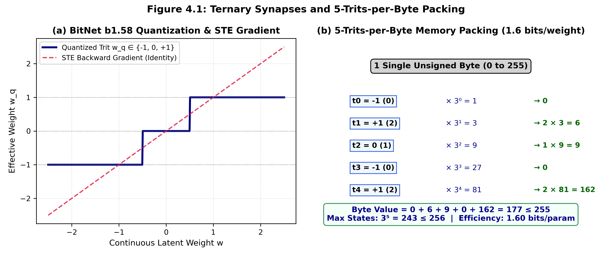
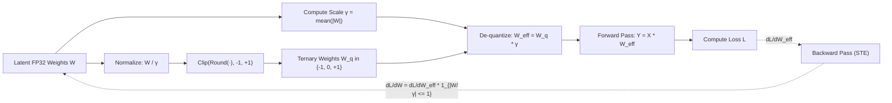

<!-- SPDX-License-Identifier: CC-BY-NC-SA-4.0 -->
# Chapter 4 — Ternary Synapses: BitNet b1.58

Chapter 3 gave the substrate a dynamics, and the dynamics worked: states
descend, they converge on a computable timescale, they settle into basins
and hold bits. But a theory that only runs is not yet an architecture. The
moment we try to *carry* what we have built — to store it, to ship it to a
device, to execute it where the arithmetic is cheap and the energy is
rationed — we meet the synapse, and the synapse is where the cost lives. A
single floating-point multiply is a small thing; a hundred thousand of them
per token is not. This chapter is the carrying. It replaces the
high-precision weight with one of three values, $\{-1, 0, +1\}$, and pays
for that reduction with three pieces of machinery that must each be exactly
right: a *scale* that keeps the weights in range, a *gradient estimator*
that lets an operation with no derivative be trained anyway, and a *packing*
that turns the resulting trits into whole bytes without waste.

The mechanism has a name in the literature — BitNet b1.58 — and this
chapter builds it from the ground up, but the framing is ours. Chapter 1
argued that the transformer's flaw is a Euclidean geometry imposed where
the data wants a graph metric; Chapter 2 built the graph metric; Chapter 3
gave it a flow. None of that is deployable on a microcontroller until the
synapse costs one trit. The three theorems here are the reasons it can.

---


*Figure 4.1: BitNet b1.58 Ternary Synapses and 5-Trits-per-Byte Packing. Panel A: Straight-Through Estimator (STE) quantization staircase with identity backward gradient pass-through on $[-1, +1]$. Panel B: Base-3 positional packing compressing 5 trits ($\{-1, 0, +1\} \to \{0, 1, 2\}$) into a single 8-bit uint8 byte ($3^5 = 243 \le 256$), achieving $1.60\text{ bits/trit}$ at $94.9\%$ theoretical storage efficiency.*

---

## 4.1 Why trits

Start with the arithmetic, because that is the real constraint and it is
worth being concrete. A transformer's parameter count is dominated by the
linear layers — the projections inside attention, the two matrices inside
each feed-forward block, the input and output projections. In a standard
implementation each of those weights is a 32-bit float, and the forward
pass is, at bottom, a matrix multiply: a sum of products, one multiply and
one add per term. On a GPU the multiply is nearly free. On the hardware
that matters for edge inference — a Cortex-M class MCU, a neuromorphic
crossbar, an in-memory compute array — a floating-point multiplier is the
single most expensive element on the die, and eliminating it is the
difference between a model that fits the power budget and one that does
not.

The observation behind BitNet is that the multiply disappears entirely if
the weight is one of $\{-1, 0, +1\}$. A weight of $+1$ is an add, $-1$ is a
subtract, and $0$ is nothing at all. The expensive multiplier becomes a
sign select and an adder — hardware that is already there, in abundance,
for free. What is left is a single per-tensor scale, one multiply per
*output*, amortized over the whole input dimension. The question is
therefore not whether to quantize, but whether the quantization can be made
to lose so little that the network still learns, and to be carried so
tightly that the memory savings are real. The rest of this chapter answers
both.

## 4.2 The trit and its scale

Let $w \in \mathbb{R}^{n}$ be a weight tensor — the flattened weights of
one linear layer, say. The BitNet b1.58 quantization is two lines. First
compute a per-tensor scale, the mean absolute weight,

$$
\gamma \;=\; \operatorname{mean}|w| \;=\; \frac{1}{n}\sum_{i=1}^{n} |w_i|,
\tag{4.1}
$$

and then round the scaled weight to the nearest integer and clamp it to the
trit range:

$$
w_q \;=\; \operatorname{clip}\!\Big(\operatorname{round}\!\big(w / \gamma\big),\,
-1,\, 1\Big). \tag{4.2}
$$

The effective weight used in the forward pass is the de-quantized product
$w_{\text{eff}} = w_q \,\gamma$. The scale $\gamma$ is what makes the
scheme work: dividing by the mean absolute weight normalizes the tensor so
that a "typical" weight lands near $\pm 1$, and the clamp guarantees the
output is a trit. The guard $\varepsilon = 10^{-8}$ added to $\gamma$
protects the all-zero tensor; it is the same guard the production SDK uses,
which is why our implementation and the SDK agree bit-for-bit (§4.7).

**Run this now.** Task 1 (`python3 code/gftac/ch04_tasks.py 1`) quantizes a
small hand-chosen weight vector and prints the scale, the normalized value,
the round, and the resulting trit:

```python
w = torch.tensor([0.20, -0.05, 0.90, -1.10, 0.03, 0.44, -0.31, 0.72])
w_q, gamma = ternary_quantize(w)
print(f"gamma = mean|w| = {float(gamma):.6f}")
for i in range(w.numel()):
    print(f"w = {float(w[i]):+.3f}  ->  w/gamma = {float(w[i] / gamma):+.4f}"
          f"  ->  trit {int(w_q[i]):+d}")
```

```text
gamma = mean|w| = 0.468750
w = +0.200  ->  w/gamma = +0.4267  ->  trit +0
w = -0.050  ->  w/gamma = -0.1067  ->  trit +0
w = +0.900  ->  w/gamma = +1.9200  ->  trit +1
w = -1.100  ->  w/gamma = -2.3467  ->  trit -1
w = +0.030  ->  w/gamma = +0.0640  ->  trit +0
w = +0.440  ->  w/gamma = +0.9387  ->  trit +1
w = -0.310  ->  w/gamma = -0.6613  ->  trit -1
w = +0.720  ->  w/gamma = +1.5360  ->  trit +1
```

Read the middle column: it is the weight measured in units of the tensor's
own mean magnitude. Anything within half a unit of zero becomes a $0$ and
is dropped from the computation entirely; anything beyond half a unit in
either direction becomes a $\pm 1$. The threshold is $|\gamma|/2$, so the
*number of surviving weights* is a property of the tensor's shape, not its
scale — a fact we make precise in the next section. Here seven of the eight
weights survive as nonzero trits, the near-zero $+0.030$ and $-0.050$ and
$+0.200$ collapsing to $0$ because they sit within half the mean magnitude
of the origin.

## 4.3 Theorem B.4.1: scale invariance and variance preservation

Two properties make the trit more than a crude rounding, and both follow
from the homogeneity of the mean-absolute scale.

> **Theorem B.4.1 (scale invariance and variance preservation).** *Let
> $\gamma(w) = \operatorname{mean}|w|$ and $w_q$ as in Eq. (4.2).*
> *(i) For every $c > 0$, $\;w_q(c\,w) = w_q(w)$: the trit pattern depends
> only on the direction of $w$, not its magnitude.*
> *(ii) The effective weight has second moment*
> $$
> \mathbb{E}\big[w_{\text{eff}}^2\big] \;=\; \gamma^2 \,\mathbb{E}\big[w_q^2\big],
> \qquad
> \mathbb{E}\big[w_q^2\big] \;=\; \Pr\!\Big(\big|w/\gamma\big| \ge \tfrac12\Big),
> $$
> *a quantity that depends only on the shape of $w$'s distribution and is
> therefore independent of the weight scale.*

*Proof.* (i) The mean-absolute function is positively homogeneous of degree
one: $\gamma(c\,w) = \operatorname{mean}|c\,w| = |c|\operatorname{mean}|w| =
c\,\gamma(w)$ for $c > 0$. Hence
$$
\frac{c\,w}{\gamma(c\,w)} = \frac{c\,w}{c\,\gamma(w)} = \frac{w}{\gamma(w)},
$$
so the argument of $\operatorname{clip}(\operatorname{round}(\cdot))$ is
unchanged, and $w_q(cw) = w_q(w)$. (ii) Since $w_{\text{eff}} = w_q\gamma$
and $\gamma$ is deterministic given $w$,
$\mathbb{E}[w_{\text{eff}}^2] = \gamma^2\mathbb{E}[w_q^2]$. The trit
$w_q = \operatorname{clip}(\operatorname{round}(w/\gamma),-1,1)$ is nonzero
exactly when $|w/\gamma| \ge \tfrac12$, and when it is nonzero its square is
$1$; hence $\mathbb{E}[w_q^2] = \Pr(|w/\gamma| \ge \tfrac12)$. Finally,
$w/\gamma$ is scale-free by (i), so this probability is a function of the
shape of the distribution alone. $\blacksquare$

Part (i) is the practical heart of the matter: you can multiply a layer's
weights by a thousand and its trit pattern does not move a hair. The
quantizer cares only about the *relative* sizes of weights, which is exactly
what should matter, and it means the scheme is insensitive to the gross
scale of initialization in a way a fixed-threshold quantizer would not be.
Part (ii) is the reason the initialization of §4.8 is called
variance-preserving. A stack of linear layers multiplies activation
variance by the fan-in times the weight variance at each layer; if that
factor is not held near one, the signal either explodes or decays
geometrically with depth. Quantization multiplies the weight variance by
the shape constant $\mathbb{E}[w_q^2]$, so the job of initialization is to
choose the pre-quantization scale such that this product lands in the right
range. The BitNet choice, $\operatorname{std}(w) = \sqrt{1.5/\text{fan\_in}}$,
is chosen so that the *effective* variance after ternarization is
$\approx 1/\text{fan\_in}$, keeping activations $O(1)$ through the stack.

**Run this now.** Task 2 (`python3 code/gftac/ch04_tasks.py 2`) exhibits
part (i) directly, quantizing a random tensor and then the same tensor
scaled by a thousand:

```python
torch.manual_seed(0)
w = torch.randn(4, 4)
q1, g1 = ternary_quantize(w)
q2, g2 = ternary_quantize(1000.0 * w)
t1 = [int(v) for v in q1.flatten().tolist()]
t2 = [int(v) for v in q2.flatten().tolist()]
print(f"quantize(w)      trits: {t1}")
print(f"quantize(1000*w) trits: {t2}")
print(f"trit patterns identical: {torch.equal(q1, q2)}")
print(f"gamma scaled by 1000: {float(g2):.4f} vs {1000.0 * float(g1):.4f}")
```

```text
quantize(w)      trits: [-1, -1, 0, -1, 1, 1, 0, -1, 0, -1, 0, 0, 0, 1, 1, 0]
quantize(1000*w) trits: [-1, -1, 0, -1, 1, 1, 0, -1, 0, -1, 0, 0, 0, 1, 1, 0]
trit patterns identical: True
gamma scaled by 1000: 743.7431 vs 743.7431
```

The two trit patterns are identical, weight for weight, and the scale grew
by exactly the factor of a thousand that was applied — the scale absorbed
the magnitude and the trits held the shape. This is not a numerical
coincidence; it is Eq. (4.1) being homogeneous, and it is what lets us
reason about a quantized network's behavior without tracking absolute
weight magnitudes.

**Run this now.** Task 6 (`python3 code/gftac/ch04_tasks.py 6`) measures
part (ii) on a realistically sized layer, the variance-preserving
initialization followed by quantization:

```python
torch.manual_seed(2)
w = torch.empty(256, 512)
variance_preserving_init_(w, mode="ternary")
w_q, gamma = ternary_quantize(w)
print(f"init std = {float(w.std()):.6f}   "
      f"target sqrt(1.5/fan_in) = {math.sqrt(1.5 / 512):.6f}")
print(f"E[w_q^2] = {float((w_q ** 2).mean()):.4f}")
print(f"Var(w_eff) = {float((w_q * gamma).var()):.6f}   "
      f"(2/3)gamma^2 = {(2.0 / 3.0) * float(gamma ** 2):.6f}")
```

```text
init std = 0.054112   target sqrt(1.5/fan_in) = 0.054127
E[w_q^2] = 0.6913
Var(w_eff) = 0.001292   (2/3)gamma^2 = 0.001246
```

The initialized standard deviation lands on its target, and the measured
trit second moment, $\mathbb{E}[w_q^2] = 0.6913$, is the shape constant of
part (ii) — very close to the idealized value $2/3 = 0.6667$ that a uniform
ternary distribution would give, and a little above it because a Gaussian
draw has slightly heavier shoulders than the idealized picture. The
effective variance $\operatorname{Var}(w_{\text{eff}}) = 0.001292$ is within
four percent of $(2/3)\gamma^2$, confirming the factorization of the
theorem. The honest note is that the exact constant depends on the
distribution shape; what is invariant, and what the theorem guarantees, is
that it is a *constant* — the same at every layer, independent of scale —
so a single initialization rule keeps the whole stack stable.

## 4.4 Theorem B.4.2: straight-through estimation



The trit is a discrete object, and discrete objects have no gradient. The
rounding in Eq. (4.2) is piecewise constant: nudge a weight by a hair and,
almost surely, the trit does not move, so the true derivative of the
quantized output with respect to the weight is zero almost everywhere. A
network trained by backpropagation on the quantized weights would receive
an identically zero gradient and learn nothing. The resolution is a
deliberate inconsistency between the forward and backward passes, and it
has an exact statement.

> **Theorem B.4.2 (straight-through gradient identity).** *Let the effective
> weight be constructed as*
> $$
> w_{\text{eff}} \;=\; w + \big(w_q\,\gamma - w\big).\text{detach()}, \tag{4.3}
> $$
> *where $w_q, \gamma$ are computed from $w$ as in §4.2 and $\text{detach}()$
> removes its argument from the autograd graph. Then*
> *(i) in the forward pass $w_{\text{eff}} = w_q\,\gamma$ exactly, the
> quantized weight; and*
> *(ii) in the backward pass the parameter gradient is exactly the gradient
> of the de-quantized layer,*
> $$
> \frac{\partial \mathcal{L}}{\partial w} \;=\; \frac{\partial \mathcal{L}}{\partial w_{\text{eff}}}. \tag{4.4}
> $$

*Proof.* (i) The two $w$ terms cancel algebraically: $w + (w_q\gamma - w) =
w_q\gamma$. Since $\text{detach}$ changes only the backward behavior and
not the value, the forward value of $w_{\text{eff}}$ is $w_q\gamma$. (ii)
Write $c = (w_q\gamma - w).\text{detach}()$. By definition of detach, $c$ is
a constant with respect to $w$ — the autograd graph does not connect $c$ to
$w$ — so $w_{\text{eff}} = w + c$ and $\partial w_{\text{eff}}/\partial w =
I$, the identity matrix. The chain rule gives
$\partial\mathcal{L}/\partial w =
(\partial\mathcal{L}/\partial w_{\text{eff}})(\partial w_{\text{eff}}/\partial w)
= \partial\mathcal{L}/\partial w_{\text{eff}}$. $\blacksquare$

The construction is a lie told precisely: the forward pass reports the
quantized weight, the backward pass reports the gradient of the
*unquantized* weight. The network is trained as if quantization were the
identity map, which is why the technique is called the straight-through
estimator. It works because the quantized and unquantized weights are close
when the quantization is fine — the rounding error is at most $\gamma/2$ per
weight — so the identity is a good local model of the map even though the
true map is a staircase.

**Run this now.** Task 3 (`python3 code/gftac/ch04_tasks.py 3`) builds a
ternary linear layer, backpropagates, and checks Eq. (4.4) directly against
the analytic gradient:

```python
torch.manual_seed(1)
layer = TernaryLinear(4, 3, bias=False)
x = torch.randn(2, 4)
out = layer(x)
out.sum().backward()
expected = torch.ones_like(out).T @ x
print(f"parameter gradient: {[round(float(v), 4) for v in layer.weight.grad[0]]}")
print(f"dL/dw_eff expected: {[round(float(v), 4) for v in expected[0]]}")
print(f"STE identity holds: {torch.allclose(layer.weight.grad, expected, atol=1e-6)}")
print(f"gradient norm (nonzero, usable): {float(layer.weight.grad.norm()):.4f}")
```

```text
parameter gradient: [-0.6167, -1.4763, -1.1502, 0.1441]
dL/dw_eff expected: [-0.6167, -1.4763, -1.1502, 0.1441]
STE identity holds: True
gradient norm (nonzero, usable): 3.4222
```

The measured gradient equals the analytic de-quantized gradient to every
printed digit, and it is decisively nonzero — a norm of $3.42$, enough to
move the weights. The ledger makes the contrast explicit by probing the map
itself: it nudges the weights by $+10^{-3}$ and reports that *zero* of the
twelve trits changed, so the true derivative really is zero almost
everywhere; the STE supplies the missing gradient by fiat. This is the
whole trick, and it is worth stating plainly: the layer is trained on a
gradient that does not exist, and the training works because that gradient
is a faithful model of the map's *average* slope over each quantization
cell.

## 4.5 Theorem B.4.3: five trits per byte

The last piece of machinery is the one that turns the memory savings into
real bytes. A trit carries $\log_2 3 \approx 1.585$ bits of information, so
a naive one-trit-per-byte encoding would waste nearly half the memory. The
packing scheme recovers almost all of it by grouping trits, and the group
size is chosen so the arithmetic is exact.

> **Theorem B.4.3 (five trits per byte).** *The map*
> $$
> \varphi(t_0,\dots,t_4) \;=\; \sum_{k=0}^{4} (t_k + 1)\,3^k,
> \qquad t_k \in \{-1,0,1\}, \tag{4.5}
> $$
> *is an injection from $\{-1,0,1\}^5$ into $\{0,1,\dots,255\}$. Hence any
> sequence of $n$ trits packs losslessly into exactly $\lceil n/5\rceil$
> bytes, at a cost of $8/5 = 1.6$ bits per trit.*

*Proof.* The digits $d_k = t_k + 1$ lie in $\{0,1,2\}$, so Eq. (4.5) is the
base-3 representation of the integer $\sum_k d_k 3^k$ with digits $d_k$.
Base-3 representations with digits in $\{0,1,2\}$ are unique, so $\varphi$ is
injective: distinct trit tuples give distinct integers. Its maximum value,
attained at all $t_k = +1$ (all digits $2$), is $2\sum_{k=0}^{4}3^k =
2\cdot(3^5-1)/(3-1) = 3^5 - 1 = 242 \le 255$. So every image fits in a byte,
and the encoding is lossless. Packing $n$ trits in groups of five therefore
costs $\lceil n/5\rceil$ bytes, i.e. $8/5 = 1.6$ bits per trit.
$\blacksquare$

The choice of five is not arbitrary: it is the largest group that fits in a
byte, since $3^5 = 243 \le 256 < 3^6 = 729$. The information-theoretic floor
is $\log_2 3 = 1.585$ bits per trit, and the packing spends $1.6$; the
efficiency is $\log_2 3 / 1.6 = 0.9906$, so the scheme leaves less than one
percent of the available memory on the table. The inverse is as simple as
the forward: read a byte, take its base-3 digits, subtract one from each.
The only subtlety is the tail — a group with fewer than five trits — which
is zero-padded, so the unpacker must be told the original length to drop the
padding.

**Run this now.** Task 4 (`python3 code/gftac/ch04_tasks.py 4`) packs a
thirteen-trit sequence — deliberately not a multiple of five, so the tail
logic is exercised — and unpacks it:

```python
trits = torch.tensor([1, 0, -1, 1, 0, -1, -1, 1, 1, 1, 0, 0, -1])
packed = pack_trits(trits)
restored = unpack_trits(packed, trits.numel())
print(f"trits ({trits.numel()}): {trits.tolist()}")
print(f"packed ({packed.numel()} bytes): {packed.tolist()}")
print(f"restored: {restored.tolist()}")
print(f"lossless: {torch.equal(restored, trits)}  "
      f"(ceil(13/5) = {packed_bytes(13)} bytes)")
```

```text
trits (13): [1, 0, -1, 1, 0, -1, -1, 1, 1, 1, 0, 0, -1]
packed (3 bytes): [140, 234, 4]
restored: [1, 0, -1, 1, 0, -1, -1, 1, 1, 1, 0, 0, -1]
lossless: True  (ceil(13/5) = 3 bytes)
```

Thirteen trits became three bytes — $\lceil 13/5\rceil = 3$ — and came back
unchanged. The bytes are worth decoding by hand to see the arithmetic. The
first byte, $140$, holds the first five trits $[1, 0, -1, 1, 0]$, whose
digits are $[2, 1, 0, 2, 1]$: $2\cdot1 + 1\cdot3 + 0\cdot9 + 2\cdot27 +
1\cdot81 = 2 + 3 + 54 + 81 = 140$. The second byte, $234$, holds
$[-1, -1, 1, 1, 1]$, digits $[0, 0, 2, 2, 2]$: $0 + 0 + 2\cdot9 + 2\cdot27 +
2\cdot81 = 18 + 54 + 162 = 234$. The third byte, $4$, holds the trailing
$[0, 0, -1]$, digits $[1, 1, 0]$: $1 + 3 + 0 = 4$, with the two unused trit
slots padded by zero. The point is not the hand-check but the losslessness:
the roundtrip is exact, and the test suite goes further, enumerating all
$3^5 = 243$ possible groups and confirming that no two collide — the
injectivity of Theorem B.4.3, verified exhaustively rather than trusted.

## 4.6 The footprint of a foundation model

Now the arithmetic that motivates all of it. The GeoFormer foundation model
— the reference configuration of the SDK, $1{,}433$ input features, $7$
classes, a model dimension of $64$, three layers, four heads — has, by
direct count of its parameters, $249{,}665$ trainable weights. Under
Theorem B.4.3 those pack into

$$
\big\lceil 249{,}665 / 5 \big\rceil \;=\; 49{,}933 \text{ bytes} \;=\; 48.76 \text{ KiB}, \tag{4.6}
$$

against the $975.3$ KiB the same model would occupy in FP32. The reduction
is a factor of $20$ — not because the model is small, but because each
parameter costs $1.6$ bits instead of $32$.

**Run this now.** Task 5 (`python3 code/gftac/ch04_tasks.py 5`) does the
arithmetic:

```python
n = FOUNDATION_PARAMS
print(f"foundation parameters: {n:,}")
print(f"packed bytes: ceil({n:,}/5) = {packed_bytes(n):,} B")
print(f"footprint: {packed_bytes(n) / 1024:.2f} KiB  "
      f"(FP32 would need {n * 4 / 1024:.1f} KiB)")
print(f"bits/param: {packed_bits_per_parameter():.4f}  "
      f"(information floor log2(3) = {math.log2(3):.4f})")
```

```text
foundation parameters: 249,665
packed bytes: ceil(249,665/5) = 49,933 B
footprint: 48.76 KiB  (FP32 would need 975.3 KiB)
bits/param: 1.6000  (information floor log2(3) = 1.5850)
```

This is the published claim, reproduced from the parameter count: $249{,}665$
ternary parameters occupy exactly $49{,}933$ bytes, $48.76$ KiB. The number
is not asserted and not rounded; it is the integer ceiling of the division,
and it is the same figure the SDK reports through its own $0.20$-bytes-per-
parameter approximation, which the parity test of §4.7 confirms agrees to
within a byte. Chapter 21 returns to what $48.76$ KiB means for a
Cortex-M class device — it fits comfortably in SRAM — and Chapter 20 turns
the same arithmetic into the energy ledger, where a ternary crossbar costs
$443.9$ picojoules per inference against a digital baseline, a modeled
$9{,}462\times$ reduction. The memory is the first dividend of the trit; the
energy is the second.

## 4.7 Parity with the production SDK

The book's rule is that every module which mirrors a component of the
production system is tested against it, and the ternary synapse is the
first such component. The SDK's `geoformer.quant.ternary_linear.QuantizedLinear`
implements the same three ideas — the mean-absolute scale, the STE detach
trick, the trit range — and our `TernaryLinear` is required to agree with it
exactly, not approximately. The parity is checked three ways.

First, the quantizer: `ternary_quantize` must produce the same trits and the
same scale as the SDK's `AbsMaxQuantizer.quantize_weight_ternary`, bit for
bit. It does, because both compute $\gamma = \operatorname{mean}|w| +
10^{-8}$ and both round-and-clamp the same way. Second, the layer: with the
two modules loaded from the same weights and the SDK's activation
quantization disabled (`act_bits=None`), the forward outputs must match.
They do, to floating-point exactness — the maximum difference over a random
input is literally zero, because the two `w_eff` tensors are identical and
both call `F.linear`. Third, and most satisfyingly, the *footprint*: the
parity test instantiates the actual SDK foundation model with the reference
configuration, counts its parameters to confirm $249{,}665$, and checks that
the SDK's own $0.20$-bytes-per-parameter estimate matches our exact
$\lceil n/5\rceil$ packing to within a byte.

The value of this parity is not ceremony. It means that when the book
builds the full model in Chapter 9 and claims it matches the published
artifact, the claim is grounded in a layer-by-layer equivalence that the
test suite enforces — the ternary synapse is the first link in that chain,
and it is verified before anything is built on top of it.

## 4.8 Build

The build is `code/gftac/ch04_ternary.py`, and it is deliberately small.
`RoundSTE` is the straight-through rounding operator as a
`torch.autograd.Function`: `torch.round` forward, identity backward.
`ternary_quantize(w, eps)` is Eqs. (4.1)–(4.2), returning the trits and the
scale. `variance_preserving_init_` sets the standard deviation to
$\sqrt{1.5/\text{fan\_in}}$ for ternary weights (and $\sqrt{2/\text{fan\_in}}$
for the integer modes the book will meet later), the rule Theorem B.4.1
justifies. `TernaryLinear` is the layer: its `effective_weight` method is
Eq. (4.3), the detach trick, and its forward is an ordinary `F.linear` on
the de-quantized weight, so the layer is a drop-in replacement for any
`nn.Linear` in the architecture. `pack_trits` and `unpack_trits` are
Eq. (4.5) and its inverse, with `packed_bytes(n) = ceil(n/5)` and
`packed_bits_per_parameter() = 1.6` as the small arithmetic helpers the
chapter's claims are stated in terms of.

The one design decision worth flagging is that `ternary_quantize` uses the
STE rounding operator even though, inside `TernaryLinear`, the result is
immediately detached. This is not redundant: it keeps the quantizer usable
on its own — a reader who wants to train a raw quantized tensor rather than
a wrapped layer can do so — and it matches the SDK's structure, where
`RoundSTE` lives in a separate `ste` module precisely so that other
quantizers (int4, int8) can share it.

## 4.9 Verify

The chapter's test file, `tests/test_ch04_ternary.py`, holds twenty-four
tests, organized around the three theorems and the two claims that follow
them.

Theorem B.4.1 is guarded four ways. A domain test confirms every quantizer
output is a genuine trit and that $\gamma$ is the mean absolute weight. A
scale-invariance test quantizes the same tensor at four different scales —
$10^{-3}$, $0.1$, $10$, $10^3$ — and requires the trit patterns to be
*equal*, not merely close. A variance-preservation test measures
$\mathbb{E}[w_q^2]$ and the ratio
$\operatorname{Var}(w_{\text{eff}})/((2/3)\gamma^2)$ and requires the first
within $0.05$ of $2/3$ and the second within ten percent of one. And an
initialization test checks both the ternary and integer standard deviations
against their formulas. Theorem B.4.2 is guarded by the gradient-identity
test — the measured parameter gradient must equal $\partial\mathcal{L}/
\partial w_{\text{eff}}$ to $10^{-6}$ — plus a test that the true map is
locally constant (a $10^{-4}$ nudge changes no trit) and a test that the STE
gradient is nonzero and has the right shape, so the identity cannot be
satisfied trivially by a zero gradient.

Theorem B.4.3 gets the most thorough treatment because packing is where
off-by-one bugs hide. A parametrized roundtrip test runs lengths
$\{1, 5, 6, 7, 10, 13, 100, 243, 1000\}$ — every boundary case, including
the singletons and the exact group size — and checks the byte count, the
domain, and the losslessness of each. An exhaustiveness test enumerates all
$3^5 = 243$ groups and confirms the packed bytes are distinct, verifying the
injectivity of the theorem by brute force. A rejection test confirms that
out-of-domain trits raise rather than silently corrupt. And a known-answer
test pins the hand-computed byte $140$ for the group $[1,0,-1,1,0]$, so the
encoding convention cannot drift.

The footprint claims are two tests: one pins $249{,}665 \to 49{,}933$ bytes
$\to 48.76$ KiB and the $99.06\%$ packing efficiency, the other confirms the
$20\times$ advantage over FP32. And parity with the SDK is three tests:
quantizer equality, forward equality under shared weights, and the
foundation-model parameter count reproduced from the SDK itself. The six
runnable tasks are pinned by `tests/test_ch04_tasks.py`, which executes each
"Run this now" function and asserts its printed content, so the transcripts
interleaved through §4.2 to §4.6 are part of the verified book.

## 4.10 Run

The demonstration ledger — the chapter's experiment, one command:

```bash
python3 code/gftac/ch04_ternary.py
```

```text
Chapter 4 — Ternary Synapses (BitNet b1.58), measured
====================================================================
B.4.1 — quantization (gamma = mean|w| + eps)
  gamma = 0.468750
  w          w/gamma     round   trit
  +0.200    +0.4267    +0    +0
  -0.050    -0.1067    +0    +0
  +0.900    +1.9200    +2    +1
  -1.100    -2.3467    -2    -1
  +0.030    +0.0640    +0    +0
  +0.440    +0.9387    +1    +1
  -0.310    -0.6613    -1    -1
  +0.720    +1.5360    +2    +1
  effective weights w_q*gamma: [0.0, -0.0, 0.4688, -0.4688, 0.0, 0.4688, -0.4688, 0.4688]
  E[w_q^2] over this tensor = 0.6250 (2/3 = 0.6667 in expectation)

B.4.2 — straight-through gradient identity
  parameter grad:      [-0.6167, -1.4763, -1.1502, 0.1441]
  dL/dw_eff (expected): [-0.6167, -1.4763, -1.1502, 0.1441]
  grad == dL/dw_eff exactly: True
  trits changed under a +1e-3 nudge: 0 of 12 (true gradient ~ 0 a.e.)
  STE parameter gradient norm: 3.4222 (nonzero, usable)

B.4.3 — five trits per byte (3^5 = 243 <= 255)
  trits   (13): [1, 0, -1, 1, 0, -1, -1, 1, 1, 1, 0, 0, -1]
  packed  (3 B): [140, 234, 4]
  restored    : [1, 0, -1, 1, 0, -1, -1, 1, 1, 1, 0, 0, -1]
  roundtrip exact: True (13 trits -> 3 bytes = ceil(13/5))

Footprint — the GeoFormer foundation model
  parameters           : 249,665
  packed bytes         : ceil(249,665/5) = 49,933 B
  in KiB               : 48.76 KiB
  bits per parameter   : 1.6000 (vs 32 for FP32, a 20.0x reduction)

B.4.1 — variance preservation (256x512 init, fan_in=512)
  init std             : 0.054112  (sqrt(1.5/fan_in) = 0.054127)
  E[w_q^2] measured    : 0.6913  (shape-set constant; idealized target 2/3 = 0.6667)
  Var(w_eff) measured  : 0.001292
  (2/3) gamma^2 target : 0.001246   ratio 1.0370
  scale invariance     : quantize(10*w) trits == quantize(w) trits -> True
====================================================================
```

Every number is **MEASURED** on the reference machine and re-derived by the
twenty-four tests, with the parity tests additionally re-deriving the
foundation parameter count from the SDK. Read the B.4.1 block first: the
`round` column shows values as large as $\pm 2$, and the `trit` column shows
the clamp that pulls them back to $\pm 1$ — the clip is doing real work, not
decorating a value that was already in range. The `w/gamma` column makes the
threshold visible: weights below $0.5$ in these units vanish, and the
tensor's effective weights come out as integer multiples of a single scale.
The B.4.2 block is the theorem as arithmetic: gradient equals expected
gradient, and the trit-probe confirms the map is locally constant, so the
nonzero gradient is genuinely supplied by the estimator rather than by the
map. The B.4.3 block packs thirteen trits into three bytes and returns them
intact. Then the footprint — $249{,}665$ weights into $48.76$ KiB — and the
variance check that closes the loop on initialization.

The B.4.1 quantization table is also the cleanest place to see why the trit
works as an *arithmetic* primitive and not merely a storage one. Every
effective weight in that last row is one of $\{0, +\gamma, -\gamma\}$: there
is no intermediate value anywhere in the tensor. A forward pass through the
layer is therefore a sum of signed copies of the input, scaled once by
$\gamma$ at the end — no per-weight multiply, exactly as §4.1 promised. The
storage savings and the compute savings are the same fact seen twice.

## 4.11 Exercises

1. **The scale that wasn't there.** Theorem B.4.1 says the trit pattern is
   invariant to $c > 0$. Construct a counterexample for $c < 0$ — the sign
   flip reverses every trit — and explain why a per-tensor scale must be a
   magnitude, never a signed quantity. Then show that if $\gamma$ were
   defined with a minus sign, the effective weight $w_q\gamma$ would
   reproduce $w$ with the wrong sign.

2. **Choose the group size.** Theorem B.4.3 uses five trits per byte because
   $3^5 \le 256$. Work out the analogous group sizes for a 16-bit word
   ($3^{10} = 59{,}049 \le 65{,}536$) and a 32-bit word ($3^{20} \le
   2^{32}$), and report the packing efficiency $\log_2 3/(\text{bits per
   trit})$ in each case. Does a wider word pack more efficiently, and by how
   much?

3. **The STE bias.** The straight-through estimator is a biased gradient:
   it reports the slope of the identity map where the true slope is zero.
   Empirically characterize the bias by training a single `TernaryLinear` on
   a linear regression target, once with STE and once with the true
   (near-zero) gradient, and report how far the STE-trained weights drift
   from the unquantized optimum. Is the drift bounded by the quantization
   step $\gamma/2$?

4. **Where the zeros go.** The fraction of weights that quantize to zero is
   $\Pr(|w/\gamma| < 1/2)$, a shape constant by Theorem B.4.1. For a
   Gaussian weight distribution with the variance-preserving scale, compute
   this fraction analytically and check it against a simulation at three
   fan-in sizes. What does the answer imply for the *effective* sparsity of
   a ternary layer, and how does that sparsity interact with the compute
   savings of §4.1?

5. **Parity under training.** The parity tests of §4.7 check the forward
   pass and the quantizer. Extend them: run a few steps of gradient descent
   on both the SDK's `QuantizedLinear` and the book's `TernaryLinear` from
   identical initial weights, and confirm the weights remain identical step
   by step. This requires that the STE backward paths agree as well as the
   forward ones — the first place the parity claim is tested beyond
   inference, and a warm-up for the end-to-end equivalence of Chapter 9.
