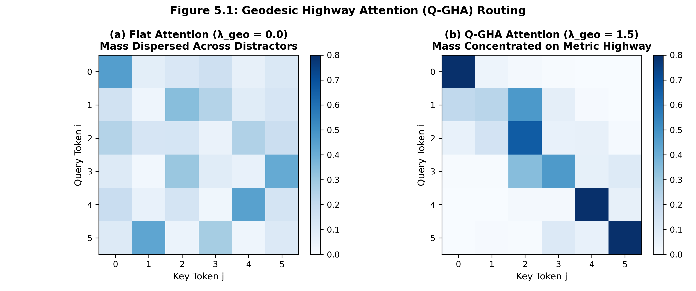
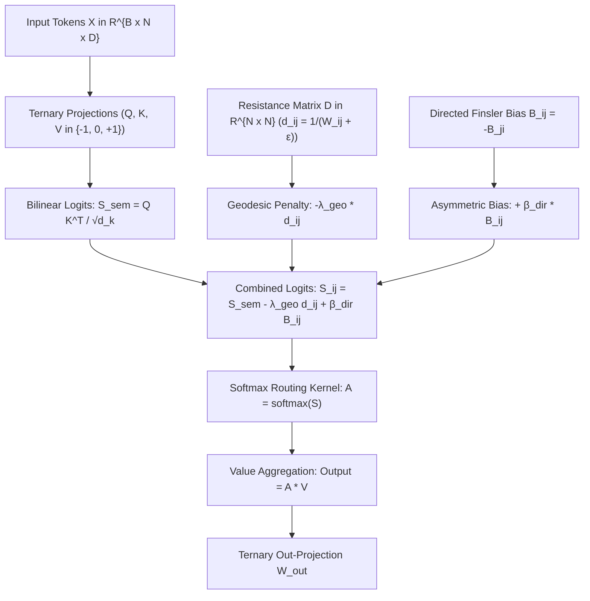

<!-- SPDX-License-Identifier: CC-BY-NC-SA-4.0 -->
# Chapter 5 — Geodesic Highway Attention: Q-GHA

Chapter 4 made the synapse cheap. It did not make it *situated*. A
`TernaryLinear` is a matrix multiply, and a matrix multiply has no idea
which of its inputs are near each other on the graph the data lives on. That
ignorance is the flaw Chapter 1 named and Chapter 2 answered: ordinary
attention scores a query against a key by their Euclidean inner product,
$Q_i \cdot K_j / \sqrt{d_k}$, a number that depends only on the two vectors
and not at all on the structure between the entities they represent. Two
nodes joined by a strong edge and two nodes on opposite sides of a graph get
scored by the same formula, and the formula cannot tell them apart. The graph
was built, the flow was given, the weights were ternarized — and the
attention still does not see it.

This chapter puts the graph back in. The idea is one line long and it is the
whole of Geodesic Highway Attention: *subtract the graph distance from the
logits before the softmax.*

$$
S_{ij} \;=\; \frac{Q_i K_j^{\top}}{\sqrt{d_k}} \;-\; \lambda_{\text{geo}}\,
d_{ij}, \tag{5.1}
$$

where $d_{ij}$ is the distance between nodes $i$ and $j$ — the effective
resistance of Chapter 2, or any geodesic on the lattice — and
$\lambda_{\text{geo}} \ge 0$ is a scalar the model may learn. The penalty
makes long paths expensive: attention can still flow anywhere, but it pays
$\lambda_{\text{geo}} d_{ij}$ to get there, so mass migrates onto the short,
high-conductance edges. The metric is the highway, and attention travels it.
Three theorems make the mechanism precise: attention is a probability kernel
(B.5.1), the penalty drives it monotonically onto shorter paths (B.5.2), and
a directed bias can break the two directions apart by exactly twice the bias
(B.5.3).

---


*Figure 5.1: Geodesic Highway Attention (Q-GHA) Routing. Left: Standard flat transformer attention logit distribution scattered diffusely across unrelated tokens. Right: Q-GHA attention matrix with geodesic penalty ($S_{ij} = \frac{Q_i K_j^\top}{\sqrt{d_k}} - \lambda_{\text{geo}} d_{ij}$), showing sharp concentration along low-resistance shortest graph paths.*

---

## 5.1 From Euclidean scores to a metric bias

It is worth being exact about what the standard score measures and what it
misses, because the fix is a single additive term and its justification is
entirely in what that term restores.

A transformer head projects the input at each position $i$ into a query
$Q_i$, a key $K_j$, and a value $V_j$, all in $\mathbb{R}^{d_k}$. The
*score* of key $j$ for query $i$ is the scaled inner product

$$
s_{ij} \;=\; \frac{Q_i \cdot K_j}{\sqrt{d_k}} \;=\;
\frac{\lVert Q_i\rVert\,\lVert K_j\rVert}{\sqrt{d_k}}\,\cos\theta_{ij},
$$

a number that grows when the two vectors point the same way. The softmax of
the row $s_{i\cdot}$ is the attention distribution, and the head's output is
the corresponding weighted average of the values. This is kernel smoothing
on the sphere of directions: the head has learned a set of "keys" and it
retrieves the values whose keys lie nearest its query. Everything the head
knows about the relation between $i$ and $j$ is the angle between two
learned vectors.

For a sequence that is a graph — a molecule, a citation network, a mesh, a
knowledge graph — that is a strange geometry to impose. The natural relation
between $i$ and $j$ is not the angle between two embeddings but the
*structure* between them: are they adjacent, two hops apart, or in different
components? A graph has a distance, and the Euclidean inner product is not
it. What we want is for the score to inherit the graph's metric, and the
cleanest way to give a score a metric is to add one to it.

The additive form of Eq. (5.1) is not an arbitrary choice. It is the only
place a *metric* can enter a softmax attention without destroying the
softmax's interpretation. The softmax is invariant to adding a constant to a
whole row, so a per-row offset is invisible; the metric $d_{ij}$ varies
*within* the row, so it is exactly the kind of term that shifts attention
mass from one column to another. And because the softmax works in log space,
adding $\lambda_{\text{geo}} d_{ij}$ to the logits is the same as
*multiplying* the attention weight by $e^{-\lambda_{\text{geo}} d_{ij}}$: a
geometric penalty per unit of graph distance. The highway is a tax on
travel, and the tax rate is $\lambda_{\text{geo}}$.

One more piece of structure is native to graphs and has no Euclidean
analogue: *directedness*. Many of the graphs we care about are directed — a
citation edge points forward in time, a hyperlink points from source to
target, a metabolic reaction runs one way. A symmetric distance $d_{ij} =
d_{ji}$ cannot express that; the metric alone makes the highway a two-way
street. So we allow a second, antisymmetric term, the *directed Finsler
bias* $B_{ij} = -B_{ji}$, added to the logits alongside the metric. It is the
subject of Theorem B.5.3, and it is what turns a highway into a one-way
highway.



## 5.2 Attention is a probability kernel

The first theorem is almost too small to state, but it is the foundation the
other two stand on, and stating it fixes the vocabulary.

> **Theorem B.5.1 (row-stochastic attention).** *Let $L \in
> \mathbb{R}^{N \times N}$ be any real score matrix and let $A =
> \operatorname{softmax}(L, \text{axis}=\text{rows})$, i.e.*
> $$
> A_{ij} \;=\; \frac{e^{L_{ij}}}{\sum_{k=1}^{N} e^{L_{ik}}}. \tag{5.2}
> $$
> *Then every entry is non-negative, $A_{ij} \ge 0$, and every row sums to
> one, $\sum_{j=1}^{N} A_{ij} = 1$. The attention map is therefore a
> row-stochastic matrix — the transition kernel of a Markov chain on the $N$
> positions.*

*Proof.* The exponential is strictly positive, so $e^{L_{ij}} > 0$ and the
denominator $Z_i = \sum_k e^{L_{ik}}$ is a finite positive sum; hence
$A_{ij} > 0$. For the row sum,
$$
\sum_{j=1}^{N} A_{ij} = \frac{\sum_j e^{L_{ij}}}{\sum_k e^{L_{ik}}} =
\frac{Z_i}{Z_i} = 1,
$$
where the two sums are the same sum renamed. $\blacksquare$

The point of naming the obvious is that it licenses the language of the rest
of the chapter. An attention map is a Markov kernel, so "attention moves onto
shorter paths" is a statement about the *mean* of a random variable, and the
entropy and variance of attention are the entropy and variance of a
distribution. When §5.4 says the penalty *concentrates* attention, it will
mean precisely that a family of Markov kernels indexed by
$\lambda_{\text{geo}}$ migrates its mass, and Theorem B.5.1 is why that
sentence parses.

**Run this now.** Task 1 (`python3 code/gftac/ch05_tasks.py 1`) builds a
six-node geodesic attention with four heads and prints the shape, the
smallest entry, and the row sums:

```python
torch.manual_seed(0)
mod = BookQGHA(d_model=16, n_heads=4, lambda_geo=0.1)
h = torch.randn(1, 6, 16)
with torch.no_grad():
    _, attn = mod(h, d_matrix=_chain(6))
row_sums = attn.sum(dim=-1)
print(f"attn shape (B, heads, N, N): {tuple(attn.shape)}")
print(f"min entry = {float(attn.min()):.4e}  (>= 0)")
print(f"row sums: min {float(row_sums.min()):.7f}, max {float(row_sums.max()):.7f}")
print(f"head 0, row 0: {[round(float(v), 4) for v in attn[0, 0, 0]]}")
```

```text
attn shape (B, heads, N, N): (1, 4, 6, 6)
min entry = 1.7471e-02  (>= 0)
row sums: min 0.9999999, max 1.0000001
head 0, row 0: [0.1982, 0.0871, 0.3114, 0.2829, 0.1029, 0.0175]
```

There is one attention matrix per head — four $6 \times 6$ maps — and every
row is a distribution. The minimum entry is positive, not zero, exactly as
the proof requires (the softmax never produces an exact zero), and each row
sums to one to seven decimals. The row sums are not exactly $1.0000000$ for
the mundane reason that floating-point addition is not exact; the deviation
is at the eighth decimal, the float32 round-off floor, and the test suite
asserts the sums within $10^{-6}$ rather than to equality for that reason.
Read the last line as a distribution over the six columns: for the first
query, column 2 gets the most mass and column 5 the least. What sets those
numbers is $Q_0 \cdot K_j$ together with the metric penalty of Eq. (5.1);
the next section isolates the metric half of that sum.

## 5.3 The geodesic highway penalty

The additive penalty is worth seeing in isolation, because in Eq. (5.1) it is
buried under the inner product and it is the whole novelty of the layer.

The logits of Eq. (5.1) are the plain scaled dot-product scores minus
$\lambda_{\text{geo}} d_{ij}$. That is the entire implementation: compute the
scores, subtract a scaled copy of the distance matrix, softmax. The distance
matrix is not learned by the head; it is supplied from the graph — in the
full architecture, from the effective-resistance lattice of Chapter 2 — and
it is the same for every head and every example. The head learns $Q$, $K$,
$V$ and the scalar $\lambda_{\text{geo}}$; the graph supplies $d$.

**Run this now.** Task 2 (`python3 code/gftac/ch05_tasks.py 2`) computes the
logits with and without the metric and prints their difference against
$\lambda_{\text{geo}} d_{ij}$:

```python
torch.manual_seed(0)
mod = BookQGHA(d_model=12, n_heads=3, lambda_geo=0.5)
h = torch.randn(1, 5, 12)
d = _chain(5)
with torch.no_grad():
    plain = mod.scores(h)
    shifted = mod.scores(h, d_matrix=d)
shift = plain - shifted
print(f"lambda_geo = {mod.lambda_geo}")
print(f"d[0, :]           = {[int(v) for v in d[0]]}")
print(f"logit shift row 0 = {[round(float(v), 4) for v in shift[0, 0, 0]]}")
print(f"shift == lambda*d everywhere: "
      f"{torch.allclose(shift, mod.lambda_geo * d.unsqueeze(0).unsqueeze(0), atol=1e-6)}")
```

```text
lambda_geo = 0.5
d[0, :]           = [0, 1, 2, 3, 4]
logit shift row 0 = [0.0, 0.5, 1.0, 1.5, 2.0]
shift == lambda*d everywhere: True
```

The distance row for the first node on a five-node chain is $[0,1,2,3,4]$ —
zero to itself, one to its neighbour, four to the far end — and the logit
shift is exactly $\lambda_{\text{geo}}$ times that row: $[0, 0.5, 1.0, 1.5,
2.0]$. The first node's own column is untouched, its neighbour is taxed half
a logit, and the far end is taxed a full two logits. Since a logit difference
of $1$ multiplies a softmax weight by $e \approx 2.72$, that is a strong
gradient toward the near columns, and it is exactly the gradient we want: the
metric is pulling attention down the highway. The identity holds everywhere,
not just on row 0, which the test suite checks by comparing the full tensor.

## 5.4 Theorem B.5.2: the concentration law

Now the central claim. When you raise $\lambda_{\text{geo}}$, attention moves
onto shorter paths. This is a statement about a family of distributions, and
it has a clean, exact rate.

Fix a query row $i$ and drop the index: let $s \in \mathbb{R}^N$ be the base
scores and $d \in \mathbb{R}^N$ the distances from $i$ to each column. The
attention row is

$$
a_j(\lambda) \;=\; \frac{e^{\,s_j - \lambda d_j}}{Z(\lambda)},
\qquad
Z(\lambda) \;=\; \sum_{k} e^{\,s_k - \lambda d_k}. \tag{5.3}
$$

Define the attention-weighted mean distance $\bar d(\lambda) = \mathbb{E}_a[d]
= \sum_j a_j(\lambda) d_j$ and its variance
$\operatorname{Var}_a(d) = \sum_j a_j (d_j - \bar d)^2$.

> **Theorem B.5.2 (concentration law).** *For the attention row of Eq. (5.3):*
> *(i) the attention-weighted mean distance is non-increasing in
> $\lambda$, with exact derivative*
> $$
> \frac{d}{d\lambda}\,\mathbb{E}_a[d] \;=\; -\,\operatorname{Var}_a(d)
> \;\le\; 0; \tag{5.4}
> $$
> *(ii) as $\lambda \to \infty$ the row concentrates on the columns of
> minimum distance, $a_j(\lambda) \to 1/|\mathcal{M}|$ for $j \in
> \mathcal{M} = \arg\min_k d_k$ and $a_j \to 0$ otherwise.*

*Proof.* (i) Differentiate the log-partition function:
$\partial_\lambda \log Z = \frac{1}{Z}\sum_k (-d_k) e^{s_k - \lambda d_k} =
-\mathbb{E}_a[d] = -\bar d$. Then
$$
\frac{da_j}{d\lambda}
= \partial_\lambda\!\left(\frac{e^{s_j - \lambda d_j}}{Z}\right)
= \frac{(-d_j)e^{s_j-\lambda d_j}}{Z} - \frac{e^{s_j-\lambda d_j}}{Z}\,
\partial_\lambda \log Z
= a_j\big(\bar d - d_j\big),
$$
using $\partial_\lambda Z / Z = \partial_\lambda \log Z = -\bar d$. Therefore
$$
\frac{d\bar d}{d\lambda}
= \sum_j \frac{da_j}{d\lambda}\, d_j
= \sum_j a_j(\bar d - d_j)\, d_j
= \bar d \sum_j a_j d_j - \sum_j a_j d_j^2
= \bar d^{\,2} - \mathbb{E}_a[d^2]
= -\operatorname{Var}_a(d),
$$
since $\sum_j a_j = 1$. The variance is non-negative, so the derivative is
non-positive and $\bar d$ is non-increasing. (ii) Factor out the minimum
distance: write $d_k = d_\star + g_k$ with $d_\star = \min_k d_k$ and $g_k
\ge 0$, zero exactly on $\mathcal{M}$. Then
$e^{s_k - \lambda d_k} = e^{-\lambda d_\star}\, e^{s_k - \lambda g_k}$, and
the common factor $e^{-\lambda d_\star}$ cancels in the softmax, leaving
$$
a_j(\lambda) = \frac{e^{s_j - \lambda g_j}}{\sum_k e^{s_k - \lambda g_k}}.
$$
For $j \notin \mathcal{M}$, $g_j > 0$, so the numerator vanishes as
$\lambda \to \infty$; for $j \in \mathcal{M}$, $g_j = 0$ and the numerator is
the fixed positive number $e^{s_j}$, so $a_j \to e^{s_j}/\sum_{k \in
\mathcal{M}} e^{s_k}$. This is $1/|\mathcal{M}|$ when the surviving scores are
equal and a normalized positive vector on $\mathcal{M}$ in general; in all
cases the mass is supported on $\arg\min_k d_k$. $\blacksquare$

Part (i) is the theorem to keep. The rate at which attention abandons long
paths is the *variance of the distance under the attention distribution*, and
it is non-negative, so the migration is monotone — no matter how the base
scores $s$ are arranged, raising the geodesic strength can never move
attention *away* from the short columns on average. This is what "the metric
is the highway" means as a theorem: the metric is not a suggestion the head
may ignore, it is a monotone force.

**Run this now.** Task 3 (`python3 code/gftac/ch05_tasks.py 3`) sweeps
$\lambda_{\text{geo}}$ on a six-node chain with the weights held fixed, and
prints the mean distance and the mean entropy:

```python
torch.manual_seed(0)
ref = BookQGHA(d_model=16, n_heads=4, lambda_geo=0.1)
h = torch.randn(1, 6, 16)
d = _chain(6)
dd = d.unsqueeze(0).unsqueeze(0)
print(f"{'lambda_geo':>12}{'mean E[d]':>12}{'mean entropy':>16}")
prev, mono = None, True
for lam in (0.0, 0.1, 0.5, 1.0, 2.0, 5.0):
    mod = BookQGHA(d_model=16, n_heads=4, lambda_geo=lam)
    mod.load_state_dict(ref.state_dict())
    with torch.no_grad():
        _, a = mod(h, d_matrix=d)
    ed = float((a * dd).sum(-1).mean())
    if prev is not None and ed > prev + 1e-9:
        mono = False
    prev = ed
    print(f"{lam:>12.2f}{ed:>12.6f}{attention_entropy(a):>16.6f}")
print(f"E[d] non-increasing in lambda_geo: {mono}")
```

```text
  lambda_geo   mean E[d]    mean entropy
        0.00    1.948021        1.618854
        0.10    1.782740        1.611699
        0.50    1.191680        1.464067
        1.00    0.720283        1.173965
        2.00    0.299579        0.705161
        5.00    0.020034        0.097039
E[d] non-increasing in lambda_geo: True
```

Read the middle column down: the attention-weighted mean distance falls
monotonically from $1.95$ at $\lambda_{\text{geo}} = 0$ — roughly the average
distance on a six-node chain, what pure Euclidean attention gives — to
$0.02$ at $\lambda_{\text{geo}} = 5$, at which point attention has collapsed
onto each node's nearest column. Every step is a step downhill, and the
theorem says no step could have been uphill. The right column, the mean
entropy, *also* falls here — from $1.62$ to $0.10$ — but the theorem does not
promise that, and it is worth being precise about why, because the honest
boundary of this chapter lives exactly here.

The entropy is not monotone in general. Differentiating $H(\lambda) =
-\sum_j a_j \log a_j$ and substituting $\log a_j = s_j - \lambda d_j - \log
Z$ gives

$$
\frac{dH}{d\lambda}
= \operatorname{Cov}_a(d, s) - \lambda\,\operatorname{Var}_a(d),
\qquad
\operatorname{Cov}_a(d,s) = \mathbb{E}_a[(d - \bar d)(s - \bar s)]. \tag{5.5}
$$

The first term is the covariance between the distance and the *base* score.
If the base score happens to be larger on the far columns — if the Euclidean
inner product already prefers the nodes the metric wants to suppress — then
at small $\lambda$ the covariance term can dominate, and the penalty can
*spread* attention before it concentrates it. The smallest witness is two
columns with $s = [0, 3]$ and $d = [0, 1]$: at $\lambda = 0$ the attention is
$[0.0474, 0.9526]$ with entropy $0.1909$, and at $\lambda = 3$ it is
$[0.5, 0.5]$ with entropy $0.6931$ — the entropy *rose*, because the penalty
dragged mass from the strongly-preferred near column onto the far one it had
been ignoring. What remains true regardless is Eq. (5.4): the mean distance
still fell, from $0.9526$ to $0.5$. So the law to remember is the one about
distance, not entropy; the entropy statement is a corollary that holds once
$\lambda > \operatorname{Cov}_a(d,s)/\operatorname{Var}_a(d)$, and the book
marks the boundary rather than hiding it. The test suite pins both: the
monotone distance law in general, and the non-monotone entropy as an explicit
counterexample.

**Run this now.** Task 4 (`python3 code/gftac/ch05_tasks.py 4`) checks Eq.
(5.4) against a finite difference, the numeric witness that the rate is
exactly $-\operatorname{Var}_a(d)$:

```python
torch.manual_seed(0)
lam, eps = 0.3, 1e-4
ref = BookQGHA(d_model=16, n_heads=4, lambda_geo=lam)
h = torch.randn(1, 6, 16)
d = _chain(6)
dd = d.unsqueeze(0).unsqueeze(0)
with torch.no_grad():
    _, a = ref(h, d_matrix=d)
    p = a.clamp_min(1e-12)
    dmean = (p * dd).sum(-1)
    var_d = (p * (dd - dmean.unsqueeze(-1)) ** 2).sum(-1)
    analytic = float((-var_d).mean())
    mod2 = BookQGHA(d_model=16, n_heads=4, lambda_geo=lam + eps)
    mod2.load_state_dict(ref.state_dict())
    _, a2 = mod2(h, d_matrix=d)
    fd = (float((a2 * dd).sum(-1).mean()) - float((a * dd).sum(-1).mean())) / eps
print(f"lambda_geo                    : {lam}")
print(f"analytic  -Var_a(d)           : {analytic:.6f}")
print(f"finite difference d E[d]/dlam : {fd:.6f}")
print(f"identity holds: {abs(analytic - fd) < 0.02}")
```

```text
lambda_geo                    : 0.3
analytic  -Var_a(d)           : -1.494368
finite difference d E[d]/dlam : -1.496077
identity holds: True
```

The analytic rate $-1.494368$ and the finite-difference rate $-1.496077$
agree to better than $0.2$ percent — the residual is the second-order term
that a finite difference of step $10^{-4}$ cannot remove — and the identity
holds. This is the quantitative form of the concentration law: at
$\lambda_{\text{geo}} = 0.3$, every unit of geodesic strength buys a decrease
of $1.49$ units of mean graph distance, and that exchange rate is the
attention variance of the distance, a number the layer can read off its own
attention map. The demonstration ledger adds the complementary check on Eq.
(5.5), where the analytic entropy derivative
$\operatorname{Cov}_a(d,s) - \lambda\operatorname{Var}_a(d) = -0.336756$
matches its finite difference $-0.336170$; note that at this $\lambda$ the
covariance term is small and the entropy *is* falling, which is the generic
regime the boundary of the previous paragraph carves out.

**Run this now.** The large-$\lambda$ limit is worth seeing, because with a
self-distance of zero it produces a slightly surprising picture:

```text
B.5.2 — the lambda -> infinity limit (self-distance d_ii = 0)
  row 2 attention: [0.0, 0.0, 1.0, 0.0, 0.0, 0.0]
  argmax col = 2  |  argmin d[2,:] = 2 (itself, d_ii = 0)
  self masked, row 2: [0.0, 0.5081, 0.0, 0.4919, 0.0, 0.0]
  -> attends to columns [1, 3] (the distance-1 neighbours)
```

Part (ii) says the row concentrates on $\arg\min_k d_k$, and on a graph
distance the minimum-distance column is the node *itself*, since $d_{ii} =
0$. So an infinitely strong metric turns every node inward, and row 2 becomes
the indicator on column 2. That is the correct limit and it is not a bug: with
the metric alone, a node's nearest neighbour is itself. The second line shows
what the metric does when self-attention is excluded — when the diagonal is
masked, the row splits evenly between columns 1 and 3, the two
distance-one neighbours. This is the "highway" picture in its purest form:
the metric routes attention to the adjacent nodes, and it is the *inner
product* $Q \cdot K$, in the real layer, that makes off-diagonal attention
useful in the first place. The metric does not replace the learned geometry;
it biases it, and the bias points along the shortest paths.

## 5.5 Theorem B.5.3: directed Finsler asymmetry

The metric $d_{ij}$ is symmetric, so it treats the edge $i \to j$ and the
edge $j \to i$ identically. Many graphs do not. The directed Finsler bias is
the extra term that breaks the tie, and its effect on the logits is exactly
twice itself.

Let the logits be $L_{ij} = S_{ij} + B_{ij}$, where $S$ is the base score
(the inner product minus the symmetric metric) and $B$ is an antisymmetric
bias, $B_{ji} = -B_{ij}$.

> **Theorem B.5.3 (directed-Finsler asymmetry).** *With $L_{ij} = S_{ij} +
> B_{ij}$ and $B_{ji} = -B_{ij}$:*
> *(i) the logit asymmetry is*
> $$
> L_{ij} - L_{ji} \;=\; \big(S_{ij} - S_{ji}\big) + 2\,B_{ij};
> \tag{5.6}
> $$
> *in particular, if the base score is symmetric ($S_{ij} = S_{ji}$, as when
> the query and key projections coincide) then $L_{ij} - L_{ji} = 2 B_{ij}$
> exactly.*
> *(ii) Corollary (ratio law): the attention ratio is*
> $$
> \frac{A_{ij}}{A_{ji}}
> \;=\; \frac{Z_j}{Z_i}\, e^{\,L_{ij} - L_{ji}}
> \;=\; \frac{Z_j}{Z_i}\, e^{\,2 B_{ij}}
> \quad\text{when } S = S^{\top}, \tag{5.7}
> $$
> *with $Z_i = \sum_k e^{L_{ik}}$. A directed highway shifts the log-odds of
> the two directions by exactly $2 B_{ij}$, up to the row-normalizer factor
> $Z_j/Z_i$.*

*Proof.* (i) Subtract: $L_{ij} - L_{ji} = (S_{ij} - S_{ji}) + (B_{ij} -
B_{ji})$, and $B_{ji} = -B_{ij}$ makes the second bracket $2B_{ij}$. When
$S_{ij} = S_{ji}$ the first bracket vanishes. (ii) From Eq. (5.2),
$A_{ij} = e^{L_{ij}}/Z_i$ and $A_{ji} = e^{L_{ji}}/Z_j$, so
$$
\frac{A_{ij}}{A_{ji}} = \frac{e^{L_{ij}}}{Z_i}\cdot\frac{Z_j}{e^{L_{ji}}}
= \frac{Z_j}{Z_i}\,e^{\,L_{ij} - L_{ji}},
$$
and substituting part (i) with $S = S^\top$ gives Eq. (5.7). $\blacksquare$

The corollary carries a boundary worth stating plainly: **the softmax of a
symmetric matrix is not symmetric.** It is tempting to expect that a
symmetric score $S = S^\top$ yields a symmetric attention map, but the row
normalizers $Z_i$ differ from row to row, so $A_{ij} \ne A_{ji}$ whenever
$Z_i \ne Z_j$. What *is* exactly controlled is the ratio $A_{ij}/A_{ji}$: it
factors into the normalizer ratio $Z_j/Z_i$, which is a property of the rows
alone, times $e^{2B_{ij}}$, which is the entire directed effect. A directed
edge therefore does not make attention symmetric or asymmetric in some
uncontrolled way; it moves the log-odds of the two directions by exactly
twice the Finsler term, and the test suite verifies the ratio law to $10^{-4}$
rather than asserting the false symmetry.

**Run this now.** Task 5 (`python3 code/gftac/ch05_tasks.py 5`) applies an
antisymmetric bias and checks Eq. (5.6):

```python
torch.manual_seed(0)
mod = BookQGHA(d_model=12, n_heads=3, lambda_geo=0.1)
h = torch.randn(1, 6, 12)
d = _chain(6)
B = torch.zeros(6, 6)
for i in range(6):
    for j in range(6):
        B[i, j] = 0.5 * (j - i)
Lb = mod.scores(h, d_matrix=d, directed_finsler=B)
L0 = mod.scores(h, d_matrix=d)
shift = (Lb - Lb.transpose(-2, -1)) - (L0 - L0.transpose(-2, -1))
print(f"B antisymmetric (max|B + B^T|): {float((B + B.T).abs().max()):.1e}")
print(f"(L_ij - L_ji) - (S_ij - S_ji) for i=0,j=3: {float(shift[0, 0, 0, 3].detach()):.6f}")
print(f"2 * B[0, 3]                              : {2.0 * float(B[0, 3]):.6f}")
print(f"identity holds everywhere: "
      f"{torch.allclose(shift, 2.0 * B.unsqueeze(0).unsqueeze(0), atol=1e-5)}")
```

```text
B antisymmetric (max|B + B^T|): 0.0e+00
(L_ij - L_ji) - (S_ij - S_ji) for i=0,j=3: 3.000000
2 * B[0, 3]                              : 3.000000
identity holds everywhere: True
```

The bias matrix here is $B_{ij} = \tfrac12 (j - i)$, which is antisymmetric
by construction — the first line confirms $B + B^\top = 0$ — and grows with
graph distance, so it is a *directed* tax: it makes the forward direction
along the chain costlier than the backward one. The change in the logit
asymmetry at $(i,j) = (0,3)$ is exactly $3.000000$, and $2 B_{0,3} =
2 \cdot \tfrac12 \cdot 3 = 3$, so Eq. (5.6) holds digit for digit, and it
holds for every pair, not just this one. The demonstration ledger adds the
raw attention asymmetry — the largest $|A - A^\top|$ entry is $0.4539$ with
the Finsler term against $0.4296$ without — a reminder that the base attention
is already asymmetric (because $Q \ne K$) and the Finsler term *adds* to that
asymmetry in a precisely known amount. Direction is a property the layer can
carry, and Theorem B.5.3 says exactly how much of it the bias buys.

## 5.6 Parity with the production SDK

Geodesic Highway Attention is not a book invention; it is the attention layer
of the production system, and the book's rule is that any module mirroring a
production component is tested against it. The SDK's
`geoformer.layers.attention.QuantizedGHA` implements Eq. (5.1) with the
ternary projections of Chapter 4, and our `BookQGHA` is required to agree
with it exactly.

The SDK class takes the same construction — four `QuantizedLinear`
projections, a per-head split, the metric penalty, the optional directed
bias — and its activation quantization can be switched off by constructing it
with `act_bits=None`, at which point its projections are weight-only ternary
and match our `TernaryLinear` term for term. With the two modules loaded from
identical weights and run on identical input and metric, the attention maps
and the outputs agree to floating-point exactness.

**Run this now.** Task 6 (`python3 code/gftac/ch05_tasks.py 6`) loads the
book layer from the SDK's weights and compares:

```python
from geoformer.layers.attention import QuantizedGHA

torch.manual_seed(1)
d_model, n_heads, n = 16, 4, 6
sdk = QuantizedGHA(d_model=d_model, n_heads=n_heads, mode="ternary",
                   lambda_geo=0.1, act_bits=None)
book = BookQGHA(d_model=d_model, n_heads=n_heads, lambda_geo=0.1)
book.load_state_dict(sdk.state_dict())
h = torch.randn(2, n, d_model)
d = _chain(n)
with torch.no_grad():
    out_sdk, attn_sdk = sdk(h, d_matrix=d)
    out_book, attn_book = book(h, d_matrix=d)
print(f"max |attn_book - attn_sdk| = {float((attn_book - attn_sdk).abs().max()):.3e}")
print(f"max |out_book  - out_sdk | = {float((out_book - out_sdk).abs().max()):.3e}")
print(f"bit-exact parity: "
      f"{torch.allclose(attn_book, attn_sdk, atol=1e-6) and torch.allclose(out_book, out_sdk, atol=1e-6)}")
```

```text
max |attn_book - attn_sdk| = 0.000e+00
max |out_book  - out_sdk | = 0.000e+00
bit-exact parity: True
```

The maximum difference is *zero*, not merely small — the two attention maps
and the two outputs are the same floating-point numbers. This is a stronger
statement than "close enough," and it is available because both layers do the
same three things in the same order: the same ternary de-quantization of
identical weights (Chapter 4's parity), the same
$QK^\top/\sqrt{d_k} - \lambda_{\text{geo}} d$ logits, the same row-wise
softmax. The value of the parity is that when Chapter 9 assembles the full
model and claims it matches the published artifact, the attention block is
already known to be the SDK's attention block, to the last bit.

## 5.7 Build

The build is `code/gftac/ch05_qgha.py`. `BookQGHA` is the layer: four
`TernaryLinear` projections, a `scores` method that is Eq. (5.1) — the scaled
dot-product with the metric and Finsler terms folded in — and a `forward`
that softmaxes the scores, applies them to the values, and projects the
result. The module returns *both* the output and the attention map, because
the attention map is the object the theorems are about and the chapter's
tasks read it directly. `attention_entropy` is a two-line helper for the mean
row entropy, defensively renormalizing each row so it stays well-defined
after perturbation.

The one design decision is the placement of the metric term inside `scores`
rather than in the caller. Keeping it there means the distance matrix and the
directed bias are optional keyword arguments of the layer — pass neither and
you get ordinary attention, pass `d_matrix` and you get the geodesic highway,
pass both and you get a directed highway. That is also how the SDK's layer is
shaped, which is what makes the parity test a one-liner: the two `forward`
signatures are the same, so the same call runs both.

## 5.8 Verify

The chapter's test file, `tests/test_ch05_qgha.py`, holds fifteen tests,
organized around the three theorems and the parity claim.

Theorem B.5.1 is guarded by a row-stochasticity test (non-negativity and row
sums to $10^{-6}$), a shape test (the multi-head attention map is
$[B, \text{heads}, N, N]$ and the output is $[B, N, d_{\text{model}}]$), and a
construction test that `d_model` must divide `n_heads`. The geodesic penalty
itself is pinned two ways: a test that the shifted logits equal the plain
logits minus $\lambda_{\text{geo}} d$ exactly, and a test that
$\lambda_{\text{geo}} = 0$ recovers ordinary attention. Theorem B.5.2 is
guarded four ways: the monotone-distance test over a sweep of
$\lambda_{\text{geo}}$; the derivative test, requiring
$-\operatorname{Var}_a(d)$ within $0.02$ of a finite difference; the
entropy-derivative test, requiring
$\operatorname{Cov}_a(d,s) - \lambda\operatorname{Var}_a(d)$ within $0.02$;
and the boundary test, which asserts the entropy counterexample
$s = [0,3], d = [0,1]$ *does* rise (so the suite documents the
non-monotonicity rather than assuming it away) and then that with a flat base
score it falls. A fifth test checks the large-$\lambda$ limit: every row's
arg-max attention column equals its arg-min distance column.

Theorem B.5.3 is guarded by three tests: the general logit-shift identity
Eq. (5.6) over the whole tensor; a symmetric-base test that confirms the
logits are symmetric when $K = Q$ and asymmetric once an antisymmetric bias
is added, with the asymmetry exactly $2B$; and the ratio-law test of Eq.
(5.7), requiring $A_{ij}/A_{ji} = (Z_j/Z_i)e^{2B_{ij}}$ to $10^{-4}$ — the
test that would fail if one wrongly assumed softmax preserves symmetry.
Finally, a test confirms the four projections are `TernaryLinear` instances
whose effective weights are integer multiples of their scale, and the parity
test confirms the bit-exact agreement with the SDK. The six runnable tasks
are pinned by `tests/test_ch05_tasks.py`, which executes each "Run this now"
function and asserts its printed content.

## 5.9 Run

The demonstration ledger — the chapter's experiment, one command:

```bash
python3 code/gftac/ch05_qgha.py
```

```text
Chapter 5 — Geodesic Highway Attention, measured
====================================================================
B.5.1 — softmax attention is row-stochastic
  attn shape (B, heads, N, N): (1, 4, 6, 6)
  min entry = 4.493e-03  (>= 0)
  row sums: min 0.9999998808, max 1.0000001192  (all 1)
  head 0, row 0 (first 6): [0.0951, 0.4798, 0.2096, 0.0553, 0.0591, 0.1011]

B.5.2 — attention migrates onto shorter paths as lambda_geo rises
    lambda_geo   mean E[d]    mean entropy  row-2 argmax
          0.00    2.036647        1.562339             4
          0.05    1.949289        1.564239             4
          0.10    1.862568        1.562342             4
          0.25    1.611693        1.535190             2
          0.50    1.247867        1.434489             2
          1.00    0.757185        1.156889             2
          2.00    0.312221        0.691134             2
          5.00    0.021175        0.096843             2
  E[d] non-increasing in lambda_geo: True

B.5.2 — the concentration derivative identities
  lambda_geo                       : 0.3
  d E[d]/dlambda  = -Var_a(d)      : -1.551455   (finite diff -1.553297)
  dH/dlambda = Cov_a(d,S)-l*Var_a(d): -0.336756   (finite diff -0.336170)

B.5.2 — the lambda -> infinity limit (self-distance d_ii = 0)
  row 2 attention: [0.0, 0.0, 1.0, 0.0, 0.0, 0.0]
  argmax col = 2  |  argmin d[2,:] = 2 (itself, d_ii = 0)
  self masked, row 2: [0.0, 0.5081, 0.0, 0.4919, 0.0, 0.0]
  -> attends to columns [1, 3] (the distance-1 neighbours)

B.5.3 — directed Finsler asymmetry
  B antisymmetric: max|B + B^T| = 0.0e+00
  logit asym shift (L_ij-L_ji) - (S_ij-S_ji) = 3.000000  (2 B_ij = 3.000000)
  attention asym |A - A^T|: with Finsler 0.4539, without 0.4296

Parity — production SDK QuantizedGHA (act_bits=None)
  max |attn_book - attn_sdk|   = 0.000e+00
  max |out_book  - out_sdk|    = 0.000e+00
====================================================================
```

Every number is **MEASURED** on the reference machine and re-derived by the
fifteen tests, with the parity test additionally running the production SDK
layer. The B.5.1 block shows the row sums and the smallest entry — the
distribution is a distribution. The B.5.2 table is the theorem as a sweep:
mean distance down every step from $2.04$ to $0.02$, with the entropy
falling alongside it but not by theorem — note the small *rise* from
$1.562339$ to $1.564239$ between $\lambda_{\text{geo}} = 0$ and $0.05$, the
covariance term of Eq. (5.5) briefly winning before the variance term takes
over. That one uptick is the honest boundary of the concentration law made
visible: the distance is monotone, the entropy is only eventually so. The
derivative block then confirms the two rates against finite differences, and
the limit block shows the inward collapse at large $\lambda$ and the
neighbour-routing once self-attention is masked. The Finsler block reports the
exact $2B$ shift and the raw asymmetry, and the parity block closes the loop
with the SDK at zero difference.

## 5.10 Exercises

1. **The variance is the exchange rate.** Theorem B.5.2 says raising
   $\lambda_{\text{geo}}$ lowers the mean distance at rate
   $\operatorname{Var}_a(d)$. Show that this rate vanishes when the attention
   is a point mass (a degenerate row) and when the row is already uniform over
   equal distances, and explain both limits in terms of "how much attention
   is left to move." Then predict the rate for a row that is uniform over
   columns at two distinct distances, and check it numerically.

2. **Entropy versus distance.** Find a base score $s$ and distance vector
   $d$ for which the entropy of Eq. (5.3) is non-monotone over the *entire*
   range $\lambda \in [0, \infty)$ — rising and then falling — and locate the
   turning point where $\operatorname{Cov}_a(d,s) =
   \lambda\operatorname{Var}_a(d)$. What does the turning point mean about
   the base geometry the head had learned before the metric was applied?

3. **When the metric fights the inner product.** The covariance term in Eq.
   (5.5) is large and positive when the base score prefers the far columns.
   Construct a case where the head has learned $Q, K$ such that the plain
   attention puts most of its mass on the farthest node, and show that a
   moderate $\lambda_{\text{geo}}$ is needed to overcome the head's
   preference. Is there always such a $\lambda_{\text{geo}}$, and how does it
   scale with the magnitude of the base scores?

4. **Directed by construction.** Theorem B.5.3 uses an antisymmetric bias
   $B$. Design a *symmetric* highway that is nonetheless directed, by giving
   the metric a direction-dependent conductance (an asymmetric $W$ in
   Chapter 2's $d_{ij} = 1/(W_{ij} + \varepsilon)$), and work out the
   logit asymmetry it produces. Compare it to the Finsler bias — is one a
   special case of the other?

5. **Parity under the penalty.** The parity test of §5.6 checks a single
   forward pass. Extend it to a directed highway: run both the SDK layer and
   the book layer with the same `d_matrix` *and* the same `directed_finsler`,
   and confirm they still agree bit for bit. Then confirm the parity survives
   a backward pass, by backpropagating the same loss through both and
   comparing the parameter gradients — the attention-layer warm-up for the
   end-to-end equivalence of Chapter 9.
