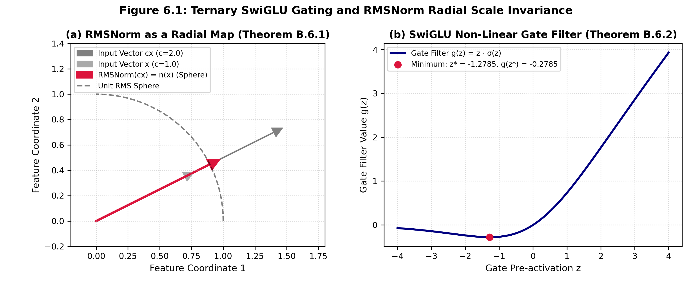
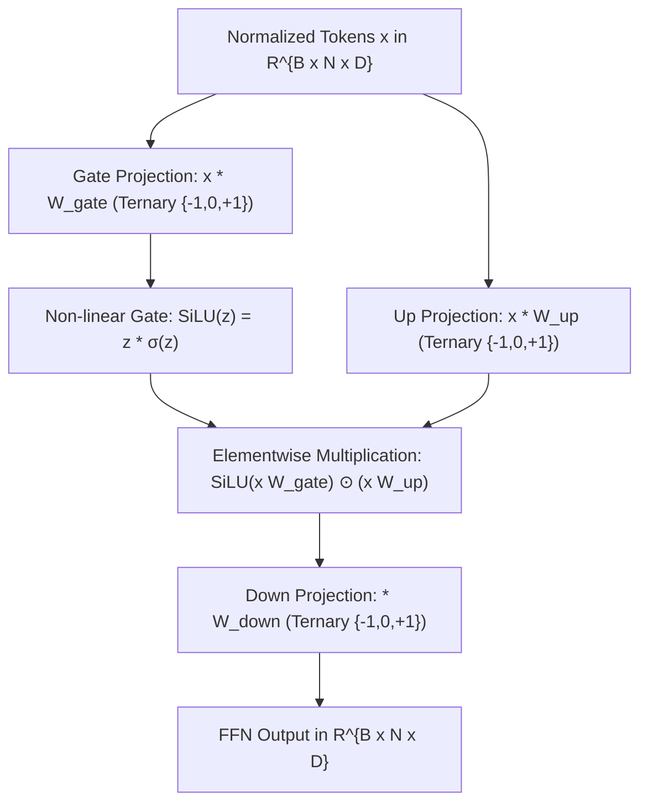

<!-- SPDX-License-Identifier: CC-BY-NC-SA-4.0 -->
# Chapter 6 — Ternary SwiGLU & RMSNorm

A transformer block has two halves. The first, which Chapter 5 built, mixes
information across positions: attention decides which tokens should talk to
which. The second, which this chapter builds, transforms information within a
position: a feed-forward network that maps each token's vector through a
wider hidden space and back. The two are wrapped in normalization layers, and
the four pieces — norm, attention, norm, feed-forward — repeat with a
residual connection around each pair. Chapter 5 gave the mixing half a
metric. This chapter gives the transforming half its shape and its cost, and
it is where the block becomes ternary from end to end.

Two objects are at stake. The normalizer is **RMSNorm**, a radial projection
that divides each activation vector by its root mean square and multiplies by
a learned gain, leaving the direction of the vector untouched and setting its
scale. The transformer is **SwiGLU**, a gated feed-forward whose output is
the elementwise product of a linear projection and a *filtered* copy of
itself. Both are built from Chapter 4's ternary synapses, and both are pinned
against the production SDK. The three theorems make the pieces precise: the
normalizer is scale-invariant (B.6.1), the gate is a bounded, sign-reversing
filter (B.6.2), and the gated block costs exactly what a plain block costs
(B.6.3).

---


*Figure 6.1: RMSNorm Radial Map and Ternary SwiGLU Gating Filter. Panel A: RMSNorm acts as a pure radial projection mapping activation vectors onto a sphere of radius $\sqrt{d}$ while rigorously preserving orientation ($\cos\theta = 1.0$). Panel B: The SiLU gating function $g(z) = z\sigma(z)$ with its non-monotonic minimum at $z \approx -1.28$, demonstrating controlled suppression of negative inputs and linear asymptotic pass-through for positive activations.*

---

## 6.1 Why a normalizer, and why this one

The reason a transformer needs a normalizer at all is the same reason
Chapter 4 needed a variance-preserving initialization: depth multiplies
scales. Each linear layer multiplies the activation variance by roughly
fan-in times weight variance; stack $L$ of them and the signal either decays
like a geometric sequence or blows up, unless something pins the scale at
every layer. A normalization layer is that something. It reads the current
scale off the activations and divides it out, so the next layer sees an input
of a predictable size no matter how the residual stream has drifted.

LayerNorm, the original choice, subtracts the mean of each activation vector
and divides by its standard deviation. RMSNorm keeps the division and drops
the subtraction. The omission is deliberate and it is the whole of the
definition:

$$
\operatorname{RMSNorm}(x) \;=\; \frac{x}{\sqrt{\operatorname{mean}(x^2) +
\varepsilon}}\,\odot\, \text{scale}, \tag{6.1}
$$

where the mean is over the feature axis, $\varepsilon = 10^{-6}$ guards the
zero vector, and $\text{scale} \in \mathbb{R}^{d}$ is a learned per-channel
gain. The claim is that re-centering is redundant here. The residual stream
already carries a running mean — it is a sum of many zero-mean-ish
contributions — so subtracting a fresh per-token mean at every block throws
away a direction the network may be using, and it costs a reduction over the
feature axis to do it. RMSNorm keeps only the second moment, which is the
part that actually controls stability, and the gain restores whatever
freedom the mean removal would have given. The result is cheaper, and — as
the parity test of §6.5 shows — it is exactly what the production system
uses.

## 6.2 Theorem B.6.1: RMSNorm is a radial map

The defining property of Eq. (6.1) is that it acts on the *magnitude* of its
input and leaves the *direction* alone. That statement has a clean exact
form.

Let $m(x) = \operatorname{mean}(x^2) = \frac1d\sum_i x_i^2$ and define the
gain-free normalization

$$
n(x) \;=\; \frac{x}{\sqrt{m(x) + \varepsilon}}, \qquad
\operatorname{RMSNorm}(x) = \text{scale} \odot n(x). \tag{6.2}
$$

> **Theorem B.6.1 (RMSNorm scale law).** *For every $c > 0$:*
> *(i) the normalized vector is a positive multiple of the original,*
> $$
> n(c\,x) \;=\; \rho(c)\, n(x), \qquad
> \rho(c) \;=\; \sqrt{\frac{m + \varepsilon}{m + \varepsilon/c^2}},
> \tag{6.3}
> $$
> *where $m = m(x)$. In particular $n(cx)$ is parallel to $x$ for every $c$,
> and $\rho(1) = 1$.*
> *(ii) The normalized vector has RMS*
> $$
> \operatorname{RMS}\big(n(x)\big) \;=\; \sqrt{\frac{m}{m+\varepsilon}}
> \;\le\; 1, \tag{6.4}
> $$
> *equal to $1$ exactly when $\varepsilon = 0$.*
> *(iii) For $c \ge 1$ the rescaling factor is squeezed into
> $1 \le \rho(c) \le \sqrt{1 + \varepsilon/m}$, so the output magnitude
> changes by a relative amount of at most $\varepsilon/(2m)$. When
> $\varepsilon = 0$, $\rho(c) \equiv 1$ and RMSNorm is exactly
> scale-invariant.*

*Proof.* (i) Since $m(cx) = c^2 m(x)$, we have $n(cx) = cx/\sqrt{c^2 m +
\varepsilon}$. The vector $n(cx)$ is a scalar multiple of $x$, and $n(x)$ is
too, so they are parallel; their (positive) ratio is
$$
\frac{n(cx)}{n(x)} = \frac{c\,x/\sqrt{c^2m+\varepsilon}}{x/\sqrt{m+\varepsilon}}
= \frac{c\sqrt{m+\varepsilon}}{\sqrt{c^2m+\varepsilon}}
= \sqrt{\frac{m+\varepsilon}{m+\varepsilon/c^2}} = \rho(c),
$$
dividing numerator and denominator by $c$ in the last step. At $c = 1$ the
radicand is $1$. (ii) Squaring the definition,
$\operatorname{RMS}(n(x))^2 = \operatorname{mean}(x^2/(m+\varepsilon)) =
m/(m+\varepsilon)$, which is $\le 1$ with equality iff $\varepsilon = 0$.
(iii) For $c \ge 1$, $\varepsilon/c^2 \le \varepsilon$, so the denominator
$m + \varepsilon/c^2 \le m + \varepsilon$ and $\rho(c)^2 = (m+\varepsilon)/
(m+\varepsilon/c^2) \in [1, (m+\varepsilon)/m]$. Taking square roots and using
$\sqrt{1+u} \le 1 + u/2$ for $u \ge 0$ gives
$\rho(c) \le 1 + \varepsilon/(2m)$. With $\varepsilon = 0$ the radicand is
$m/m = 1$ for every $c$. $\blacksquare$

Part (i) is the theorem in one sentence: **RMSNorm moves the point $x$ along
its own ray to the sphere of radius $\operatorname{RMS}$, and never off the
ray.** It is a radial map, and radial maps are scale-free by construction —
up to the $\varepsilon$ that sets a floor on the radius. Part (iii) quantifies
the floor honestly: the deviation from perfect invariance is at most
$\varepsilon/(2m)$, which for $\varepsilon = 10^{-6}$ and typical activations
$m \approx 1$ is a relative change of about $5\times10^{-7}$ — below float32
resolution. The invariance is exact in the limit and essentially exact in
practice, and the theorem says precisely which is which.

**Run this now.** Task 1 (`python3 code/gftac/ch06_tasks.py 1`) takes a
random activation vector, scales it by five factors spanning four orders of
magnitude, and measures the cosine between $n(cx)$ and $n(x)$ and the ratio
$\rho(c)$:

```python
torch.manual_seed(0)
x = torch.randn(1, 8)
eps = 1e-6
m = float(x.pow(2).mean())
n_x = x / math.sqrt(m + eps)
print(f"RMS(n(x)) = {float(n_x.pow(2).mean().sqrt()):.6f}")
for c in (0.01, 0.1, 1.0, 10.0, 100.0):
    n_cx = (c * x) / math.sqrt((c * x).pow(2).mean() + eps)
    cos = float(F.cosine_similarity(n_cx.flatten(), n_x.flatten(), dim=0))
    rho = float(n_cx.norm() / n_x.norm())
    rho_pred = math.sqrt((m + eps) / (m + eps / c ** 2))
    print(f"c = {c:>6.2f}  cos = {cos:.10f}  rho = {rho:.6f}  pred = {rho_pred:.6f}")
```

```text
RMS(n(x)) = 1.000000
c =   0.01  cos = 1.0000001192  rho = 0.996549  pred = 0.996549
c =   0.10  cos = 1.0000000000  rho = 0.999966  pred = 0.999966
c =   1.00  cos = 1.0000001192  rho = 1.000000  pred = 1.000000
c =  10.00  cos = 0.9999998808  rho = 1.000000  pred = 1.000000
c = 100.00  cos = 1.0000000000  rho = 1.000000  pred = 1.000000
```

Read the `cos` column first: it is $1.000000$ to within float32 round-off at
every scale, which is part (i) — the direction of the activation vector is
untouched whether you shrink it by a hundred or grow it by a hundred. The
`rho` column is the magnitude ratio, and it tracks the closed form of
Eq. (6.3) exactly (the `pred` column). At $c = 0.01$ the ratio is $0.9965$,
just shy of one: this is the $\varepsilon$ floor showing through, because
$c^2 m = 1.44\times10^{-4}$ is only two orders above $\varepsilon = 10^{-6}$,
so the guard term has begun to matter. By $c = 0.1$ the ratio is $0.999966$
and by $c \ge 1$ it is $1.000000$ to six decimals. The first row confirms
part (ii): the normalized vector has RMS $1.000000$, its target. This is why
a stack of ternary layers stays stable: whatever scale the residual stream
has drifted to, the next block sees a unit-RMS input, and the only scale left
in the system is the one the gain chooses.

## 6.3 Theorem B.6.2: the SiLU gate

The feed-forward network is where the model does its per-token thinking, and
the modern version of it is *gated*. Where a classic FFN is
$\sigma(xW_1)W_2$ — a projection, a nonlinearity, a projection back — SwiGLU
computes two projections and multiplies them:

$$
\text{SwiGLU}(x) \;=\; \Big(\operatorname{SiLU}(x\,W_{\text{gate}}) \;\odot\;
(x\,W_{\text{up}})\Big)\, W_{\text{down}}, \tag{6.5}
$$

with $\operatorname{SiLU}(z) = z\,\sigma(z)$ and $\sigma$ the logistic
function. The first projection is a *gate*: it is squashed through SiLU and
multiplied elementwise into the second projection, so the gate decides, per
hidden channel, how much of the up-projection survives. The nonlinearity is
the point; the shape of the gate is what makes it a good one.



> **Theorem B.6.2 (SiLU gate suppression).** *Let $g(z) = z\,\sigma(z)$ with
> $\sigma(z) = 1/(1+e^{-z})$. Then*
> *(i) $g(0) = 0$, and for $z > 0$, $\;0 < g(z) < z$, while for $z < 0$,
> $\;z < g(z) < 0$. The gate preserves the sign of its argument and shrinks
> its magnitude.*
> *(ii) $g$ has a unique global minimum at $z^\ast = -1.2784645\ldots$, with
> $g(z^\ast) = -0.2784645\ldots$; hence $g(z) \ge -0.2784646$ for all $z$. The
> gate is bounded.*
> *(iii) $g(z) \to 0$ as $z \to -\infty$, and $g(z)/z \to 1$ as
> $z \to +\infty$: the gate annihilates strongly negative pre-activations and
> passes strongly positive ones.*

*Proof.* (i) Since $0 < \sigma(z) < 1$, we have $g(z) = z\sigma(z)$ with the
same sign as $z$ and magnitude strictly between $0$ and $|z|$. (ii)
Differentiate:
$$
g'(z) = \sigma(z) + z\,\sigma(z)\big(1-\sigma(z)\big)
= \sigma(z)\Big[1 + z\big(1-\sigma(z)\big)\Big].
$$
The prefactor $\sigma > 0$, so $g' = 0$ exactly when $1 + z(1-\sigma(z)) = 0$.
Writing $u = -z$ and using $1 - \sigma(-u) = e^{u}/(1+e^{u})$, the condition
becomes $u\,e^{u}/(1+e^{u}) = 1$, which has the single positive root
$u^\ast = 1.2784645\ldots$; thus $z^\ast = -1.2784645\ldots$. For $z < z^\ast$
the bracket is negative and for $z > z^\ast$ positive, so $z^\ast$ is the
global minimum, and $g(z^\ast) = z^\ast\sigma(z^\ast) = -0.2784645\ldots$.
(iii) As $z\to-\infty$, $\sigma(z)\sim e^{z}$ so $g(z)\sim z e^{z}\to 0$; as
$z\to+\infty$, $\sigma(z)\to 1$ so $g(z)/z = \sigma(z)\to 1$.
$\blacksquare$

The gate is a **soft threshold with a bounded floor**. A strongly negative
pre-activation is driven to zero — the channel is switched off — while a
strongly positive one passes through nearly unchanged, and the transition is
smooth. Unlike ReLU, which has a hard corner at zero and no negative lobe,
SiLU dips to a small negative value just below zero, at $z^\ast = -1.278$,
before rising. That negative lobe is the "gate" in the name: it is a learned,
smooth suppression rather than a rectifier. The measured sparsity is the
suppression made visible.

**Run this now.** Task 2 (`python3 code/gftac/ch06_tasks.py 2`) locates the
minimum and tabulates the gate across the sign change:

```python
z_star, g_min = silu_minimum()
print(f"global minimum at z* = {z_star:.6f},  g(z*) = {g_min:.6f}")
for z in (-4.0, -2.0, -1.2784645, -0.5, 0.0, 0.5, 2.0, 4.0):
    print(f"z = {z:>8.3f}  ->  g(z) = {float(F.silu(torch.tensor(z))):>10.6f}")
```

```text
global minimum at z* = -1.278464,  g(z*) = -0.278465
z =   -4.000  ->  g(z) =  -0.071945
z =   -2.000  ->  g(z) =  -0.238406
z =   -1.278  ->  g(z) =  -0.278465
z =   -0.500  ->  g(z) =  -0.188770
z =    0.000  ->  g(z) =   0.000000
z =    0.500  ->  g(z) =   0.311230
z =    2.000  ->  g(z) =   1.761594
z =    4.000  ->  g(z) =   3.928055
```

The minimum lands at $z^\ast = -1.278464$, $g(z^\ast) = -0.278465$ — the
constants of part (ii) — and the table shows the whole shape: negative and
shrinking for negative $z$, crossing zero at the origin, and approaching the
identity ($g(4) = 3.93$ against $z = 4$) for large positive $z$. The book
computes this minimum in **double precision**, and the reason is worth
recording: in float32 the gate has a flat basin about $4\times10^{-4}$ wide
around $z^\ast$ where the true curvature is smaller than the round-off, so a
float32 arg-min returns an arbitrary point in the basin rather than the
minimum. A single-precision computation would have reported a
$\Delta z$ error of $4\times10^{-4}$ and looked like a bug; the honest fix is
to resolve the flat direction in float64, which the `silu_minimum` helper
does.

**Run this now.** Task 3 (`python3 code/gftac/ch06_tasks.py 3`) measures the
gate statistics on a million standard-normal pre-activations:

```python
torch.manual_seed(1)
z = torch.randn(1_000_000)
g = F.silu(z)
print(f"E[g(z)]         = {float(g.mean()):.6f}")
print(f"E[|g(z)|]       = {float(g.abs().mean()):.6f}")
print(f"P(g(z) < 0)     = {float((g < 0).float().mean()):.6f}")
print(f"P(|g(z)| < 0.1) = {float((g.abs() < 0.1).float().mean()):.6f}")
```

```text
E[g(z)]         = 0.206285
E[|g(z)|]       = 0.399013
P(g(z) < 0)     = 0.500803
P(|g(z)| < 0.1) = 0.161772
```

This is the gate's sparsity profile. Half the channels — $P(g(z)<0) =
0.500803$, which is $\tfrac12$ up to sampling error, and exactly $\tfrac12$ by
the symmetry $g(-z) = -z\sigma(-z) = -z(1-\sigma(z))$ of a symmetric
pre-activation — are pushed negative, into the suppressing lobe. About
$16.2\%$ of channels land within $\pm 0.1$ of zero, effectively switched off.
And the mean gate value is *positive*, $0.206$, despite the negative lobe,
because the positive tail ($g(4)=3.93$) outweighs the bounded negative one
($g \ge -0.278$). The gate is therefore an asymmetric filter: it clamps
negative evidence to a small band while letting positive evidence through
almost linearly. That asymmetry is what the gated architecture buys over a
rectifier, and it is entirely captured by the three statements of B.6.2.

## 6.4 Theorem B.6.3: the 8/3 convention

The gated block has three weight matrices — $W_{\text{gate}}$ and
$W_{\text{up}}$ of shape $d_{\text{ff}} \times d_{\text{model}}$, and
$W_{\text{down}}$ of shape $d_{\text{model}} \times d_{\text{ff}}$ — where
the classic FFN has two. That is fifty percent more weights, which would
normally mean fifty percent more parameters. The convention that keeps the
budget flat is to *narrow* the hidden width to compensate.

> **Theorem B.6.3 (parameter accounting).** *A gated feed-forward with
> $d_{\text{ff}} = \lfloor \tfrac83 d_{\text{model}} \rfloor$ has*
> $$
> N_{\text{SwiGLU}} \;=\; 3\,d_{\text{model}}\,d_{\text{ff}}
> \;\;\le\;\; 8\,d_{\text{model}}^2 \tag{6.6}
> $$
> *weight parameters, with equality when $3 \mid d_{\text{model}}$. This is
> exactly the count of a conventional two-matrix FFN with hidden width
> $4\,d_{\text{model}}$, namely $2\,d_{\text{model}}\cdot 4d_{\text{model}} =
> 8\,d_{\text{model}}^2$. The packed ternary footprint is
> $\lceil N_{\text{SwiGLU}}/5 \rceil$ bytes.*

*Proof.* The three matrices contribute $d_{\text{ff}} d_{\text{model}} +
d_{\text{ff}} d_{\text{model}} + d_{\text{model}} d_{\text{ff}} =
3 d_{\text{model}} d_{\text{ff}}$ weights. Substituting the floored hidden
width, $3 d_{\text{model}} \lfloor \tfrac83 d_{\text{model}}\rfloor \le
3 d_{\text{model}} \cdot \tfrac83 d_{\text{model}} = 8 d_{\text{model}}^2$,
with equality iff $\tfrac83 d_{\text{model}}$ is an integer, i.e. iff $3 \mid
d_{\text{model}}$. The conventional FFN count is $2 d_{\text{model}} \cdot
4 d_{\text{model}} = 8 d_{\text{model}}^2$. The footprint is Chapter 4's
Theorem B.4.3 applied to $N_{\text{SwiGLU}}$ trits. $\blacksquare$

The factor $\tfrac83$ is the whole reason the gated architecture is
affordable. A conventional FFN spends its budget on a hidden width of
$4d_{\text{model}}$; the gated block spends the same budget on three
matrices at width $\tfrac83 d_{\text{model}} \approx 2.67\,d_{\text{model}}$,
trading a wider single layer for a narrower gated one at constant cost. The
floor matters only for model widths not divisible by three, and there it
errs on the side of *fewer* parameters — a free, if minor, saving.

**Run this now.** Task 4 (`python3 code/gftac/ch06_tasks.py 4`) does the
arithmetic for the foundation model's width:

```python
d_model = 64
d_ff = int(8 / 3 * d_model)
n = swiglu_param_count(d_model, d_ff)
print(f"d_model = {d_model}, d_ff = {d_ff}")
print(f"3 * d_model * d_ff      = {n:,}")
print(f"8 * d_model^2 (ideal)   = {8 * d_model ** 2:,}")
print(f"packed ternary footprint = ceil({n:,}/5) = {swiglu_packed_bytes(d_model):,} B")
```

```text
d_model = 64, d_ff = 170
3 * d_model * d_ff      = 32,640
8 * d_model^2 (ideal)   = 32,768
packed ternary footprint = ceil(32,640/5) = 6,528 B
```

For the foundation width $d_{\text{model}} = 64$ the hidden width is
$\lfloor 170.67 \rfloor = 170$, and the gated block carries $32{,}640$
weights against the ideal $32{,}768$ — $128$ fewer, the floor doing its small
work because $64$ is not divisible by three. Packed as trits, the block is
$6{,}528$ bytes, about $6.4$ KiB. Chapter 9 sums this over the stack; here it
is enough to note that the gated feed-forward is not more expensive than the
plain one it replaces, and in the ternary regime it is dramatically cheaper
than either would be in FP32.

## 6.5 Parity with the production SDK

The production SDK's feed-forward is
`geoformer.layers.ffn.TernarySwiGLU`, and its normalizer is
`geoformer.models.block.RMSNorm`. The book's `BookSwiGLU` and `BookRMSNorm`
are required to agree with them exactly, and there is one detail worth
surfacing because it changes the answer.

The SDK's `TernarySwiGLU` builds its three projections from
`QuantizedLinear`, whose **default** is to quantize activations to 8 bits as
well as weights to trits — the same optional integer activation quantization
the SDK applies inside attention. The book's `TernaryLinear` is weight-only,
so a naive comparison would disagree. The chapter resolves this the honest
way: `BookSwiGLU` takes an `act_bits` argument, and
`int_activation_quantize` reproduces the SDK's per-token int quantizer, so
the book can match *both* the SDK's weight-only path (`act_bits=None`, the
book's default) and its actual default path (`act_bits=8`). Both are tested.

**Run this now.** Task 5 (`python3 code/gftac/ch06_tasks.py 5`) checks the
normalizer:

```python
from geoformer.models.block import RMSNorm as SDKRMSNorm

torch.manual_seed(2)
sdk = SDKRMSNorm(16)
book = BookRMSNorm(16)
book.load_state_dict(sdk.state_dict())
x = torch.randn(2, 5, 16)
with torch.no_grad():
    diff = float((book(x) - sdk(x)).abs().max())
print(f"max |book - sdk| = {diff:.3e}")
print(f"bit-exact parity: {diff == 0.0}")
```

```text
max |book - sdk| = 0.000e+00
bit-exact parity: True
```

**Run this now.** Task 6 (`python3 code/gftac/ch06_tasks.py 6`) checks the
feed-forward on both paths:

```python
from geoformer.layers.ffn import TernarySwiGLU as SDKFFN

torch.manual_seed(3)
x = torch.randn(2, 5, 16)
# weight-only path
sdk_wo = SDKFFN(d_model=16, mode="ternary")
for lin in (sdk_wo.w_gate, sdk_wo.w_up, sdk_wo.w_down):
    lin.act_bits = None
book_wo = BookSwiGLU(16, act_bits=None)
book_wo.load_state_dict(sdk_wo.state_dict())
# SDK default (8-bit activation) path
sdk_8 = SDKFFN(d_model=16, mode="ternary")
book_8 = BookSwiGLU(16, act_bits=8)
book_8.load_state_dict(sdk_8.state_dict())
with torch.no_grad():
    d_wo = float((book_wo(x) - sdk_wo(x)).abs().max())
    d_8 = float((book_8(x) - sdk_8(x)).abs().max())
print(f"weight-only (act_bits=None): max |book - sdk| = {d_wo:.3e}")
print(f"SDK default (8-bit activations): max |book - sdk| = {d_8:.3e}")
```

```text
weight-only (act_bits=None): max |book - sdk| = 0.000e+00
SDK default (8-bit activations): max |book - sdk| = 0.000e+00
```

Both paths agree to the last bit. The first is the book's weight-only feed-
forward; the second is the production feed-forward *as it actually runs by
default*, activation quantization and all. The book can therefore claim, with
a test behind it, that its feed-forward is the SDK's feed-forward, and it has
shown the difference the activation quantization makes rather than hiding it
behind a switched-off option. The parity of the normalizer is exact by
inspection — the two implementations are the same three operations — and the
test confirms it.

## 6.6 Build

The build is `code/gftac/ch06_swiglu.py`. `BookRMSNorm` is Eq. (6.1): a
mean-square reduction, a reciprocal square root, and a learned gain, and
nothing else. `int_activation_quantize` is the SDK's per-token symmetric int
quantizer, included so the book can match the production default. `BookSwiGLU`
is Eq. (6.5): three `TernaryLinear` projections, an `F.silu` gate, and an
elementwise product, with an optional `act_bits` that int-quantizes each
projection's input. The helpers `swiglu_param_count`, `swiglu_packed_bytes`,
and `silu_minimum` are the small arithmetic the chapter's claims are stated
in terms of.

The one design decision is the placement of activation quantization in a
`_q` method applied to the *input* of each projection, rather than inside
`TernaryLinear`. That mirrors the SDK exactly — the SDK quantizes inside
`QuantizedLinear`, so each of gate, up, and down sees its own quantized input,
and the gate and up projections see the *same* quantized `x` — while keeping
Chapter 4's `TernaryLinear` a pure weight-only layer. The default
`act_bits=None` means the book's feed-forward is weight-only unless activation
quantization is explicitly requested, which keeps the book's stack
internally consistent and makes the parity claim two-sided.

## 6.7 Verify

The chapter's test file, `tests/test_ch06_swiglu.py`, holds nineteen tests.

Theorem B.6.1 is guarded five ways: a direction-invariance test (the cosine
between $n(cx)$ and $n(x)$ is one to $10^{-6}$ over five scales), a
$\rho$-formula test (the measured ratio matches Eq. (6.3) to $10^{-5}$), a
unit-RMS test (with the exact target $\sqrt{m/(m+\varepsilon)}$), an exact
scale-invariance test with $\varepsilon = 0$, and a gain-inclusive test that
$\operatorname{RMSNorm}(cx) = \rho(c)\operatorname{RMSNorm}(x)$. Theorem
B.6.2 is guarded four ways: the sign bounds $0<g<z$ and $z<g<0$; the minimum
location and value against $z^\ast = -1.2784645$; the two limits; and the gate
statistics ($P(g<0) \approx \tfrac12$, $E[|g|] \approx 0.399$, the
near-zero fraction). Theorem B.6.3 is guarded four ways: the default hidden
width, the parameter formula with the divisibility case, the equality with a
conventional hidden-$4\times$ FFN, and the packed footprint. Parity is four
tests: the activation quantizer against the SDK's, the normalizer, and the
feed-forward on both the weight-only and the SDK-default paths, plus a test
that activation quantization actually changes the output (so the parity is
not trivially satisfied by a no-op). The six runnable tasks are pinned by
`tests/test_ch06_tasks.py`.

## 6.8 Run

The demonstration ledger — the chapter's experiment, one command:

```bash
python3 code/gftac/ch06_swiglu.py
```

```text
Chapter 6 — Ternary SwiGLU & RMSNorm, measured
====================================================================
B.6.1 — RMSNorm is a radial map (direction invariant)
  input RMS        = 1.200429   (mean(x^2) = 1.441030)
  RMS(n(x))        = 1.000000   target sqrt(m/(m+eps)) = 1.000000
         c    cos(n(cx), n(x))        rho(c)   rho(c) pred
      0.01        1.0000001192      0.996549      0.996549
      0.10        1.0000000000      0.999966      0.999966
      1.00        1.0000001192      1.000000      1.000000
     10.00        0.9999998808      1.000000      1.000000
    100.00        1.0000000000      1.000000      1.000000

B.6.2 — the SiLU gate g(z) = z*sigma(z)
  global minimum at z* = -1.278464,  g(z*) = -0.278465
         z        g(z)    0<g<z or z<g<0
    -4.000   -0.071945              True
    -2.000   -0.238406              True
    -1.278   -0.278465              True
    -0.500   -0.188770              True
     0.000    0.000000              True
     0.500    0.311230              True
     2.000    1.761594              True
     4.000    3.928055              True

B.6.2 — gate statistics over z ~ N(0, 1)
  E[g(z)]                = 0.206285
  E[|g(z)|]              = 0.399013
  P(g(z) < 0)            = 0.500803   (exactly 1/2 by symmetry)
  P(|g(z)| < 0.1)        = 0.161772   (gate near-zero fraction)
  bounded below by g_min = -0.278465 (never exceeds this in magnitude below)

B.6.3 — parameter accounting (8/3 convention)
  d_model = 64, d_ff = floor(8/3 * d_model) = 170
  weights = 3 * 64 * 170 = 32,640
  8 * d_model^2 (unfloored) = 32,768   (gated FFN matches a hidden-4x FFN)
  packed ternary footprint = ceil(32,640/5) = 6,528 B

Parity — RMSNorm vs geoformer.models.block.RMSNorm
  max |book - sdk| = 0.000e+00

Parity — TernarySwiGLU, weight-only (act_bits=None)
  max |book - sdk| = 0.000e+00

Parity — TernarySwiGLU, SDK default (8-bit activations)
  max |book - sdk| = 0.000e+00
====================================================================
```

Every number is **MEASURED** on the reference machine and re-derived by the
nineteen tests, with the parity tests additionally running the production SDK
layers. The B.6.1 block is the radial map: cosine one at every scale, the
magnitude ratio tracking its closed form down to the $\varepsilon$ floor at
$c = 0.01$. The B.6.2 blocks are the gate: the minimum located, the sign
bounds all `True`, and the statistics showing a half-negative,
sixteen-percent-near-zero suppression profile with a positive mean. The B.6.3
block is the accounting: three matrices at width $170$ costing what two at
width $256$ would. Then three exact parities, closing the loop with the SDK.

## 6.9 Exercises

1. **RMSNorm against LayerNorm.** LayerNorm subtracts the mean as well as
   dividing by the standard deviation. Show that LayerNorm is also
   scale-invariant, but that its output has *zero* mean while RMSNorm's does
   not. Construct an input whose mean is large compared to its spread and
   compute both outputs; what direction does LayerNorm discard that RMSNorm
   keeps, and why might the residual stream want to keep it?

2. **The $\varepsilon$ floor.** Theorem B.6.1(iii) bounds the relative
   magnitude deviation by $\varepsilon/(2m)$ for $c \ge 1$. Show that for
   $c < 1$ the deviation is *not* bounded this way, and find the input scale
   $c$ at which $\rho(c)$ falls below $0.99$ as a function of $m$ and
   $\varepsilon$. Interpret the result as the scale below which RMSNorm stops
   being scale-free.

3. **The negative lobe.** The SiLU minimum is $-0.2785$, small and bounded.
   Show that the gate's *product* with the up-projection can still be large
   and negative when the up-projection is large, so the effective suppression
   of a channel depends on both factors. Design a pair of pre-activations
   $(z_{\text{gate}}, z_{\text{up}})$ that produce a large-magnitude negative
   hidden value, and explain why the gate alone does not bound the block's
   output.

4. **The floored convention.** For $d_{\text{model}}$ not divisible by three,
   Theorem B.6.3 gives $N_{\text{SwiGLU}} < 8 d_{\text{model}}^2$. Tabulate
   the shortfall for $d_{\text{model}} = 1, \dots, 20$ and report the largest
   relative saving. Is there any $d_{\text{model}}$ for which the gated block
   is *more* expensive than the conventional one, and what would the hidden
   width have to be for that to happen?

5. **Parity under backward.** The parity tests of §6.5 check forward passes.
   Backpropagate the same loss through the SDK's `TernarySwiGLU` and the
   book's `BookSwiGLU` from identical weights, on both the weight-only and
   the 8-bit paths, and confirm the parameter gradients agree. This exercises
   the STE backward of Chapter 4 and the activation-quantization detach
   together, and it is the feed-forward half of the end-to-end equivalence
   Chapter 9 will assemble.
