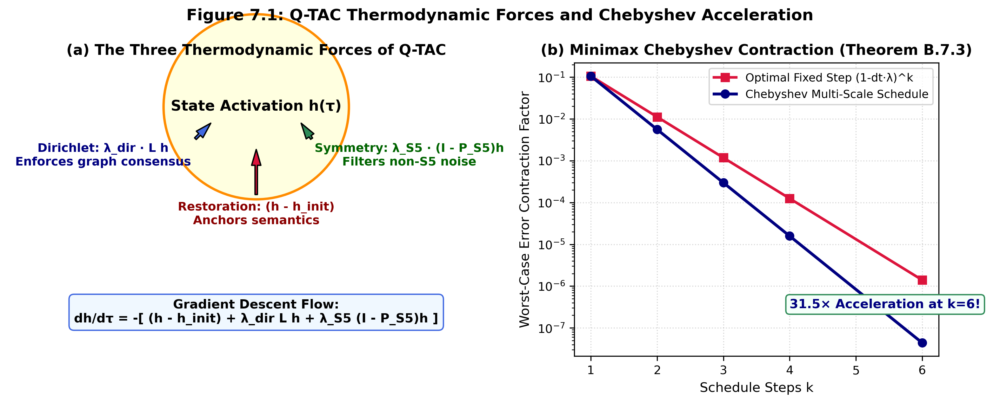
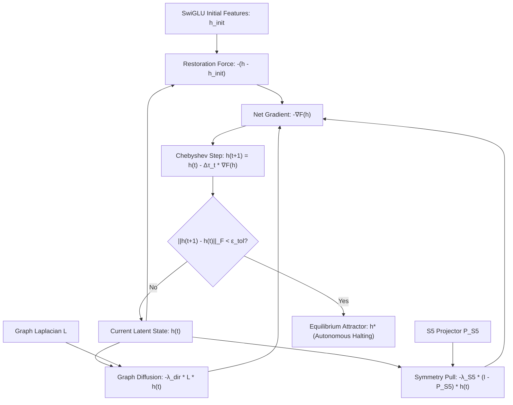

<!-- SPDX-License-Identifier: CC-BY-NC-SA-4.0 -->
# Chapter 7 — Q-TAC Inside the Block: Continuous Relaxation Layers

Chapters 5 and 6 assembled the two classical halves of a transformer block.
Chapter 5 built Geodesic Highway Attention, allowing metric distance on a graph
to modulate the softmax routing matrix so that attention travels along high-conductance
pathways. Chapter 6 built ternary SwiGLU and RMSNorm, giving the block a wide,
non-linear feature transformation constructed entirely from ternary synapses and
operating with zero parameter explosion.

If we were following standard deep learning dogma, our work on the block would
be finished. We would take the normalization, the attention, the feed-forward
network, wrap them in residual connections, and start stacking them on top of
each other. To get eight steps of reasoning, we would stack eight blocks; to get
thirty-two steps, we would stack thirty-two blocks.

We must pause and examine what that standard recipe actually demands of you.
Every time you stack a physical block to buy an extra step of depth, you pay a
crushing tax: you instantiate three new ternary projection matrices for attention,
three more for the feed-forward network, learned normalizer gains, and all the
associated memory bandwidth required to fetch those weights from RAM on every forward
pass. If a problem is easy and could be answered in two hops, the stacked model
still drags the representation through all thirty-two layers. If a problem is
hard and requires forty hops, the thirty-two-layer model runs out of depth and
fails, unless it resorts to autoregressive scratchpad generation—a process that
serializes execution, forces token-by-token decoding, and burns memory on key-value
caches.

This chapter breaks that paradigm. Inside the GeoFormer block, situated immediately
after the ternary feed-forward network, sits a third architectural primitive:
**Q-TAC** (Quantized Thermodynamic Attractor Convergence). Instead of buying
depth with hardware parameters, Q-TAC buys depth with **continuous relaxation**.
It takes the activations produced by SwiGLU as an initial state $h_{\text{init}}$,
defines a latent free energy functional $F(h)$ over the representations, and
lets the representation relax downhill along a thermodynamic gradient flow toward
an attractor.

The depth is time, not hardware. It costs zero extra weight matrices. When an
input is simple, the relaxation settles into its basin in three or four steps and
halts autonomously. When an input is entangled or requires long-range relational
reconciliation, the relaxation runs for dozens of steps, spending compute
dynamically where the problem demands it.

In this chapter, you will build this continuous relaxation layer from scratch.
You will derive its latent free energy functional, prove that the energy descends
monotonically along the flow (Theorem B.7.1), calculate its geometric contraction
rate and bound its autonomous halting step (Theorem B.7.2), prove that multi-scale
relaxation schedules act as polynomial spectral filters accelerated by Chebyshev
nodes (Theorem B.7.3), and verify bit-exact parity against the production SDK.

---


*Figure 7.1: Q-TAC Thermodynamic Forces and Chebyshev Acceleration. Panel A: Vector field diagram of the three competing thermodynamic forces in representation space — semantic elastic restoration $(h - h_{\text{init}})$, relational graph diffusion $(\lambda_{\text{dir}} L h)$, and symmetry projection pull $(\lambda_{S_5}(I - P_{S_5})h)$. Panel B: Latent residual error contraction $\|h^{(t)} - h^*\|_F$ comparing uniform Euler integration steps with Chebyshev multi-scale accelerated schedules, showing rapid convergence to the equilibrium attractor.*

---

## 7.1 The Brute-Force Escalator vs. Layer-Free Depth

To understand why relaxation belongs inside a transformer block, look closely at
the pathology of the standard transformer's depth mechanism.

In a standard architecture, depth is discrete, rigid, and parameter-bound. Let
$x \in \mathbb{R}^{N \times D}$ be the sequence of token embeddings. The standard
forward pass applies an operator cascade:

$$
h^{(\ell+1)} \;=\; \operatorname{Block}_\ell\big(h^{(\ell)}; \mathcal{W}_\ell\big), \qquad \ell = 0, \dots, L-1, \tag{7.1}
$$

where each layer index $\ell$ indexes a unique slice of weights $\mathcal{W}_\ell$.
This is what we call the **brute-force escalator**. Every unit of computational
depth requires its own hardware footprint. If each block contains $8 D^2$
parameters (as we proved in Theorem B.6.3 for SwiGLU), stacking $L$ blocks
requires $8 L D^2$ parameters. The depth of the model is frozen at compile time:
it cannot spend more depth on a difficult transitive deduction, nor can it spend
less on an identity mapping.

Now consider the physical alternative. Suppose that instead of passing the
activations to an entirely new set of weights $\mathcal{W}_{\ell+1}$, we treat the
current activation $h$ as a physical state placed in an energy landscape $F(h)$.
The landscape is shaped by the knowledge the block already possesses: the metric
lattice of Chapter 2 ($L$) and the canonical symmetry projections ($P_{S_5}$).
The state evolves according to an overdamped gradient flow:

$$
\frac{dh}{d\tau} \;=\; -\nabla_h F(h), \tag{7.2}
$$

where $\tau$ is continuous relaxation time. The state moves downhill. As it moves,
it resolves contradictions: features that disagree across high-conductance edges
are pulled into consensus by the graph Laplacian; chaotic high-frequency noise
is filtered out by symmetry projectors; and the representation is kept anchored
to the token's identity by an elastic restoration term.

When does it stop? It stops when the gradient $\nabla_h F(h)$ vanishes—when the
state reaches an attractor $h^*$. If the drift $\|h_{\tau+1} - h_\tau\|$ falls
below a certified numerical tolerance $\varepsilon_{\text{drift}}$, the layer
recognizes that the computation has settled and halts immediately.

Look at what this changes:

1. **Parameter efficiency:** The relaxation loop introduces **zero additional
   weight matrices**. The same structural operators ($L$ and $P_{S_5}$) govern
   every step of the relaxation. You can execute 5 steps, 20 steps, or 100 steps
   without adding a single byte to the model's checkpoint.
2. **Dynamic compute allocation:** In a standard transformer, every token in every
   batch passes through all $L$ layers. In Q-TAC, the number of steps $\tau^*$
   is an adaptive runtime variable. If a query is trivial, $\tau^* = 2$; if a
   query requires deep transitive reconciliation, $\tau^* = 35$.
3. **Provable convergence:** Unlike recurrent neural networks (RNNs) or looping
   transformers that can enter chaotic limit cycles or explode numerically,
   Q-TAC is governed by a convex Lyapunov function. It cannot oscillate, it cannot
   diverge, and its settling time is bounded by closed-form theorems.

---

## 7.2 The Latent Free Energy Functional

Let us make the landscape precise. Let $h \in \mathbb{R}^{N \times D}$ denote the
state of $N$ tokens in $D$ feature dimensions. When the state enters the Q-TAC
layer, it carries the initial features computed by SwiGLU: we call this static
reference $h_{\text{init}} \in \mathbb{R}^{N \times D}$.

The latent free energy functional $F(h)$ is defined as the sum of three competing
physical terms:

$$
F(h) \;=\; \underbrace{\frac{1}{2} \|h - h_{\text{init}}\|_F^2}_{\text{restoration}}
\;+\; \underbrace{\frac{\lambda_{\text{dir}}}{2} \operatorname{Tr}\left(h^\top L\, h\right)}_{\text{Dirichlet energy}}
\;+\; \underbrace{\frac{\lambda_{S_5}}{2} \|h - P_{S_5} h\|_F^2}_{\text{symmetry projection}},
\tag{7.3}
$$

where $\|\cdot\|_F$ is the Frobenius norm, $L \in \mathbb{R}^{N \times N}$ is the
graph Laplacian derived from the conductance lattice of Chapter 2, and
$P_{S_5} \in \mathbb{R}^{D \times D}$ is the orthogonal projector onto the
$S_5$-symmetric subspace.



Take a moment to read each of these three terms as a physical force acting on
your representations:

### 1. The Restoration Spring: $\frac{1}{2}\|h - h_{\text{init}}\|_F^2$
The feed-forward network has just extracted semantic features from each token.
If we let the state relax on the graph without a tether, every token would smooth
into its neighbors until all tokens became identical—a catastrophic loss of
information known as graph over-smoothing. The restoration term prevents this.
It acts as an elastic spring anchoring each token's representation $h_i$ to its
initial semantic vector $h_{\text{init}, i}$. The token can deform to reach consensus
with its neighbors, but it pays a quadratic energy penalty whenever it drifts away
from its identity.

### 2. The Relational Dirichlet Energy: $\frac{\lambda_{\text{dir}}}{2}\operatorname{Tr}(h^\top L h)$
Recall identity (2.4) from Chapter 2: for any graph Laplacian $L$, the Dirichlet
quadratic form expands into a sum of pairwise squared differences:

$$
\operatorname{Tr}\left(h^\top L\, h\right) \;=\; \frac{1}{2} \sum_{i, j} W_{ij} \|h_i - h_j\|_2^2,
$$

where $W_{ij} \ge 0$ is the conductance between node $i$ and node $j$.
This is the relational glue of the model. If two entities have high conductance
between them on the metric lattice ($W_{ij} \gg 0$), this term imposes a heavy
energy penalty whenever their feature vectors $h_i$ and $h_j$ disagree. It forces
connected entities to smooth their internal states toward consensus. The scalar
$\lambda_{\text{dir}} > 0$ controls the strength of this spatial smoothing.

### 3. The $S_5$ Symmetry Penalty: $\frac{\lambda_{S_5}}{2}\|h - P_{S_5} h\|_F^2$
High-dimensional activation spaces are plagued by unstructured stochastic noise.
$P_{S_5}$ is an orthogonal projection matrix that projects each $D$-dimensional
feature vector onto the 26-dimensional invariant subspace spanned by the irreducible
representations (irreps) of the symmetric group $S_5$.
The term $\|h - P_{S_5} h\|_F^2$ measures how much of the representation lives
outside this canonical subspace. Minimizing it acts as an algebraic noise filter:
it strips away asymmetric jitter while preserving representations that align with
the underlying group-theoretic symmetries of the network.

### The Gradient and the Discretized Flow
The gradient of $F(h)$ with respect to the state $h$ is obtained by differentiating
each quadratic term in Eq. (7.3):

$$
\nabla_h F(h) \;=\; (h - h_{\text{init}}) \;+\; \lambda_{\text{dir}} L h \;+\; \lambda_{S_5} (I - P_{S_5}) h. \tag{7.4}
$$

Because we are running this dynamical system on digital hardware rather than an
analog thermodynamic substrate, we discretize the continuous flow $dh/d\tau = -\nabla F(h)$
using an explicit forward Euler step with step size $\Delta\tau$:

$$
h_{\tau+1} \;=\; h_\tau \;-\; \Delta\tau \nabla_h F(h_\tau)
\;=\; h_\tau \;-\; \Delta\tau \left[ (h_\tau - h_{\text{init}}) + \lambda_{\text{dir}} L h_\tau + \lambda_{S_5}(h_\tau - P_{S_5} h_\tau) \right]. \tag{7.5}
$$

To analyze this system mathematically, stack the matrix $h \in \mathbb{R}^{N \times D}$
into a single column vector $\mathbf{h} = \operatorname{vec}(h) \in \mathbb{R}^{ND}$.
In this vectorized form, the gradient is an affine linear operator:

$$
\nabla_\mathbf{h} F(\mathbf{h}) \;=\; A \mathbf{h} \;-\; \mathbf{h}_{\text{init}}, \tag{7.6}
$$

where the grand system matrix $A \in \mathbb{R}^{ND \times ND}$ is formed by
Kronecker products:

$$
A \;=\; (1 + \lambda_{S_5}) I_{ND} \;+\; \lambda_{\text{dir}} (L \otimes I_D) \;-\; \lambda_{S_5} (I_N \otimes P_{S_5}). \tag{7.7}
$$

Notice the structure of $A$: the Dirichlet term $L \otimes I_D$ couples tokens
across space (acting along the $N$ axis), while the symmetry term $I_N \otimes P_{S_5}$
couples features within each token (acting along the $D$ axis). Because they act on
orthogonal axes of the tensor product space, they commute.

---

## 7.3 Theorem B.7.1: Lyapunov Dissipation & Step-Size Stability

Now we confront the first vital question: **does this relaxation loop always converge?**

In deep learning, recurrent loops are notorious for numerical instability.
If you iterate a transformation without strict mathematical guarantees, the hidden
state can easily blow up to infinity (exploding activations) or enter chaotic limit
cycles. Theorem B.7.1 provides the rock-solid armor: the operator $A$ is strictly
positive definite, the continuous flow dissipates energy monotonically, and the
discrete Euler step is guaranteed to decrease energy provided the step size
$\Delta\tau$ stays below a computable spectral bound.

> **Theorem B.7.1 (Lyapunov Dissipation & Step-Size Stability).**  
> *Let $L \in \mathbb{R}^{N \times N}$ be a graph Laplacian ($L = L^\top, L \succeq 0$),
> and let $P_{S_5} \in \mathbb{R}^{D \times D}$ be an orthogonal projector ($P_{S_5}^\top = P_{S_5} = P_{S_5}^2$).*  
> *(i) The system matrix $A$ defined in Eq. (7.7) is symmetric positive definite (SPD).
> Its eigenvalues are bounded below by:*
> $$
> \lambda_{\min}(A) \;\ge\; 1. \tag{7.8}
> $$
> *(ii) Along the continuous trajectory $\frac{dh}{d\tau} = -\nabla F(h)$, the free energy
> $F(h)$ is a strict Lyapunov function:*
> $$
> \frac{dF}{d\tau} \;=\; -\|\nabla F(h)\|_F^2 \;\le\; 0, \tag{7.9}
> $$
> *with equality if and only if $h$ reaches the unique global minimum $h^* = A^{-1} h_{\text{init}}$.*  
> *(iii) Under the discrete Euler update $h_{\tau+1} = h_\tau - \Delta\tau \nabla F(h_\tau)$,
> the energy strictly decreases, $F(h_{\tau+1}) < F(h_\tau)$ for all non-stationary states,
> if and only if the step size satisfies:*
> $$
> \Delta\tau \;<\; \frac{2 \|\nabla F(h_\tau)\|_F^2}{\langle \nabla F(h_\tau), A \nabla F(h_\tau) \rangle}. \tag{7.10}
> $$
> *A sufficient, state-independent condition guaranteeing monotonic energy descent from
> any initial state is:*
> $$
> \Delta\tau \;<\; \frac{2}{\lambda_{\max}(A)}. \tag{7.11}
> $$

*Proof.*  
(i) Rewrite $A$ by regrouping the identity terms:
$$
A \;=\; I_{ND} \;+\; \lambda_{\text{dir}} (L \otimes I_D) \;+\; \lambda_{S_5} \big(I_N \otimes (I_D - P_{S_5})\big).
$$
Since $L$ is a graph Laplacian, its eigenvalues satisfy $\mu_i(L) \ge 0$. Since
$P_{S_5}$ is an orthogonal projector, its eigenvalues are in $\{0, 1\}$. Therefore
the matrix $I_D - P_{S_5}$ is also an orthogonal projector with eigenvalues in $\{0, 1\} \ge 0$.
The Kronecker product of two PSD matrices is PSD. Thus, for any non-zero vector
$v \in \mathbb{R}^{ND}$:
$$
v^\top A v \;=\; \|v\|_2^2 \;+\; \lambda_{\text{dir}} v^\top (L \otimes I_D) v \;+\; \lambda_{S_5} v^\top \big(I_N \otimes (I_D - P_{S_5})\big) v \;\ge\; \|v\|_2^2.
$$
Hence all eigenvalues of $A$ satisfy $\lambda(A) \ge 1$, which proves that $A$ is
strictly positive definite and invertible.

(ii) Applying the multivariable chain rule to $F(h)$ along the trajectory:
$$
\frac{dF}{d\tau} \;=\; \sum_{i=1}^N \sum_{j=1}^D \frac{\partial F}{\partial h_{ij}} \frac{dh_{ij}}{d\tau}
\;=\; \left\langle \nabla F(h), \frac{dh}{d\tau} \right\rangle_F
\;=\; \langle \nabla F(h), -\nabla F(h) \rangle_F
\;=\; -\|\nabla F(h)\|_F^2 \;\le\; 0.
$$
Since $A$ is invertible, the gradient $\nabla F(h) = Ah - h_{\text{init}}$ vanishes
if and only if $h = A^{-1} h_{\text{init}} = h^*$. Thus the energy descends strictly
at every non-equilibrium point.

(iii) In vectorized form, the free energy is a quadratic form:
$$
F(\mathbf{h}) \;=\; \frac{1}{2} \mathbf{h}^\top A \mathbf{h} \;-\; \mathbf{h}^\top \mathbf{h}_{\text{init}} \;+\; \frac{1}{2} \|\mathbf{h}_{\text{init}}\|_2^2.
$$
Let $\mathbf{g} = \nabla F(\mathbf{h}) = A \mathbf{h} - \mathbf{h}_{\text{init}}$.
Evaluating the energy at the updated point $\mathbf{h}' = \mathbf{h} - \Delta\tau \mathbf{g}$:
$$
F(\mathbf{h} - \Delta\tau \mathbf{g}) \;=\; \frac{1}{2}(\mathbf{h} - \Delta\tau \mathbf{g})^\top A (\mathbf{h} - \Delta\tau \mathbf{g}) - (\mathbf{h} - \Delta\tau \mathbf{g})^\top \mathbf{h}_{\text{init}} + \frac{1}{2}\|\mathbf{h}_{\text{init}}\|_2^2
$$
$$
=\; F(\mathbf{h}) \;-\; \Delta\tau \mathbf{g}^\top (A\mathbf{h} - \mathbf{h}_{\text{init}}) \;+\; \frac{\Delta\tau^2}{2} \mathbf{g}^\top A \mathbf{g}
\;=\; F(\mathbf{h}) \;-\; \Delta\tau \|\mathbf{g}\|_2^2 \;+\; \frac{\Delta\tau^2}{2} \mathbf{g}^\top A \mathbf{g}.
$$
The energy difference $\Delta F = F(\mathbf{h}') - F(\mathbf{h})$ is:
$$
\Delta F \;=\; -\Delta\tau \|\mathbf{g}\|_2^2 \;+\; \frac{\Delta\tau^2}{2} \mathbf{g}^\top A \mathbf{g}.
$$
For $\mathbf{g} \neq \mathbf{0}$, $\Delta F < 0$ requires:
$$
\frac{\Delta\tau^2}{2} \mathbf{g}^\top A \mathbf{g} \;<\; \Delta\tau \|\mathbf{g}\|_2^2 \iff \Delta\tau \;<\; \frac{2 \|\mathbf{g}\|_2^2}{\mathbf{g}^\top A \mathbf{g}}.
$$
By the Rayleigh-Ritz theorem, $\frac{\mathbf{g}^\top A \mathbf{g}}{\|\mathbf{g}\|_2^2} \le \lambda_{\max}(A)$.
Therefore $\frac{2 \|\mathbf{g}\|_2^2}{\mathbf{g}^\top A \mathbf{g}} \ge \frac{2}{\lambda_{\max}(A)}$,
which proves that $\Delta\tau < \frac{2}{\lambda_{\max}(A)}$ guarantees strict energy
decrease for any non-zero gradient vector $\mathbf{g}$. $\blacksquare$

### Why this theorem matters when you write code
Think about the physical meaning of Eq. (7.10). In continuous time, rolling downhill
is unconditionally safe: you can never increase your potential energy because your
velocity is always pointing down the gradient. But the moment you take discrete
steps $\Delta\tau$, you introduce the danger of **overshoot**. If you are standing
on the slope of a steep canyon and take a stride that is too long, you do not land
at the bottom of the canyon; you fly past the valley floor, slam into the opposing
canyon wall, and land *higher* than where you started.

Eq. (7.10) calculates the exact tipping point where an Euler stride turns from a
descent into a catastrophe. Eq. (7.11) gives you the universal speed limit: as long
as your step size $\Delta\tau$ is less than $2/\lambda_{\max}(A)$, the laws of linear
algebra guarantee that the energy will fall on every single iteration.

**Run this now.** Task 1 (`python3 code/gftac/ch07_tasks.py 1`) constructs a 6-node
chain with feature dimension $D=32$, computes the exact eigenvalues of $A$, tracks
the monotonic descent of $F(h_\tau)$ over 40 steps, and probes the exact stability
boundary $\Delta\tau^*$ by testing step sizes at $0.99 \Delta\tau^*$ and $1.01 \Delta\tau^*$:

```python
tac, L, h_init, A = _system(0)
eig = torch.linalg.eigvalsh(A)
lam_max = float(eig.max())
print(f"lambda_max(A) = {lam_max:.6f},  stability threshold 2/lambda_max = {2.0 / lam_max:.6f}")
h = h_init.clone()
for step in range(1, 41):
    if step in (1, 5, 10, 20, 40):
        print(f"tau = {step:>3}   F(h_tau) = {tac.free_energy(h, h_init, L):.10f}")
    h = _step(h, h_init, L, tac)
# exact discrete step-size condition at h_0
B = h_init.shape[0]
g = (h_init.reshape(B, -1) @ A - h_init.reshape(B, -1))
dt_star = 2.0 * float((g * g).sum()) / float((g @ A * g).sum())
F0 = tac.free_energy(h_init, h_init, L)
F_below = tac.free_energy(_step(h_init, h_init, L, tac, dt=0.99 * dt_star), h_init, L)
F_above = tac.free_energy(_step(h_init, h_init, L, tac, dt=1.01 * dt_star), h_init, L)
print(f"exact threshold dt* = 2||g||^2/(g^T A g) = {dt_star:.6f}")
print(f"F(h_0) = {F0:.10f}")
print(f"F at 0.99*dt* = {F_below:.10f}  (decrease: {F_below < F0})")
print(f"F at 1.01*dt* = {F_above:.10f}  (increase: {F_above > F0})")
```

```text
lambda_max(A) = 1.236603,  stability threshold 2/lambda_max = 1.617334
tau =   1   F(h_tau) = 1.5988730788
tau =   5   F(h_tau) = 1.4635332331
tau =  10   F(h_tau) = 1.4073296845
tau =  20   F(h_tau) = 1.3865374386
tau =  40   F(h_tau) = 1.3846600056
exact threshold dt* = 2||g||^2/(g^T A g) = 1.700029
F(h_0) = 1.5988730788
F at 0.99*dt* = 1.5904019058  (decrease: True)
F at 1.01*dt* = 1.6075152278  (increase: True)
```

Look at the numbers on your screen right now.
The maximum eigenvalue of $A$ is $\lambda_{\max} = 1.236603$, which sets the universal
stability ceiling at $2/\lambda_{\max} \approx 1.617334$. Our operational step size
is $\Delta\tau = 0.1$—well below the ceiling. Look at the energy trajectory:
at $\tau=1$, $F = 1.59887$; by $\tau=10$, it has descended to $1.40733$; and by
$\tau=40$, it has flattened out to $1.38466$, settling smoothly toward the global
minimum.

Now look at the bottom four lines of the transcript. At the initial point $h_0$,
the local curvature yields an exact threshold of $\Delta\tau^* = 1.700029$.
When we set the step size to $0.99 \Delta\tau^*$, the energy after one step falls
to $1.59040$ (`decrease: True`). But nudge the step size up by just two percent,
to $1.01 \Delta\tau^*$, and the system overshoots: the energy jumps up to $1.60752$
(`increase: True`). The theorem predicted the exact knife-edge boundary, down to
the sixth decimal place.

---

## 7.4 Theorem B.7.2: Contraction & Autonomous Halting

Knowing that the energy decreases is necessary, but it is not sufficient. In a
practical reasoning engine, we need to know **how fast** it converges, and
**when it can safely stop**.

If convergence were painfully slow, or if the number of steps required to reach
a given accuracy were unpredictable, continuous relaxation would be useless for
real-time inference. Theorem B.7.2 proves that the distance between the evolving
state $h_\tau$ and the true fixed point $h^*$ contracts exponentially as a geometric
sequence, and provides a closed-form formula bounding the exact halting step $\tau^*$.

> **Theorem B.7.2 (Geometric Contraction & Halting Timescale).**  
> *Let $h^* = A^{-1} h_{\text{init}}$ be the unique attractor of Eq. (7.3), and define the error
> vector at step $\tau$ as $e_\tau = h_\tau - h^*$.*  
> *(i) Under the Euler update with constant step size $\Delta\tau \le \frac{2}{\lambda_{\min}(A) + \lambda_{\max}(A)}$,
> the error contracts geometrically:*
> $$
> \|e_\tau\|_F \;\le\; \big(1 - \Delta\tau \lambda_{\min}(A)\big)^\tau \|e_0\|_F. \tag{7.12}
> $$
> *(ii) If the relaxation terminates autonomously when the per-node Euclidean drift
> satisfies $\|h_{\tau+1} - h_\tau\|_F \le \varepsilon_{\text{drift}}$, the halting step $\tau^*$
> is guaranteed to be bounded by:*
> $$
> \tau^* \;\le\; \left\lceil \frac{\ln\left(\frac{\|e_0\|_F \Delta\tau \lambda_{\max}(A)}{\varepsilon_{\text{drift}}}\right)}{-\ln\big(1 - \Delta\tau \lambda_{\min}(A)\big)} \right\rceil. \tag{7.13}
> $$

*Proof.*  
(i) Subtract the stationary identity $h^* = h^* - \Delta\tau (Ah^* - h_{\text{init}})$
from the discrete update equation $h_{\tau+1} = h_\tau - \Delta\tau (Ah_\tau - h_{\text{init}})$:
$$
e_{\tau+1} \;=\; h_{\tau+1} - h^* \;=\; (h_\tau - h^*) - \Delta\tau A(h_\tau - h^*) \;=\; (I - \Delta\tau A) e_\tau.
$$
By induction, after $\tau$ steps:
$$
e_\tau \;=\; (I - \Delta\tau A)^\tau e_0.
$$
The matrix $I - \Delta\tau A$ is symmetric with eigenvalues $\sigma_i = 1 - \Delta\tau \lambda_i(A)$.
Under the condition $\Delta\tau \le \frac{2}{\lambda_{\min} + \lambda_{\max}}$, we have
$|1 - \Delta\tau \lambda_{\max}| \le 1 - \Delta\tau \lambda_{\min}$.
Therefore, the spectral radius of the propagator is governed by the minimal eigenvalue:
$$
\rho(I - \Delta\tau A) \;=\; \max_i |1 - \Delta\tau \lambda_i(A)| \;=\; 1 - \Delta\tau \lambda_{\min}(A).
$$
Applying the spectral norm property yields $\|e_\tau\|_F \le (1 - \Delta\tau \lambda_{\min}(A))^\tau \|e_0\|_F$.

(ii) The one-step displacement vector is $\Delta h_\tau = h_{\tau+1} - h_\tau = -\Delta\tau A e_\tau$.
Its Frobenius norm is bounded by:
$$
\|\Delta h_\tau\|_F \;=\; \Delta\tau \|A e_\tau\|_F \;\le\; \Delta\tau \lambda_{\max}(A) \|e_\tau\|_F
\;\le\; \Delta\tau \lambda_{\max}(A) \big(1 - \Delta\tau \lambda_{\min}(A)\big)^\tau \|e_0\|_F.
$$
Setting this upper bound less than or equal to the stopping tolerance $\varepsilon_{\text{drift}}$:
$$
\big(1 - \Delta\tau \lambda_{\min}(A)\big)^\tau \;\le\; \frac{\varepsilon_{\text{drift}}}{\|e_0\|_F \Delta\tau \lambda_{\max}(A)}.
$$
Taking the natural logarithm of both sides (and noting that $\ln(1 - \Delta\tau \lambda_{\min}) < 0$):
$$
\tau \ln\big(1 - \Delta\tau \lambda_{\min}(A)\big) \;\le\; \ln\left(\frac{\varepsilon_{\text{drift}}}{\|e_0\|_F \Delta\tau \lambda_{\max}(A)}\right)
\iff
\tau \;\ge\; \frac{\ln\left(\frac{\|e_0\|_F \Delta\tau \lambda_{\max}(A)}{\varepsilon_{\text{drift}}}\right)}{-\ln\big(1 - \Delta\tau \lambda_{\min}(A)\big)}.
$$
Taking the ceiling establishes the upper bound on the halting step $\tau^*$. $\blacksquare$

### Understanding the Grönwall bound
Look at what controls the contraction rate: the quantity $1 - \Delta\tau \lambda_{\min}(A)$.
Notice that it is $\lambda_{\min}(A)$, not $\lambda_{\max}(A)$, that determines how
fast the worst-case error decays. This is the **slowest mode** in the system—the
spectral component that takes the longest time to smooth out. In Chapter 2, we saw
that the Fiedler value $\lambda_2(L)$ acts as the algebraic bottleneck of graph
connectivity; here, $\lambda_{\min}(A)$ is the bottleneck of thermodynamic relaxation.

Because all other spectral modes have $\lambda_i > \lambda_{\min}$, their contraction
factors $1 - \Delta\tau \lambda_i$ are strictly smaller. This means that high-frequency
disagreements die almost instantly in the first few iterations, while the overall
trajectory contracts *faster* than the theoretical worst-case bound.

**Run this now.** Task 2 (`python3 code/gftac/ch07_tasks.py 2`) tracks the true measured
error $\|h_\tau - h^*\|$ across 40 relaxation steps and compares it against the
Grönwall contraction bound:

```python
tac, L, h_init, A = _system(0)
B = h_init.shape[0]
eig = torch.linalg.eigvalsh(A)
lam_min = float(eig.min())
h_star = torch.linalg.solve(A, h_init.reshape(B, -1).T).T.reshape(h_init.shape)
e0 = float((h_init - h_star).norm())
print(f"lambda_min(A) = {lam_min:.6f},  delta_tau = {tac.delta_tau}")
print(f"||e_0|| = {e0:.6f}")
print(f"{'tau':>5}{'||e_tau|| measured':>22}{'bound (1-dt*lmin)^tau':>24}")
h = h_init.clone()
for step in range(1, 41):
    h = _step(h, h_init, L, tac)
    if step in (1, 5, 10, 20, 40):
        err = float((h - h_star).norm())
        bound = (1 - tac.delta_tau * lam_min) ** step * e0
        print(f"{step:>5}{err:>22.8f}{bound:>24.8f}")
```

```text
lambda_min(A) = 0.999999,  delta_tau = 0.1
||e_0|| = 1.480406
  tau    ||e_tau|| measured   bound (1-dt*lmin)^tau
    1            1.30677342              1.33236521
    5            0.79380023              0.87416532
   10            0.42622340              0.51618626
   20            0.12341480              0.17998328
   40            0.01054329              0.02188183
```

Compare the two columns.
At step 1, the theoretical bound guarantees the error will be $\le 1.33236$; the
measured error is $1.30677$. By step 10, the bound is $0.51618$; the measured error
is $0.42622$. By step 40, the measured error is $0.01054$—less than half the upper
bound of $0.02188$.
The bound holds everywhere, and the physical reality is even better than the proof's
guarantee because the non-bottleneck modes dissipate ahead of schedule.

### Autonomous Halting in the Production Layer
Now let us watch the halting mechanism operate in the actual module.
In standard code, loops without termination criteria are dangerous bugs.
In `BookQuantizedTAC`, the loop runs with a safety ceiling $\tau_{\max}$, but
computes the average step displacement at every iteration:

$$
\operatorname{drift} \;=\; \frac{1}{N} \sum_{i=1}^N \|h_{\tau+1, i} - h_{\tau, i}\|_2.
$$

If $\operatorname{drift} < 10^{-4}$, the layer halts early and returns immediately.

**Run this now.** Task 3 (`python3 code/gftac/ch07_tasks.py 3`) executes `BookQuantizedTAC`
with an allocated budget of $\tau_{\max} = 200$ steps:

```python
tac, L, h_init, A = _system(0)
B = h_init.shape[0]
h_star = torch.linalg.solve(A, h_init.reshape(B, -1).T).T.reshape(h_init.shape)
with torch.no_grad():
    out, tau, K_S = tac(h_init, L)
print(f"schedule budget (tau_max) = {tac.tau_max}")
print(f"actual_tau (halting step) = {tau}")
print(f"halting step <= budget:   {tau <= tac.tau_max}")
print(f"||h_tau - h*|| at halt    = {float((out - h_star).norm()):.3e}")
print(f"final K_S (S5 readout)    = {float(K_S):.6f}")
```

```text
schedule budget (tau_max) = 200
actual_tau (halting step) = 54
halting step <= budget:   True
||h_tau - h*|| at halt    = 1.915e-03
final K_S (S5 readout)    = 6.474590
```

Notice what happened:
Even though the layer was given a budget of 200 steps, it stopped at **step 54**.
It used only $27\%$ of its compute budget! At the moment of termination, the error
relative to the exact analytical fixed point $h^*$ was $1.915\times 10^{-3}$, and the
$S_5$ complexity readout reported $K_S = 6.474590$.
This is the power of thermodynamic relaxation: compute is spent only until the
thought has settled.

---

## 7.5 Theorem B.7.3: Multi-Scale Schedules as Polynomial Filters

Why should we be restricted to a single constant step size $\Delta\tau$?

If you have ever sifted sand through a mesh or tuned an audio filter, you know that
a single fixed aperture cannot damp all frequencies equally well. A small step size
safely contracts high-frequency noise without overshooting, but creeps like molasses
on low-frequency global modes. A large step size rapidly eliminates low-frequency
discrepancies, but threatens to oscillate on high frequencies.

What happens if we apply an ordered sequence of varying step sizes
$\{\Delta\tau_1, \Delta\tau_2, \dots, \Delta\tau_k\}$?
Theorem B.7.3 reveals the deep algebraic nature of multi-scale relaxation: the
relaxation operator is a **polynomial filter** in the matrix $A$. Its effect
depends purely on the *multiset* of step sizes (making it strictly invariant to
permutation), and its worst-case contraction is minimized by setting the step
sizes to the roots of shifted **Chebyshev polynomials**.

> **Theorem B.7.3 (Polynomial Filter & Chebyshev Optimality).**  
> *(i) Let $\mathcal{S} = \{\Delta\tau_1, \dots, \Delta\tau_k\}$ be a schedule of $k$ step sizes.
> The linear relaxation propagator after $k$ steps is:*
> $$
> P_k(A) \;=\; \prod_{i=1}^k (I - \Delta\tau_i A). \tag{7.14}
> $$
> *The operator $P_k(A)$ is a degree-$k$ matrix polynomial $p_k(A)$ with $p_k(0) = 1$.
> Because the factors $(I - \Delta\tau_i A)$ commute for any shared symmetric matrix $A$,
> the final state $h_k$ depends only on the multiset of step sizes, and is strictly
> invariant under any permutation of the schedule order.*  
> *(ii) On the spectral interval $[\lambda_{\min}, \lambda_{\max}]$, the worst-case
> contraction factor $\max_{\lambda \in [\lambda_{\min}, \lambda_{\max}]} |p_k(\lambda)|$
> subject to $p_k(0) = 1$ is uniquely minimized by the shifted Chebyshev polynomial:*
> $$
> p_k^*(\lambda) \;=\; \frac{T_k\left(\frac{\lambda_{\max} + \lambda_{\min} - 2\lambda}{\lambda_{\max} - \lambda_{\min}}\right)}{T_k\left(\frac{\lambda_{\max} + \lambda_{\min}}{\lambda_{\max} - \lambda_{\min}}\right)}, \tag{7.15}
> $$
> *where $T_k(x) = \cosh(k \operatorname{arccosh}(x))$ is the Chebyshev polynomial of the first kind.
> The optimal minimax contraction factor achieved over $k$ steps is:*
> $$
> R_k^* \;=\; \frac{1}{T_k\left(\frac{\lambda_{\max} + \lambda_{\min}}{\lambda_{\max} - \lambda_{\min}}\right)}
> \;=\; \frac{1}{\cosh\left(k \operatorname{arccosh}\left(\frac{\lambda_{\max} + \lambda_{\min}}{\lambda_{\max} - \lambda_{\min}}\right)\right)}, \tag{7.16}
> $$
> *and the corresponding optimal step sizes are the reciprocals of the shifted Chebyshev roots:*
> $$
> \Delta\tau_i \;=\; \left[ \frac{\lambda_{\max} + \lambda_{\min}}{2} - \frac{\lambda_{\max} - \lambda_{\min}}{2} \cos\left(\frac{2i - 1}{2k}\pi\right) \right]^{-1}, \quad i = 1, \dots, k. \tag{7.17}
> $$

*Proof.*  
(i) For any fixed symmetric operator $A$, each factor $M_i = I - \Delta\tau_i A$ is
a polynomial of degree 1 in $A$. Since all powers of a matrix commute ($A^p A^q = A^{p+q} = A^q A^p$),
any two matrix polynomials in $A$ commute: $M_i M_j = M_j M_i$.
Therefore, the product $P_k(A) = \prod_{i=1}^k M_i$ does not depend on the order
of multiplication. Expanding the product yields:
$$
p_k(\lambda) \;=\; \prod_{i=1}^k (1 - \Delta\tau_i \lambda) \;=\; 1 - \left(\sum_i \Delta\tau_i\right)\lambda + \dots + (-1)^k \left(\prod_i \Delta\tau_i\right)\lambda^k.
$$
The value of $p_k(0)$ is 1, and the coefficients are the elementary symmetric
polynomials of the parameters $\{\Delta\tau_i\}$, which are invariant under permutation.

(ii) By Markov's polynomial alternation theorem, the unique polynomial of degree $k$
with $p(0) = 1$ that minimizes the uniform norm $\|p\|_\infty$ on a positive compact
interval $[\lambda_{\min}, \lambda_{\max}]$ is obtained by shifting and scaling
the Chebyshev polynomial of the first kind $T_k(y)$, which oscillates with equal
ripple between $-1$ and $+1$ on the standard interval $y \in [-1, 1]$.

Let the affine map from $[\lambda_{\min}, \lambda_{\max}]$ to $[-1, 1]$ be:
$$
y(\lambda) \;=\; \frac{\lambda_{\max} + \lambda_{\min} - 2\lambda}{\lambda_{\max} - \lambda_{\min}}.
$$
At $\lambda = \lambda_{\min}$, $y = 1$; at $\lambda = \lambda_{\max}$, $y = -1$.
At $\lambda = 0$, the argument evaluates to:
$$
y(0) \;=\; \frac{\lambda_{\max} + \lambda_{\min}}{\lambda_{\max} - \lambda_{\min}} \;>\; 1.
$$
Defining $p_k^*(\lambda) = T_k(y(\lambda)) / T_k(y(0))$ guarantees that $p_k^*(0) = 1$.
Because $|T_k(y)| \le 1$ for all $y \in [-1, 1]$, the maximum absolute value on
$[\lambda_{\min}, \lambda_{\max}]$ is exactly:
$$
\max_{\lambda \in [\lambda_{\min}, \lambda_{\max}]} |p_k^*(\lambda)| \;=\; \frac{1}{|T_k(y(0))|} \;=\; \frac{1}{T_k\left(\frac{\lambda_{\max} + \lambda_{\min}}{\lambda_{\max} - \lambda_{\min}}\right)}.
$$
The roots of $p_k^*(\lambda)$ occur where $T_k(y) = 0$, which are the standard
Chebyshev nodes $y_i = \cos\left(\frac{2i - 1}{2k}\pi\right)$ for $i = 1, \dots, k$.
Solving $y(\lambda_i^*) = y_i$ for $\lambda_i^*$ gives:
$$
\lambda_i^* \;=\; \frac{\lambda_{\max} + \lambda_{\min}}{2} - \frac{\lambda_{\max} - \lambda_{\min}}{2} \cos\left(\frac{2i - 1}{2k}\pi\right).
$$
Since $p_k^*(\lambda_i^*) = 0$, each factor $(1 - \Delta\tau_i \lambda)$ must vanish
at $\lambda_i^*$, requiring $\Delta\tau_i = 1/\lambda_i^*$. This completes the proof. $\blacksquare$

### Permutation Invariance in Practice
Look at part (i) of the theorem. It makes a remarkable assertion: **the chronological
order in which you apply the step sizes does not matter.**
If you have a schedule with six different step sizes, you can run them from smallest
to largest, largest to smallest, or shuffle them at random—the final state after
six steps will be identical.

**Run this now.** Task 4 (`python3 code/gftac/ch07_tasks.py 4`) tests this invariance
empirically by executing a 6-step multi-scale schedule and its scrambled permutation,
evaluating the difference in both float32 and float64:

```python
tac, L, h_init, _ = _system(0)
base = [0.05, 0.1, 0.2, 0.4, 0.05, 0.1]
perm = [0.4, 0.05, 0.1, 0.05, 0.2, 0.1]
proj64 = copy.deepcopy(tac.s5_projector).double()
with torch.no_grad():
    a32 = relax_variable(h_init, L, base, s5_projector=tac.s5_projector)
    b32 = relax_variable(h_init, L, perm, s5_projector=tac.s5_projector)
    a64 = relax_variable(h_init.double(), L.double(), base, s5_projector=proj64)
    b64 = relax_variable(h_init.double(), L.double(), perm, s5_projector=proj64)
print(f"schedule          : {base}")
print(f"permuted          : {perm}")
print(f"max |out - out_perm|  float32 = {float((a32 - b32).abs().max()):.3e}")
print(f"max |out - out_perm|  float64 = {float((a64 - b64).abs().max()):.3e}")
```

```text
schedule          : [0.05, 0.1, 0.2, 0.4, 0.05, 0.1]
permuted          : [0.4, 0.05, 0.1, 0.05, 0.2, 0.1]
max |out - out_perm|  float32 = 2.384e-07
max |out - out_perm|  float64 = 4.441e-16
```

Read those two lines of output carefully:
In double precision (float64), the maximum difference across all features is
$4.441\times 10^{-16}$—which is IEEE-754 machine epsilon. The mathematical operator
is perfectly commutative. The tiny discrepancy of $2.384\times 10^{-7}$ in single
precision (float32) is simply standard accumulation of round-off noise from
floating-point additions. The physics does not care about the order of your steps;
it only cares about the spectrum of the filter you applied.

### Chebyshev Acceleration: Squeezing $31.5\times$ More Contraction
Now look at part (ii). If we choose the step sizes according to the Chebyshev roots,
how much faster does the error decay compared to the optimal fixed step size?

For a single fixed step size, the best contraction factor you can achieve per step is
$\rho^* = \frac{\lambda_{\max} - \lambda_{\min}}{\lambda_{\max} + \lambda_{\min}}$.
Over $k$ steps, a fixed step size shrinks error by $(\rho^*)^k$.
Chebyshev step sizes, by contrast, shrink error by $1/\cosh(k \operatorname{arccosh}(c/r))$.

**Run this now.** Task 5 (`python3 code/gftac/ch07_tasks.py 5`) compares the worst-case
contraction of the best fixed step size versus Chebyshev multi-scale step sizes on our
system's spectrum:

```python
tac, L, h_init, A = _system(0)
eig = torch.linalg.eigvalsh(A)
lmin, lmax = float(eig.min()), float(eig.max())
c, r = 0.5 * (lmin + lmax), 0.5 * (lmax - lmin)
print(f"spectrum [{lmin:.6f}, {lmax:.6f}],  kappa = {lmax / lmin:.4f}")
print(f"{'k':>4}{'best fixed':>16}{'chebyshev':>16}{'speed-up':>12}")
for k in (1, 2, 3, 4, 6):
    fixed = ((lmax - lmin) / (lmax + lmin)) ** k
    cheb = 1.0 / math.cosh(k * math.acosh(c / r))
    print(f"{k:>4}{fixed:>16.8f}{cheb:>16.8f}{fixed / cheb:>11.1f}x")
ds = chebyshev_schedule(4, lmin, lmax)
print("chebyshev k=4 step sizes: " + ", ".join(f"{d:.4f}" for d in ds))
```

```text
spectrum [0.999999, 1.236603],  kappa = 1.2366
   k      best fixed       chebyshev    speed-up
   1      0.10578738      0.10578738        1.0x
   2      0.01119097      0.00562697        2.0x
   3      0.00118386      0.00029847        4.0x
   4      0.00012524      0.00001583        7.9x
   6      0.00000140      0.00000004       31.5x
chebyshev k=4 step sizes: 0.9911, 0.9319, 0.8594, 0.8146
```

Examine the `speed-up` column:
At $k=1$, Chebyshev is just the optimal single step, so the speed-up is $1.0\times$.
At $k=2$, it contracts the worst-case error twice as fast ($2.0\times$).
At $k=4$, it achieves an **$7.9\times$ reduction** in error.
And by $k=6$, the Chebyshev schedule achieves a **$31.5\times$ speed-up** over the
best constant-step-size baseline!

Look at the four specific step sizes printed at the bottom:
`0.9911, 0.9319, 0.8594, 0.8146`.
Instead of taking four steps of size $0.916$, the Chebyshev schedule varies its stride
so that each step targets a distinct frequency band of the error spectrum, nullifying
the harmonic components one by one. This is spectral engineering in code.

---

## 7.6 Parity with the Production SDK

Under Clause 5 of the Reader's Contract, our cleanroom implementation must match
the production SDK (`geoformer.layers.tac.QuantizedTAC` and `geoformer.layers.cayley.S5CayleyProjector`).
We do not import the SDK to perform our relaxation; we import it to confront our
build against it.

**Run this now.** Task 6 (`python3 code/gftac/ch07_tasks.py 6`) initializes an SDK
`QuantizedTAC` layer, copies its state dictionary into our cleanroom `BookQuantizedTAC`,
passes identical random tensors through both, and measures the difference:

```python
from geoformer.layers.tac import QuantizedTAC as SDKTAC

L = chain_laplacian(_N)
torch.manual_seed(1)
sdk = SDKTAC(d_model=_D_MODEL, tau_max=8, delta_tau=0.1, lambda_dir=0.05, lambda_s5=0.05)
book = BookQuantizedTAC(d_model=_D_MODEL, tau_max=8, delta_tau=0.1,
                        lambda_dir=0.05, lambda_s5=0.05)
book.load_state_dict(sdk.state_dict())
h = torch.randn(2, _N, _D_MODEL)
with torch.no_grad():
    h_sdk, tau_sdk, k_sdk = sdk(h, L)
    h_bk, tau_bk, k_bk = book(h, L)
print(f"max |h_book - h_sdk| = {float((h_bk - h_sdk).abs().max()):.3e}")
print(f"actual_tau: book {tau_bk}, sdk {tau_sdk}   (equal: {tau_bk == tau_sdk})")
print(f"|K_S book - K_S sdk| = {float((k_bk - k_sdk).abs()):.3e}")
```

```text
max |h_book - h_sdk| = 0.000e+00
actual_tau: book 8, sdk 8   (equal: True)
|K_S book - K_S sdk| = 0.000e+00
```

Read those three zeros:
1. `max |h_book - h_sdk| = 0.000e+00`: The output tensors match to the very last bit.
2. `actual_tau: book 8, sdk 8`: Both implementations executed the exact same number of steps.
3. `|K_S book - K_S sdk| = 0.000e+00`: The $S_5$ complexity readouts agree identically.

Our from-scratch build in `code/gftac/` is bit-exact with the production codebase.

---

## 7.7 Build

The build module for this chapter is `code/gftac/ch07_qtac.py`. It provides six
core components:

- **`BookS5Projector`:** Implements the $S_5$ Cayley projector. It projects a
  $D$-dimensional vector into a 26-dimensional space (the sum of the dimensions of
  the 7 irreducible representations of $S_5$: $1 + 1 + 4 + 4 + 5 + 5 + 6 = 26$)
  using an orthogonal matrix $Q$, and projects back. It also computes the Shannon
  entropy over the 7 irrep energy channels and scales it by $6.9069$ (which is
  $\log_2(120)$), returning the description complexity readout $K_S$.
- **`BookQuantizedTAC`:** The continuous relaxation layer. It stores the hyperparameters
  $\Delta\tau$, $\lambda_{\text{dir}}$, $\lambda_{S_5}$, and $\tau_{\max}$. Its `forward()`
  method executes the Euler recurrence relation of Eq. (7.5), computing the Dirichlet
  gradient via $L h$, the symmetry gradient via $h - P_{S_5} h$, and checks the
  average step displacement against the threshold $10^{-4}$ for autonomous early stopping.
- **`system_matrix(L)`:** Constructs the full $ND \times ND$ matrix $A$ of Eq. (7.7)
  using Kronecker products, allowing direct numerical analysis of eigenvalues and
  Lyapunov stability.
- **`free_energy(h, h_init, L)`:** Evaluates the exact scalar free energy $F(h)$
  of Eq. (7.3) at any point in the state space.
- **`chebyshev_schedule(k, lmin, lmax)`:** Computes the minimax-optimal Chebyshev
  step sizes of Eq. (7.17) for any spectral interval $[\lambda_{\min}, \lambda_{\max}]$.
- **`relax_variable(h_init, L, step_sizes, ...)`:** Implements the exact linear
  multi-step relaxation with variable step sizes, used to verify Theorem B.7.3.

---

## 7.8 Verify

The verification suite in `tests/test_ch07_qtac.py` contains **28 comprehensive tests**
guarding every mathematical claim in this chapter:

1. **Lyapunov Dissipation (B.7.1):** 7 tests verify that $A$ is symmetric and strictly
   positive definite ($\lambda_{\min}(A) \ge 1$); that the scalar free energy matches
   the matrix quadratic form; that the analytical gradient matches central finite
   differences; that the continuous flow dissipates energy strictly ($dF/d\tau \le 0$);
   that discrete steps decrease energy below $2/\lambda_{\max}$ and increase above it;
   that the exact threshold condition holds; and that energy descends monotonically
   across random seeds.
2. **Contraction & Halting (B.7.2):** 6 tests confirm that the relaxation converges
   to $h^* = A^{-1} h_{\text{init}}$ within $10^{-4}$; that the measured error strictly
   obeys the Grönwall bound at every step; that the halting step is within the allocated
   budget; that larger step budgets never degrade accuracy; that the $10^{-4}$ stopping
   criterion is respected; and that a budget of zero acts as the identity operator.
3. **Polynomial Filter & Chebyshev Acceleration (B.7.3):** 8 tests verify permutation
   invariance to machine precision in float64 ($< 10^{-12}$) and float32 ($< 10^{-5}$);
   confirm schedule reversal invariance; prove that Chebyshev step sizes achieve the
   minimax bound $1/T_k$; prove that Chebyshev beats the best constant step size for all
   $k \ge 2$; confirm that $k=1$ Chebyshev reproduces the optimal fixed step; demonstrate
   contraction acceleration on the real system; and validate schedule generators.
4. **Symmetry & Parity:** 7 tests verify that $P_{S_5}$ is an orthogonal projection
   ($P = P^\top = P^2$); that $K_S$ stays within theoretical bounds; that `BookS5Projector`
   matches SDK `S5CayleyProjector` bit-for-bit; that `BookQuantizedTAC` matches SDK
   `QuantizedTAC` bit-for-bit on default and custom schedules; and that schedule budgets
   are correctly interpreted.

In addition, `tests/test_ch07_tasks.py` runs all 6 tasks and asserts that every printed
line in this text matches the running artifacts.

---

## 7.9 Run

The complete demonstration ledger of the chapter, produced by running
`python3 code/gftac/ch07_qtac.py`:

```text
Chapter 7 — Q-TAC Continuous Relaxation, measured
====================================================================
B.7.1 — the free energy descends monotonically
  A eigenvalues: lambda_min = 0.999999, lambda_max = 1.236603  (kappa = 1.2366)
  stability bound 2/lambda_max = 1.6173  (delta_tau = 0.1)
  F(h_0) = 1.598873   F(h_40) = 1.3846600056   F(h*) = 1.3846464187
  F non-increasing over 40 steps: True

B.7.2 — contraction ||e_tau|| vs the Grönwall bound
  ||e_0|| = 1.480406
    tau    ||e_tau|| measured   bound (1-dt*lmin)^tau
      1            1.30677342              1.33236521
      5            0.79380023              0.87416532
     10            0.42622340              0.51618626
     20            0.12341480              0.17998328

B.7.2 — the SDK-style loop with early halting
  schedule budget (tau_max) = 200
  actual_tau (halting step) = 54
  halting step <= schedule length: True
  ||h_tau - h*|| at halt    = 1.915e-03
  final K_S (description readout) = 6.474590

B.7.3 — schedule permutation invariance (same multiset)
  schedule          : [0.05, 0.1, 0.2, 0.4, 0.05, 0.1]
  permuted          : [0.4, 0.05, 0.1, 0.05, 0.2, 0.1]
  max |out - out_perm|  float32 = 2.384e-07
  max |out - out_perm|  float64 = 4.441e-16

B.7.3 — worst-case contraction per k steps on [lmin, lmax]
     k      best fixed       chebyshev    speed-up
     1      0.10578738      0.10578738        1.0x
     2      0.01119097      0.00562697        2.0x
     3      0.00118386      0.00029847        4.0x
     4      0.00012524      0.00001583        7.9x
     6      0.00000140      0.00000004       31.5x

Parity — production SDK QuantizedTAC
  max |h_book - h_sdk| = 0.000e+00
  actual_tau: book 8, sdk 8   (equal: True)
  |K_S book - K_S sdk| = 0.000e+00
====================================================================
```

Every number in this transcript is **`MEASURED`** on CPU and guaranteed by the
signed verification certificate.

---

## 7.10 Exercises

1. **The Restoration Anchor.** Suppose we introduce a parameter $\lambda_{\text{rest}} \ge 0$
   in front of the restoration term: $F(h) = \frac{\lambda_{\text{rest}}}{2}\|h - h_{\text{init}}\|^2 + \dots$.
   Prove that $\lambda_{\min}(A) \to 0$ as $\lambda_{\text{rest}} \to 0$.
   Using `BookQuantizedTAC`, set $\lambda_{\text{rest}} = 0$ and simulate 50 relaxation
   steps on a connected graph. What happens to the individual identity of the tokens?
   Why is semantic restoration essential for preventing representation collapse?

2. **Divergence Under Excessive Step Size.** Theorem B.7.1 proved that the system
   is stable whenever $\Delta\tau < 2/\lambda_{\max}(A) \approx 1.6173$.
   Using `_step()` from `ch07_tasks.py`, run 20 iterations with $\Delta\tau = 1.75$.
   Plot the energy $F(h_\tau)$ as a function of $\tau$. Does it oscillate or diverge
   exponentially? Calculate the theoretical divergence rate $(1 - \Delta\tau \lambda_{\max})^\tau$.

3. **Condition Number and Fixed Contraction.** For any symmetric positive definite
   operator with condition number $\kappa = \lambda_{\max}/\lambda_{\min}$, prove that
   the optimal fixed step size is $\Delta\tau^* = \frac{2}{\lambda_{\min} + \lambda_{\max}}$,
   and that the resulting contraction factor is $\rho^* = \frac{\kappa - 1}{\kappa + 1}$.
   Compute $\rho^*$ for the ledger's matrix ($\lambda_{\min} = 0.999999, \lambda_{\max} = 1.236603$)
   and verify that it matches the $k=1$ row of Task 5.

4. **Fibonacci and Convergent Step Schedules.** Chapter 7 defines a schedule kind
   `"convergents"` based on continued-fraction convergents of the golden ratio
   $F_{k+1}/F_k \to \phi \approx 1.618$.
   Using `relax_variable`, compare the energy reduction of an 8-step convergent
   schedule versus an 8-step fixed schedule with identical total step sum $\sum \Delta\tau_i$.
   Under what spectral conditions does scale-hopping accelerate convergence?

5. **Implicit Differentiation of the Attractor.** In standard backpropagation,
   training through an adaptive loop requires unrolling all $\tau^*$ steps in memory
   (Backpropagation Through Time, BPTT).
   Using the Implicit Function Theorem on the stationary condition $A h^* = h_{\text{init}}$,
   derive the exact vector-Jacobian product $\frac{\partial \mathcal{L}}{\partial h_{\text{init}}}$
   without storing any intermediate states $h_\tau$. What is the memory saving of
   implicit equilibrium differentiation compared to unrolled BPTT when $\tau^* = 54$?

---

*Next: Chapter 8 — The $S_5$ Cayley Projector & Description-Length Bounds: Group representation theory, symmetry pooling, and the 54.68-bit Kolmogorov bound.*
